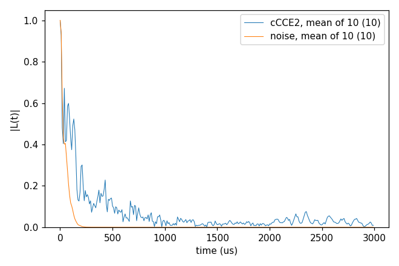
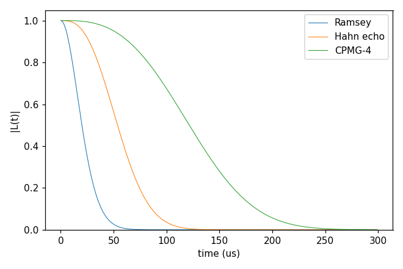

# 11_noise

Method `noise`: the coherence as the Gaussian decay W(T) = exp(−χ(T)) of the qubit's phase noise, χ = ⟨φ²⟩/2 of the
phase φ = ∫ f(t) δω(t) dt (f = ±1, flipped by each ideal π pulse). The noise δω comes from the bath, each cCCE
cluster giving its share of χ from its eigenmodes (`hamiltonian.noise.spectrum` `"bath"`, the default; semi-cce's
semi-classical CCE), or from a model of the frequency noise without a bath (`{"model": "OU", ...}` or
`{"model": "power", ...}`). The Gaussian approximation leaves out the qubit's back-action on the bath and the
non-Gaussian part of the noise; it is meant for many weakly coupled noise sources. The keys are in
[InputFile_General](../../../docs/user/InputFile_General.md#tag_noise_spectrum). Each folder:
`cd <folder> && NP=4 bash run.sh`, then compare `results/coherence.png` with `expected.png`. Times: i7-14700K, WSL.

## noise2_Hahn_vsCCE

- **What it shows:** the Hahn echo of the NV (ms −1 / 0) in 1 ppm P1 (the bath of `03_P1`, one configuration, 10
  sampled states) by method `noise` and by cCCE2. They are not the same quantity: in `noise` a sampled state only sets
  the static field of the other spins and every cluster is averaged at infinite temperature, with one bath
  Hamiltonian for both branches of the qubit; cCCE2 evolves each state as a pure initial state under the two
  branches' Hamiltonians. Here the Gaussian curve decays faster than the cCCE2 mean.
- **Keys that matter:** `method` `noise`, `hamiltonian.noise.spectrum` `"bath"`; the rest as in
  `03_P1/cCCE2_Hahn_states` (`ccein_cce.jsonc` is the same input with `method` `cCCE`).
- **How to run:** `NP=4 bash run.sh`: 8 s for both, 0.05 GB per rank.
- **Expected result:** `expected.png`; T2 of the mean of 10 states 56 µs by `noise`, 148 µs by cCCE2.
- **What to change next:** `"pseudo_secular": true` in `hamiltonian.noise` (the noise of a bath spin with A_zx I_x +
  A_zy I_y as well as A_zz I_z); `pulse.count` 0 or 4.

Inputs: [`ccein_noise.jsonc`](noise2_Hahn_vsCCE/ccein_noise.jsonc), [`ccein_cce.jsonc`](noise2_Hahn_vsCCE/ccein_cce.jsonc)

## noiseModel_OU

- **What it shows:** Ornstein–Uhlenbeck frequency noise, ⟨δν(t)δν(0)⟩ = σ² exp(−|t|/τ_c) with σ = 10 kHz and
  τ_c = 50 µs, under a Ramsey sequence, a Hahn echo and CPMG-4: the echo and the decoupling sequence filter the slow
  noise out. χ is computed exactly for ideal π pulses. No bath is read, so `order`, `bfield`, `rbath`, `rdip` and
  `Qubit` are left out of the input.
- **Keys that matter:** `hamiltonian.noise.spectrum` `{"model": "OU", "sigma", "tau_c"}` (σ in kHz, τ_c in ms; both
  take a unit), `pulse.count`.
- **How to run:** `bash run.sh`: 1 s (one rank: a model run has no clusters to share).
- **Expected result:** `expected.png`; T2 24 µs (Ramsey), 62 µs (Hahn echo), 138 µs (CPMG-4).
- **What to change next:** `{"model": "power", "amplitude": 50, "beta": 1, "f_min": 0.01, "f_max": 200}`, 1/f noise
  between f_min and f_max (kHz); a longer τ_c (the quasi-static limit, χ ≈ (2πσ)² T³ / (12 τ_c) for the Hahn echo).

Input: [`ccein.jsonc`](noiseModel_OU/ccein.jsonc)
