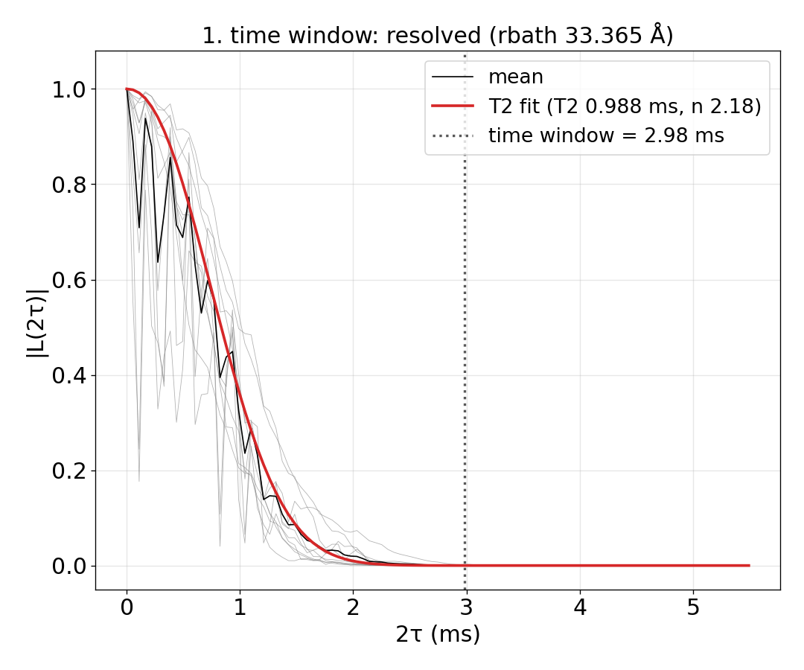
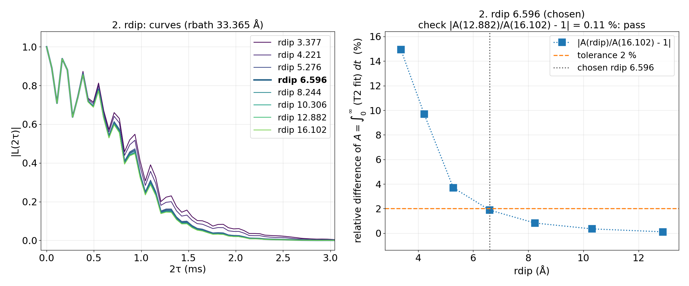
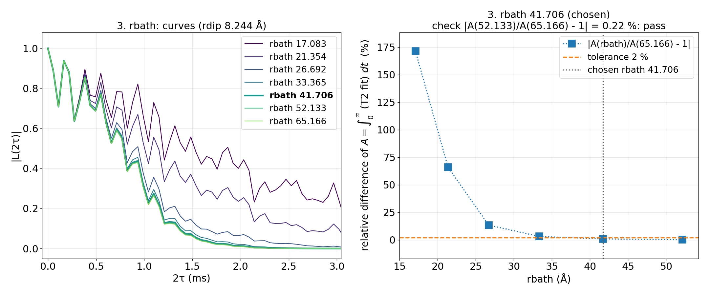
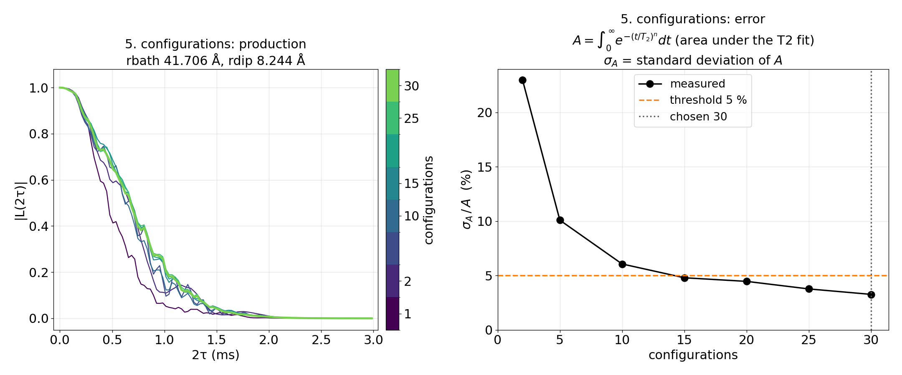
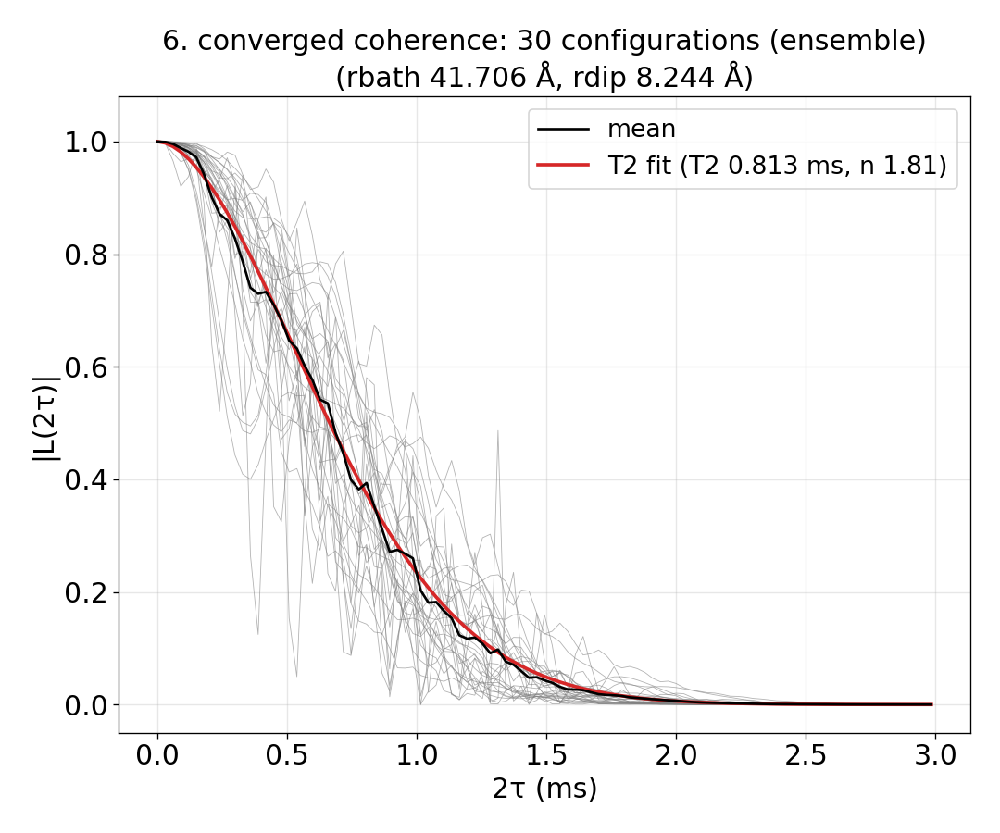
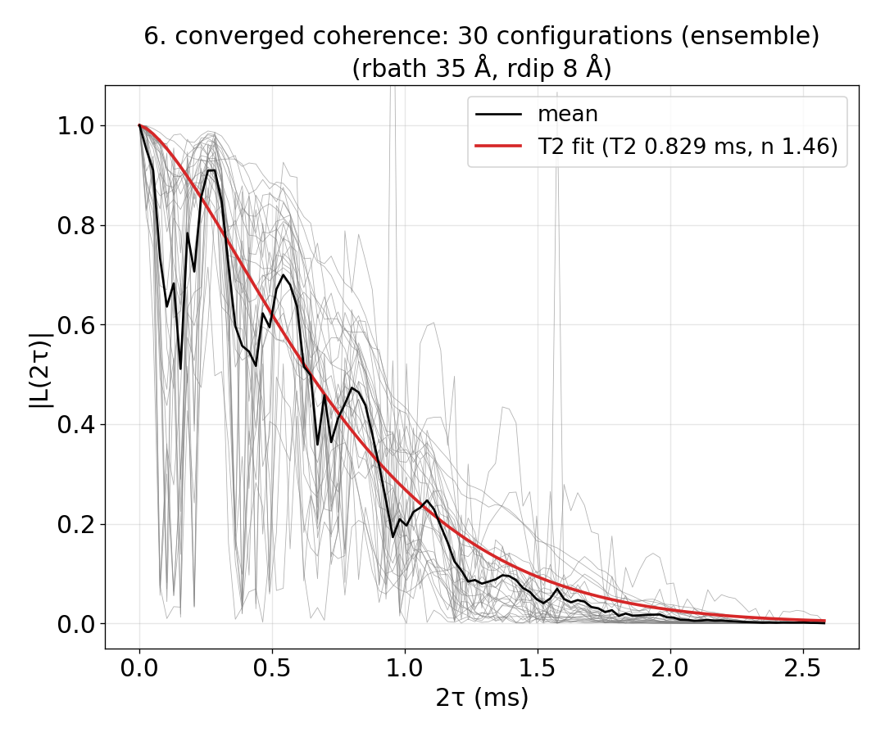
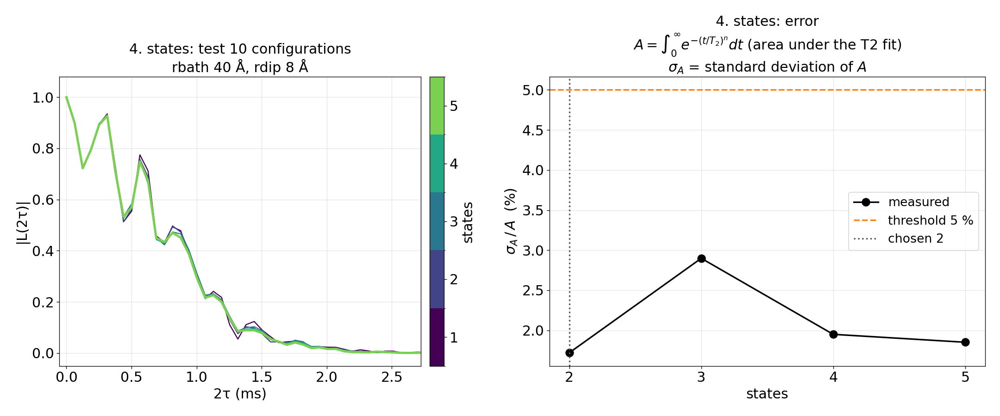
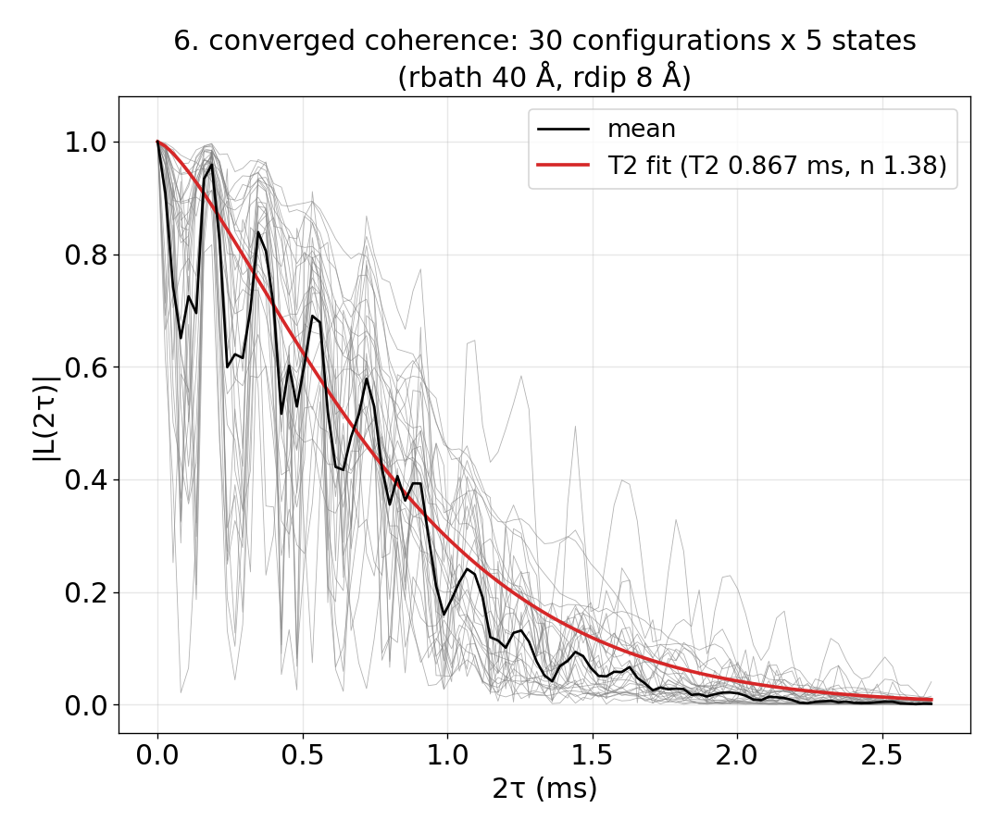

# Advanced 01: Automatic convergence

Folder: `example/tutorial/advanced/01_auto_convergence/`

A CCE result depends on a few choices that cut the problem down to a size that can be computed. You can trust it
only when making these choices larger no longer changes the curve. The four choices are:

- `rbath`, how far from the qubit bath spins are included.
- `rdip`, how close two bath spins must be to form a pair cluster.
- The time window, how long the curve is computed.
- The number of bath configurations, the random placements of the spins that are averaged.

[Basic 03: Checking convergence](../../basic/03_convergence/README.md) checks them by hand, one at a time. An
`auto_convergence` block in the input does the same automatically. You write an ordinary input, add the block, and
run `mpirun -n N main.out -f ccein.jsonc` as usual. CCEX then hands the run to a Python program, the runner
(`example/tools/AutoConvergence/`), which makes many small CCEX runs, chooses the four values, and finally computes
the curve with them.

You need Python with numpy, scipy and matplotlib, and several bath files named with `{k}` (`config_1`, `config_2`,
...), one per configuration. The `run.sh` of each case makes them.

How the runner decides is in [Automatic convergence](../../../../docs/methods/auto-convergence.md), and every key of
the block is in [Automatic convergence tags](../../../../docs/user/InputFile_AutoConvergence.md).

This page has four cases:

1. [Letting the runner choose everything](#ac_found) (`cCCE2_Hahn_ensemble_noCandidates/`): the shortest input, and
   [what the runner does step by step](#ac_steps).
2. [Giving the candidates](#ac_given) (`cCCE2_Hahn_ensemble/`): you list the rdip and rbath values to try.
3. [Fixing some values](#ac_fixed) (`cCCE2_Hahn_ensemble_fixed/`): the window and rbath given, so the runner does not
   search them.
4. [Sampled bath states](#ac_states) (`cCCE2_Hahn_states/`): the step that checks the number of states.

<a id="ac_found"></a>
## 1. Letting the runner choose everything

Folder: `cCCE2_Hahn_ensemble_noCandidates/`

<a id="ac_found_input"></a>
### 1.1 The input

The system is the NV of Basic 01, a cCCE2 Hahn echo of the ensemble at 500 G. The input has no `rbath` or `rdip`,
and it adds one block:

```jsonc
"configuration"    : {"gyrofile": "../../../basic/01_first_run/bath/gyro_13C", "seed": 1,
                      "bathfile": ["results/bath/config_{k}"]},
"deltat"           : 0.01,
"nstep"            : 101,
"auto_convergence" : {"workdir": "results/auto", "sampling": {}}
```

- `workdir` is the folder for the runs and the results.
- `sampling` is left empty, so its defaults hold.
- Each `results/bath/config_k` that exists is one configuration.
- `nstep` is the number of time points of every run. `deltat` only sets the first window.

<a id="ac_found_run"></a>
### 1.2 Running it

```sh
NP=4 bash run.sh
```

`run.sh` makes 40 bath configurations in cells of 140 Å with `../../../make_natab_baths.sh` (`NBATH` sets how many).
Then it runs `mpirun -n 4 main.out -f ccein.jsonc`. On 4 ranks of a desktop CPU this takes about 7 min, most of it for
the baths, and 0.19 GB per process. A stopped run goes on from where it stopped when you start it again.

<a id="ac_steps"></a>
### 1.3 What the runner does

Each step prints its lines in `results/auto/result/summary.txt` and draws a figure in the same folder.

**How the runner judges.** Every step turns a curve into one number, the area under a stretched exponential fitted to
the mean |L(t)|:

$$A = \int_0^\infty e^{-(t/T_2)^n}\,dt = T_2\,\Gamma(1 + 1/n).$$

When a fit fails, the area under the mean curve itself, from 0 to the decay time, is used. The criteria are:

| Step | Criterion | Key, default |
|---|---|---|
| 1. Time window | The decay time $T_d$ is where the fit reaches \|L\| = 0.01, and the window is $1.5\,T_d$. | `time_window.decay_level` 0.01, `production_factor` 1.5 |
| 2. rdip, 3. rbath | A value agrees when $\lvert A/A_\text{ref} - 1\rvert \le$ 2 %, with $A_\text{ref}$ the largest value computed. The smallest value from which every larger one agrees is chosen. | `rdip.threshold`, `rbath.threshold` 0.02 |
| 4. States | The share of the states in the error of the mean is at most 5 %. This is a check only. | `sampling.states_threshold` 0.05 |
| 5. Configurations | The relative error of the mean, $\sigma_A/A$, is at most 5 %. | `sampling.threshold` 0.05 |

First the runner splits the 40 configurations. Ten are test configurations, which steps 1 to 3 use. The other 30 are
for the production, the final calculation with the chosen values. Then it counts the ¹³C of the test configurations
and sets the candidates, the values of rbath and rdip to try:

- Four rbath candidates up to 33.4 Å, the radius that holds 300 spins.
- Seven rdip candidates from 3.4 to 12.9 Å, around an estimate of 8.2 Å from the pair couplings
  (`example/tools/AutoConvergence/autoconv/autostart.py`).

<a id="ac_step1"></a>
#### Step 1. The time window

The test configurations (grey) are averaged (black), and $\exp(-(t/T_2)^n)$ is fitted to the average (red). The fit
reaches |L| = 0.01 at 1.99 ms, the decay time. The window is 1.5 times that, 2.98 ms (dotted line), and every later
run uses it. The decay time is checked once more at the largest rbath and rdip, and the window stays.



<a id="ac_step2"></a>
#### Step 2. rdip

At rbath 33.4 Å every rdip candidate is computed and compared with a larger reference, 16.1 Å. The right panel shows
the relative difference of the area under the T2 fits. It drops below the 2 % threshold at 6.6 Å (1.88 %) and stays
below it for every larger rdip.



<a id="ac_step3"></a>
#### Step 3. rbath

rbath is compared in the same way, with rdip 8.24 Å. The largest rbath grows by a factor 1.25 until the two largest
agree. With candidates the runner chose itself, it asks for two agreements in a row, so the reference reaches
65.2 Å. The difference is 3.09 % at 33.4 Å and 0.94 % at 41.7 Å, so rbath is 41.7 Å.

At the larger rbath, rdip is checked again. There 6.6 Å no longer agrees but 8.24 Å does, so the final rdip is
8.24 Å. The figure of step 2 therefore still marks 6.6 Å.



<a id="ac_step4"></a>
#### Step 4. The states

This input is the ensemble (no `configuration.s_range`), so there are no sampled states and the step is skipped.
[Section 4](#ac_states) shows it with sampled states.

<a id="ac_step5"></a>
#### Step 5. The number of configurations

With rbath 41.7 Å and rdip 8.24 Å the production configurations are computed one after another, and the relative
error σA/A of their mean is measured as they are added (right panel). The test configurations estimated that 30 are
needed, which is all the production has. With 30 the error is 3.27 %, below the 5 % threshold.



<a id="ac_found_result"></a>
### 1.4 The result



The figure is the mean of the 30 production curves with its T2 fit, the runner's `6_converged_coherence.png`. The
mean itself is in `results/auto/result/coherence_mean.txt`.

`summary.txt` starts with the status, `converged`, which means every value was found. If one had not been found, it
would read `unresolved` and say which value and what to change. The values found are rdip 8.24 Å, rbath 41.7 Å and
the window 2.98 ms, and T2 is 0.81 ms (stretched-exponential fit, n 1.81).

Read the WARNINGS under the status before you use the result. At the end the runner compares the chosen rbath and
rdip with the largest values it computed, on three production configurations. Here they differ by 5.7 % in the area
under the curve, more than the 2 % of each step. This is only a warning, and the status stays converged.

Next, give the candidates yourself (section 2). It is faster and needs smaller baths.

Input: [`ccein.jsonc`](cCCE2_Hahn_ensemble_noCandidates/ccein.jsonc)

<a id="ac_given"></a>
## 2. Giving the candidates

Folder: `cCCE2_Hahn_ensemble/`

<a id="ac_given_input"></a>
### 2.1 The input

It is the input of section 1 with the candidates written in the block:

```jsonc
"auto_convergence" : {"workdir": "results/auto", "sampling": {},
                      "rdip": {"candidates": [4, 6, 8, 10, 12]}, "rbath": {"candidates": [30, 35, 40, 45]}}
```

The runner picks among these values instead of choosing its own. The largest of each is the reference.

<a id="ac_given_run"></a>
### 2.2 Running it

```sh
NP=4 bash run.sh
```

The baths are made in cells of 110 Å, enough for rbath up to 53 Å. The run takes about 5 min and under 0.2 GB per
process.

<a id="ac_given_result"></a>
### 2.3 The result


The status is converged. The values found are the window 2.58 ms, rdip 8 Å, rbath 35 Å and 25 production
configurations, with a relative error of 4.0 %. T2 is 0.82 ms (n 1.37), the same as in section 1 within 2 %. The runner
itself took 0.8 min here and 1.2 min in section 1. The final check differs by 9 %, again a warning only.

The time points are worth a second look. The 101 points over 2.58 ms are 26 µs apart, coarser than the ¹³C precession
at 500 G (about 2 µs), so the small ESEEM ripple is not resolved. The runner keeps `nstep` as written and does not
check it, so raise `nstep` if the ripple matters.

Input: [`ccein.jsonc`](cCCE2_Hahn_ensemble/ccein.jsonc)

<a id="ac_fixed"></a>
## 3. Fixing some values

Folder: `cCCE2_Hahn_ensemble_fixed/`

<a id="ac_fixed_input"></a>
### 3.1 The input

A section of the block can take a value instead of candidates. The runner then uses that value as it is and does not
test its convergence. This input fixes the window and rbath at the values section 2 found, and leaves rdip to be
searched:

```jsonc
"auto_convergence" : {"workdir": "results/auto", "sampling": {},
                      "time_window": {"value": 2.58}, "rbath": {"value": 35},
                      "rdip": {"candidates": [4, 6, 8, 10, 12]}}
```

The values that can be fixed are `time_window.value` (ms), `rdip.value`, `rbath.value` (Å) and
`sampling.configurations` with `sampling.states`. Fixing all four is refused, since nothing is then left to find. Run
CCEX itself with those values instead.

<a id="ac_fixed_run"></a>
### 3.2 Running it

```sh
NP=4 bash run.sh
```

It makes the baths of section 2 (cells of 110 Å) and starts the runner. The runner needs 0.018 core-hours here,
against 0.044 in section 2, since it computes no rbath candidates.

<a id="ac_fixed_result"></a>
### 3.3 The result



The status is converged. `summary.txt` shows what was not searched. Step 1 reads "window given: 2.58 ms", and step 3
reads "rbath 35 given (not converged)". rdip is again 8 Å, and the production uses 30 configurations (relative error
4.06 %). T2 is 0.83 ms (n 1.46).

A fixed value is not checked, and the runner says so in the warnings when it can. Step 1 still fits the test curves,
and here it measured a decay time of 2.06 ms, whose 1.5 times, 3.08 ms, is longer than the given 2.58 ms. The
warning "1.5 x T_d = 3.083 ms is longer than the given window" tells you the window may be short. Fix only values you
have checked before.

Input: [`ccein.jsonc`](cCCE2_Hahn_ensemble_fixed/ccein.jsonc)

<a id="ac_states"></a>
## 4. Sampled bath states

Folder: `cCCE2_Hahn_states/`

<a id="ac_states_input"></a>
### 4.1 The input

It is the input of section 2 with sampled bath states. Each spin of a configuration then starts in a definite
state, and every configuration is computed in several such states instead of the unpolarised ensemble:

```jsonc
"configuration" : {"gyrofile": "../../../basic/01_first_run/bath/gyro_13C", "seed": 1, "s_range": [1, 30],
                   "bathfile": ["results/bath/config_{k}"]}
```

With an `auto_convergence` block, `s_range` only switches the states on. Its numbers are not used, and the runner says
so in a warning. How many states are computed comes from `sampling`. The test runs use `test_states` (5 by default)
states per configuration, and step 4 may add more, up to `max_states` (30). The runner writes the state of every spin
itself, so a spin keeps its state at every rbath and rdip.

<a id="ac_states_run"></a>
### 4.2 Running it

```sh
NP=4 bash run.sh
```

It uses baths in cells of 110 Å, as section 2. With 5 states per configuration the runner needs 0.057 core-hours,
against 0.044 for the ensemble of section 2.

<a id="ac_states_step4"></a>
### 4.3 Step 4, the states

Steps 1 to 3 run as in section 2, now on the test configurations in 5 states each. Step 4 then asks whether 5 states
are enough. It measures how much of the error of the mean comes from the states, the right panel, for 2 to 5 states.



The share of the states is 1.7 % to 2.9 %, below the 5 % threshold (`states_threshold`) from 2 states on. So 5 states
are enough, and the step adds none. Had it been above the threshold, the runner would have computed 5 more states at
a time, up to `max_states`. This step is only a check. Its result is a warning when the states are not enough, and
the production always uses `test_states` states, here 5.

<a id="ac_states_result"></a>
### 4.4 The result



The status is converged, with the window 2.67 ms, rdip 8 Å, rbath 40 Å and 30 production configurations of 5 states
each (relative error 4.52 %). T2 is 0.87 ms (n 1.38).

Input: [`ccein.jsonc`](cCCE2_Hahn_states/ccein.jsonc)

