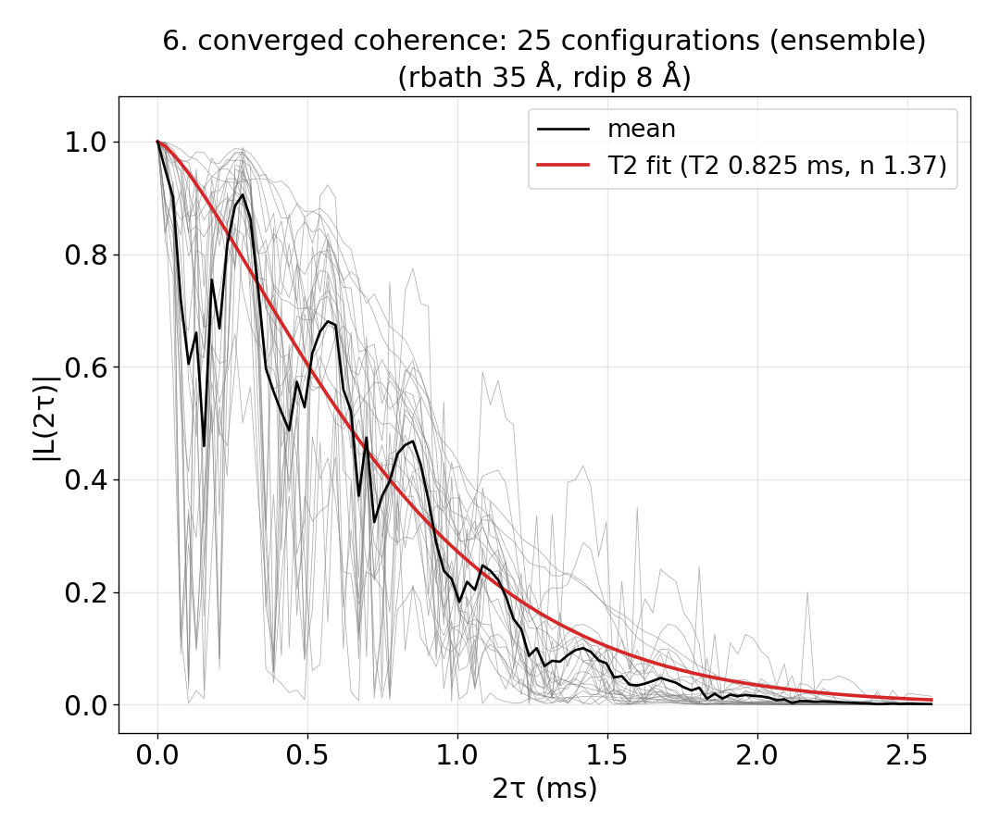
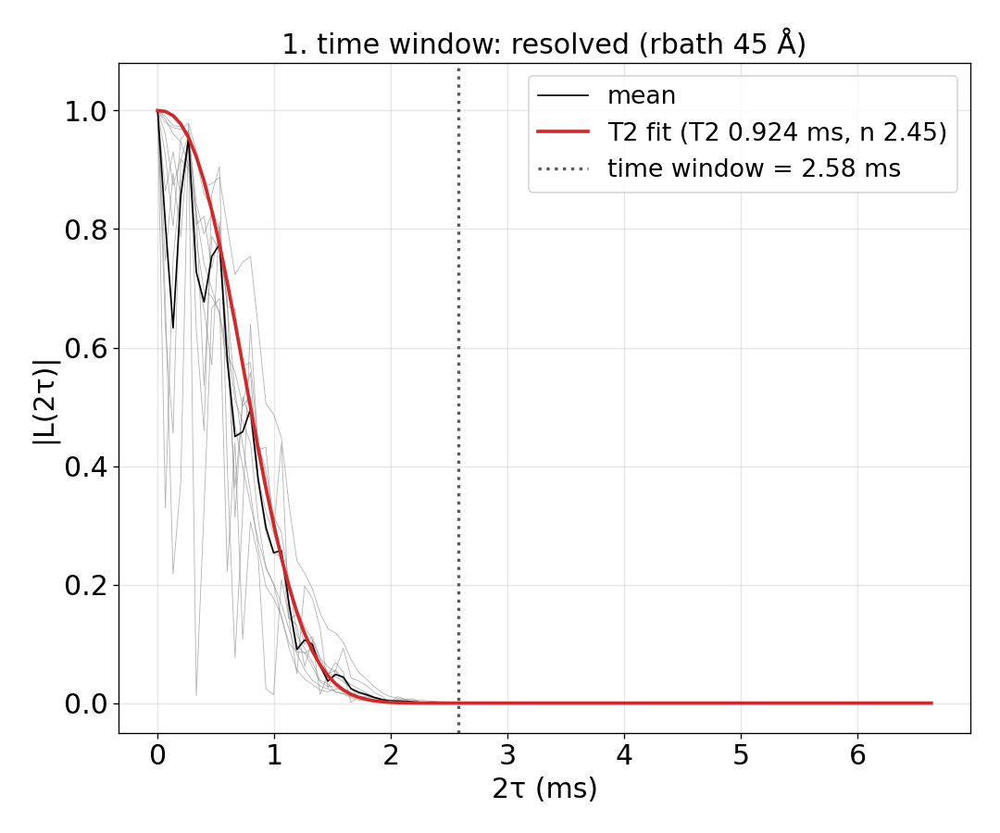
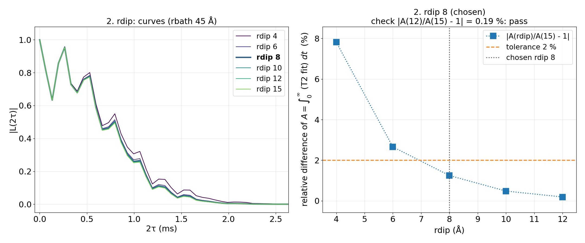
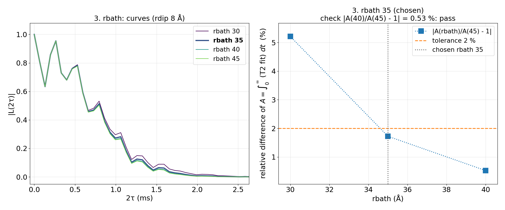
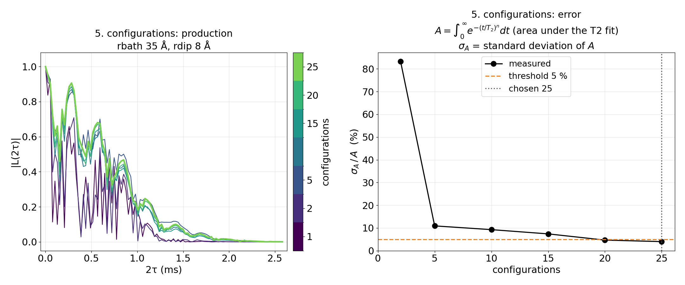

# Advanced 01: Automatic convergence

Folder: `example/tutorial/advanced/01_auto_convergence/`

In [Basic 03: Checking convergence](../../basic/03_convergence/README.md) you change `rbath`, `rdip`, the time window
and the number of bath configurations by hand until the curve stops moving. An `auto_convergence` block in the input
does this for you. You write an ordinary input, add the block and prepare the bath files, and run
`mpirun -n N main.out -f ccein.jsonc` as usual. CCEX then starts the runner (`example/tools/AutoConvergence/`, Python
with numpy, scipy and matplotlib) instead of one calculation. The runner makes many small CCEX runs, picks the values,
and at the end computes the final curve with them.

Three words are used below:

- **Candidates** are the values of `rbath` or `rdip` the runner tries. You can give them, or leave them out and let
  the runner choose them.
- **The production** is the final calculation with the chosen values, on its own set of bath configurations.
- **Converged** is the status when every value was found. `unresolved` means one was not, and the summary says which
  and what to change.

How the runner decides is in [Automatic convergence](../../../../docs/methods/auto-convergence.md), and every key of
the block is in [Automatic convergence tags](../../../../docs/user/InputFile_AutoConvergence.md).

1. [cCCE2_Hahn_ensemble](#ac_given): you give the candidates.
2. [cCCE2_Hahn_ensemble_noCandidates](#ac_found): the runner chooses the candidates.
3. [The two cases compared](#ac_compared): the values found, the times, and one warning to read.

## 1. cCCE2_Hahn_ensemble: you give the candidates

- **What it shows:** the NV of Basic 01, a cCCE2 Hahn echo of the ensemble. The input gives the rdip candidates
  4–12 Å and the rbath candidates 30–45 Å. The runner finds the time window (1.5 times the decay time), rdip, rbath,
  and how many configurations the mean needs for a relative error of 5 % or less.
- **Keys that matter:** `auto_convergence` {`workdir`, `rdip.candidates`, `rbath.candidates`, `sampling`}. The bath
  files are `configuration.bathfile` ["results/bath/config_{k}"], and every k whose file exists is used. `nstep` 101
  is the number of time points of every run, and `deltat` sets only the first window.
- **How to run:** `NP=4 bash run.sh`. It first makes 40 bath configurations with `../../../make_natab_baths.sh` (cells
  of 110 Å, enough for rbath up to 53 Å, and `NBATH` sets how many). Then it starts the runner. It takes about 5 min,
  most of it making the baths, and under 0.2 GB per process. Running it again goes on from where it stopped and reuses
  the baths and the finished runs.
- **Expected result:** `expected.png`, the runner's `6_converged_coherence.png`. The status is converged, with the
  window 2.58 ms, rdip 8 Å, rbath 35 Å and 25 production configurations (relative error 4.0 %). T2 is 0.82 ms from a
  stretched-exponential fit with n 1.37. `run.sh` prints the status and `results/auto/result/summary.txt`, and
  `results/auto/result/` also has the figure of each step (`1_window.png`, `2_rdip.png`, `3_rbath.png`,
  `5_configurations.png`) and the final curve, `coherence_mean.txt`.
- **What to change next:** raise `nstep`. The 101 points over 2.58 ms are 26 µs apart, coarser than the ¹³C
  precession at 500 G (about 2 µs), so the small ESEEM ripple is not resolved. The runner keeps `nstep` as written and
  does not check it.

Input: [`ccein.jsonc`](cCCE2_Hahn_ensemble/ccein.jsonc)

### What the runner did, step by step

`results/auto/result/summary.txt` lists every step, and each step has a figure. The runner first splits the 40
configurations into 10 test configurations, which every step below uses, and 30 for the production.

**Step 1, the time window.** The runner computes the test configurations with the largest rbath and rdip, averages
them (black) and fits $\exp(-(t/T_2)^n)$ to the average (red, T2 0.92 ms, n 2.45). The fit reaches |L| = 0.01 at
1.72 ms, the decay time, and the window is 1.5 times that, 2.58 ms (dotted line). Every later run uses this window.

**Step 2, rdip.** At rbath 45 Å the runner computes every rdip candidate and compares each with the largest, rdip
15 Å. The left panel shows the curves, and the right one the relative difference of the area under their T2 fits.
The difference falls below the 2 % threshold at rdip 8 Å (1.25 %) and stays below it for every larger rdip, so 8 Å is
chosen.

**Step 3, rbath.** The same with rbath at rdip 8 Å, against rbath 45 Å. The differences are 5.21 % at 30 Å, 1.72 % at
35 Å and 0.53 % at 40 Å, so 35 Å is chosen. The runner then checks rdip 8 Å again at rbath 45 Å, and it still passes.

**Step 4, the states,** is skipped, since this input is the ensemble (no `configuration.s_range`).

**Step 5, the configurations.** With rbath 35 Å and rdip 8 Å the runner computes the production configurations and
measures the relative error σA/A of the mean as configurations are added (right panel). The test configurations
estimated that 14 are needed. The runner computes 1.5 times that, rounded up to a multiple of 5, so 25, and the error
with 25 is 4.00 %, below the 5 % threshold. The left panel shows the mean of the first 1, 2, 5, ... configurations
settling down.

**Step 6, the result,** is the mean of the 25 production curves with its T2 fit, the figure `expected.png` above.

## 2. cCCE2_Hahn_ensemble_noCandidates: the runner chooses the candidates

- **What it shows:** the same calculation with the `rdip` and `rbath` blocks left out. The runner counts the ¹³C of
  its test configurations and sets four rbath candidates up to 33.4 Å, the radius that holds 300 spins, and seven rdip
  candidates up to 8.2 Å, from an estimate of the pair couplings. It then raises the largest of each until the
  results agree (`example/tools/AutoConvergence/autoconv/autostart.py`).
- **Keys that matter:** `auto_convergence` {`workdir`, `sampling`} only. The rest is as in `cCCE2_Hahn_ensemble`.
- **How to run:** `NP=4 bash run.sh`. With candidates it chose itself, the runner asks for two agreeing results in a
  row, so it goes to larger rbath and needs larger baths. `run.sh` makes them in cells of 140 Å (rbath up to 68 Å).
  With the 110 Å cells of `cCCE2_Hahn_ensemble` the run would stop as `truncation-unresolved` and ask for baths
  covering 65.5 Å.
- **Expected result:** `expected.png`, the runner's `6_converged_coherence.png`. The status is converged.
- **What to change next:** compare the values it found with those of `cCCE2_Hahn_ensemble` ([section 3](#ac_compared)).

Input: [`ccein.jsonc`](cCCE2_Hahn_ensemble_noCandidates/ccein.jsonc)

## 3. The two cases compared

Times are for 4 ranks of a desktop CPU. Most of the time is making the 40 baths, which is done once.

| | rdip | rbath | Window | Configurations | T2 (n) | Time in all (baths + runner) | Peak memory |
|---|---|---|---|---|---|---|---|
| `cCCE2_Hahn_ensemble` (candidates given) | 8 Å | 35 Å | 2.58 ms | 25 | 0.82 ms (1.37) | 4.8 min (3.9 + 0.8) | 0.18 GB |
| `cCCE2_Hahn_ensemble_noCandidates` | 8.24 Å | 41.7 Å | 2.98 ms | 30 | 0.81 ms (1.81) | 6.9 min (5.6 + 1.2) | 0.19 GB |

The two T2 agree within 2 %, but the exponents n do not (1.37 and 1.81). The bath configurations are not the same,
since the cells have another size.

**A warning to read.** At the end the runner compares the chosen rbath and rdip with the largest values it computed,
on three production configurations. Here they differ by 9 % in the area under the curve for `cCCE2_Hahn_ensemble`
(rbath 35 and rdip 8 against rbath 45 and rdip 15) and by 5.7 % for `cCCE2_Hahn_ensemble_noCandidates`, more than the
2 % each step allows. The runner writes this as a warning in the summary and still reports converged, so read the
warnings in `summary.txt` before you use the result.
