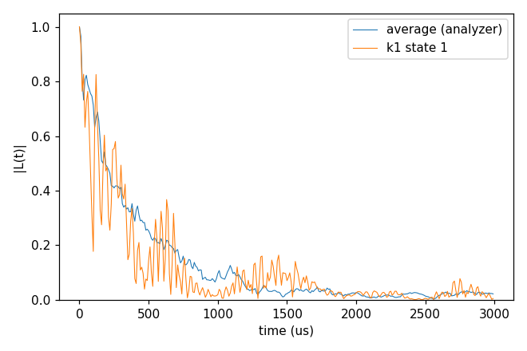
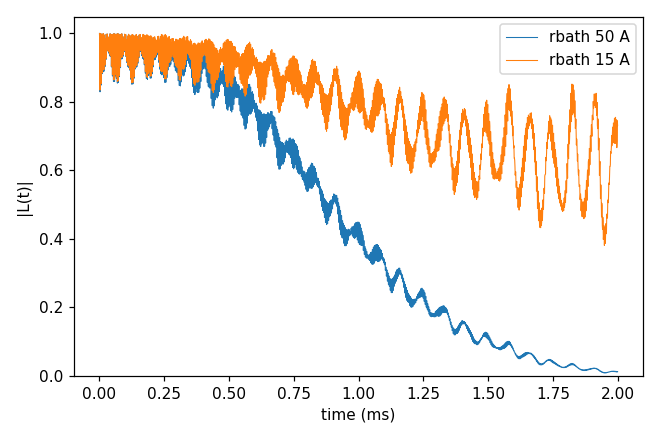

# Advanced 02: Analysis of the output

Folder: `example/tutorial/advanced/02_analysis/`

This topic is about what to do with the output of a run. The analyzer of `example/analysis`
([Analysis](../../../../docs/user/Analysis.md)) corrects, averages and fits the curves, and the run itself can report
which clusters matter.

In each folder run `cd <folder> && NP=4 bash run.sh`, then compare `results/coherence.png` with `expected.png`. Every
key not written in an input has its default (`main.out -e`). Times are for 4 ranks of a desktop CPU.

1. [cCCE2_Hahn_analyzer](#a02_analyzer): the error correction, the average and the T2 fit.
2. [cCCE2_Hahn_clusterReport](#a02_report): what a run reports about its clusters.

## 1. cCCE2_Hahn_analyzer: the error correction, the average and the T2 fit

- **What it shows:** the three steps of the analyzer on the 20 curves of
  [Basic 06: An electron-spin bath (P1)](../../basic/06_defect_bath/README.md)'s `cCCE2_Hahn_states`, whose input is
  run here.
  - `run.py -err` repairs each `_wiDiv` against its `_noDiv` where the two differ by more than the tolerance. Here no point is
    repaired, since no division blew up.
  - `-ea` averages the 20 corrected curves as complex numbers (`results/ccein_Avg_conv20`).
  - `-fit_w` fits $\exp(-(t/T_2)^n)$ to the average and writes `results/ccein_Avg_params` (the number of curves, T2 in
    ms and n).
- **Options that matter:** `-fi` with the variables in the file name (`ccein_kCONF_stateST_wiDiv`), `-vn CONF ST` and
  one `-v` per variable. `-uc ms` is given in both calls, because the files the analyzer writes keep their time in the
  `-uc` unit and the next call reads them as ms.
- **How to run:** `NP=4 bash run.sh`. It takes 3 s and 0.05 GB per rank, and needs numpy, scipy and matplotlib.
- **Expected result:** `expected.png`. The fit gives T2 348 µs and n 0.82. `plot_coherence.py` prints 307 µs for the
  same average, because its T2 is the last time |L| ≥ 1/e, not a fit.
- **What to change next:** `-pl -fit` for the analyzer's own figure, or a smaller `-err_tol` to see the correction act.

Input: [`ccein.jsonc`](cCCE2_Hahn_analyzer/ccein.jsonc)

## 2. cCCE2_Hahn_clusterReport: what a run reports about its clusters

- **What it shows:** three reports on the system of Basic 01.
  - `ccein_contributions.jsonc` (`output.cluster_contributions`) writes
    `results/ccein_contributions.contributions.state-0.tsv`, one row per cluster with its sites, its dimension, the
    largest |log L̃| over the time points and the step where it is reached. `.contributions.sites.tsv` gives each
    site's name, spin, γ and position. `savemode` with `nodiv` false writes `_wiDiv` alone.
  - `ccein_plan.jsonc` (`output.cluster_only` true) writes the cluster list, `results/ccein_plan.clusters.json`, and
    computes no dynamics.
  - `ccein_curves.jsonc` (`output.savemode` `cluster_coherence`, `rbath` 15 Å) writes, beside the result, the
    coherence of each of its 97 clusters, `results/ccein_curves_<bath indices>_wiDiv` and `_noDiv`.
- **Keys that matter:** `output.cluster_contributions` {`enabled` true}, `output.savemode` {`mode`, `nodiv`} and
  `output.cluster_only`.
- **How to run:** `NP=4 bash run.sh`. It takes 1.3 s and 0.05 GB per rank. Sorting the table by its fifth column
  (`sort -k5 -g -r`, since the columns are tab-separated and hold no spaces) lists the clusters that matter most, here
  the pair 621,655 (|log L̃| 0.58).
- **Expected result:** `expected.png`. T2 is 1.084 ms with rbath 50 Å, the curve of Basic 01, and |L| is 0.73 at 2 ms
  with rbath 15 Å.
- **What to change next:** `savemode` `cluster_density_matrix` with gCCE on a few spins.

Inputs: [`ccein_contributions.jsonc`](cCCE2_Hahn_clusterReport/ccein_contributions.jsonc), [`ccein_curves.jsonc`](cCCE2_Hahn_clusterReport/ccein_curves.jsonc), [`ccein_plan.jsonc`](cCCE2_Hahn_clusterReport/ccein_plan.jsonc)
