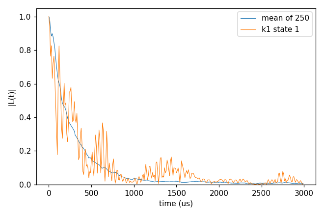

# Advanced 03: Runs on a cluster (Slurm)

Folder: `example/tutorial/advanced/03_server_runs/`

A run too long for a workstation goes to a cluster as a batch job. This folder shows it with Slurm (`sbatch`) on the
system of [Basic 06: An electron-spin bath (P1)](../../basic/06_defect_bath/README.md)'s `cCCE2_Hahn_states`, with
5 bath configurations × 50 sampled states, 250 curves. That run takes about 20 s on 4 ranks, so the scripts can
be tried anywhere, and the same steps hold for runs of hours. Add what your cluster needs to the
`#SBATCH` lines (`--partition`, `--account`) and to the `module load` line (the compiler and MPI CCEX was built with).

This page has one case:

1. [Sizing a run, one job, and a job array](#sr_slurm) (`cCCE2_Hahn_slurm/`).

<a id="sr_slurm"></a>
## 1. Sizing a run, one job, and a job array

Folder: `cCCE2_Hahn_slurm/`

<a id="a03_input"></a>
### 1.1 The input

Two keys of the input let the run be split into jobs that still give the same files:

```jsonc
"configuration" : {"gyrofile": "../../../basic/06_defect_bath/bath/DiaP1_gyro",
                   "bathfile": ["../../../basic/06_defect_bath/bath/14N_1ppm/bath_DiaP1_1ppm_{k}"],
                   "k_range": [1, 5], "s_range": [1, 50], "seed": [1, 2, 3, 4, 5]},
"output"        : {"file": "ccein"}
```

- `configuration.seed` has one entry per configuration. A job that runs configuration k alone (`k_range` [k, k],
  `seed` [k]) then draws the same states as the whole run.
- `output.file` fixes the output name. The job array writes its inputs under other names, and with this key all its
  files are still `ccein_k<k>_state<s>_...`, the names of the one-job run.

<a id="a03_run"></a>
### 1.2 Running it

Size the run first, then submit it as one job (step 2) or as a job array (step 3). The folder has a script for each.
`CCEX_BIN` names another binary in all of them. `CCEX_ROOT` names the repository in the two `.sbatch` files, and `analyse.sh` takes it as its argument.

<a id="a03_step1"></a>
#### Step 1. Sizing the run

`estimate.sh` runs one state of one configuration on this machine:

```sh
NP=4 bash estimate.sh
```

It prints three lines of the log:

```
Clusters per order : 1: 469, 2: 25929 (total 26398, 469 bath spins, 4 ranks)
Memory estimate    : 0.051 GB per rank (...)
State done : 1 of 1, 26398 clusters, 0.09 s
```

A rank needs 0.05 GB, which has to fit in the memory per rank of the node. One state takes 0.09 s on 4 ranks, so the
250 states take about 250 × 0.09 s ≈ 20 s. These two numbers set `--ntasks` and `--time` in the job scripts.

<a id="a03_step2"></a>
#### Step 2. One job

`job.sbatch` runs the whole input in one job and then `analyse.sh`:

```sh
#SBATCH --nodes=1
#SBATCH --ntasks=32
#SBATCH --time=01:00:00
cd "$SLURM_SUBMIT_DIR"
mpirun -n "$SLURM_NTASKS" "$CCEX" -f ccein.jsonc -o results > results/ccein.log
bash analyse.sh "$ROOT"
```

`--ntasks` is the number of MPI ranks, over which the clusters are shared. Slurm runs a copy of the script, so the
script first changes to `$SLURM_SUBMIT_DIR`, the folder it was submitted from. `analyse.sh` repairs, averages and
fits the 250 curves as in [Advanced 02: Analysis of the output](../02_analysis/README.md). Submit it with:

```sh
sbatch job.sbatch
```

<a id="a03_step3"></a>
#### Step 3. A job array instead

`job_array.sbatch` splits the same run into five tasks, one per configuration, that may run at the same time:

```sh
#SBATCH --array=1-5
#SBATCH --ntasks=8
K=$SLURM_ARRAY_TASK_ID
python3 "$ROOT/example/tools/InputKeys/set_input_keys.py" ccein.jsonc results/inputs/ccein_k$K.json \
    "configuration.k_range=[$K, $K]" "configuration.seed=[$K]"
mpirun -n "$SLURM_NTASKS" "$CCEX" -f results/inputs/ccein_k$K.json -o results > results/ccein_k$K.log
```

Task k writes an input for configuration k alone and runs it. Submit the array, and run the analysis when all five
tasks are done:

```sh
sbatch job_array.sbatch
bash analyse.sh
```

<a id="a03_result"></a>
### 1.3 The result



The analyzer's fit gives T2 263 µs and n 0.96, and `plot_coherence.py` 241 µs (the last time |L| ≥ 1/e). The one job
and the job array write the same 250 files, so `analyse.sh` gives the same average after either.

Next, split the states as well. `s_range` [26, 50] computes the states 26 .. 50 of the run [1, 50]. Use `srun` in
place of `mpirun` where the cluster asks for it.

Input: [`ccein.jsonc`](cCCE2_Hahn_slurm/ccein.jsonc)
