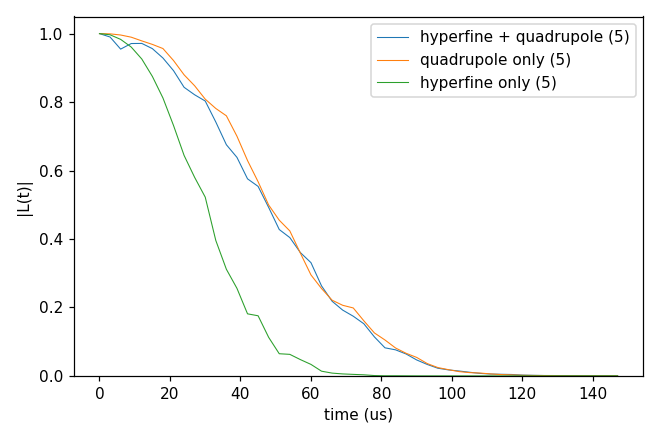

# advanced/04_DFT_tensors

Hyperfine and quadrupole tensors from DFT instead of the point dipole of the positions. `example/tools/SpinTensorReader`
reads a VASP OUTCAR (or a Quantum ESPRESSO output) and writes two files: `Afile`, the hyperfine tensor of each atom of
the cell (MHz, tensor format v3), and `Qfile`, the electric-field gradient of each atom (for spins I > 1/2). An input
names them in `hamiltonian.common.hyperfine` (`dipole` dft, `contact` true, `file`) and `hamiltonian.common.quadrupole`
(`file`).

The rows are matched to the bath spins by position from the defect, so the bath has to be built on the lattice of the
DFT cell; a bath spin inside the cell without a row stops the run, and spins outside the cell take the point dipole
(`missing_row` point_dipole extends that to every missing row). The cell of `makeTensors_hBN` is not the one of the
tutorial bath, so `cCCE2_Hahn_tensors` uses the files kept with [advanced/02_hBN](../02_hBN/README.md). Each folder: `cd
<folder> && NP=4 bash run.sh`, then compare `results/coherence.png` with `expected.png`. Every key not written in an
input has its default (`main.out -e`). Times: i7-14700K, WSL, 4 ranks.

## makeTensors_hBN

- **What it shows:** how the tensor files are made: `run.sh` runs `example/tools/SpinTensorReader/main.py` on the VASP
  run of V_B⁻ kept in `example/tools/SpinTensorReader/examples/02.hBN_VB_VASP` (its relaxed cell `VASP_CONTCAR_flat`,
  the defect named `VB`, and `VASP_OUTCAR_flat` for both `--A` and `--Q`) and checks that `results/Afile` and
  `results/Qfile` are the example's `Afile_v2` and `Qfile_v2`, byte for byte.
- **What the files hold:** the first line names the DFT code (`VASP`); the second, which CCEX reads, says what the values
  are (`# CCEX-tensor v3: values = hyperfine of the spin-S defect (MHz), source = VASP OUTCAR, S = 1`). Then the
  gyromagnetic g-factors, the corners `v1` .. `v8` of the cell (Å from the defect, the range of the rows), and one row
  per atom: the position from the defect, the isotropic (contact) term and the nine components, MHz. Here 53 B and 54 N;
  the three ¹⁴N next to the vacancy have a contact term of 121 MHz. `Qfile` has the same layout with the field gradient
  (Hartree/Bohr²).
- **How to run:** `sh run.sh`: under a second; needs python3 with numpy, pandas and psutil, no CCEX.
- **What to change next:** your own OUTCAR; `--addhfcore False` leaves out the core term of the contact interaction;
  for Quantum ESPRESSO give `--spin S` ([Tools](../../../../docs/user/Tools.md)).

## cCCE2_Hahn_tensors

- **What it shows:** what the DFT tensors change: cCCE2 Hahn echo at 3 T over five configurations (`k_range`), with
  the hyperfine and quadrupole tensors (`ccein_hf3_qd2.jsonc`), the quadrupole only (the hyperfine a point dipole,
  `hf0_qd2`) and the hyperfine only (`hf3_qd0`).
- **Keys that matter:** `hamiltonian.common.hyperfine` {`dipole` dft, `contact` true, `file`},
  `hamiltonian.common.quadrupole` {`structure` plain, `file`}, `bfield` 30000 G, `rbath` 20 Å, `rdip` 10 Å, `deltat`
  3 µs × `nstep` 50, `k_range` [1, 5].
- **How to run:** `NP=4 bash run.sh`: 8 s, 0.07 GB per rank.
- **Expected result:** `expected.png`; T2 56.5 µs with both tensors, 56.6 µs quadrupole only, 34.0 µs hyperfine only.
- **What to change next:** `k_range` [1, 50]; `rbath` 30 to check convergence.

Inputs: [`ccein_hf0_qd2.jsonc`](cCCE2_Hahn_tensors/ccein_hf0_qd2.jsonc), [`ccein_hf3_qd0.jsonc`](cCCE2_Hahn_tensors/ccein_hf3_qd0.jsonc), [`ccein_hf3_qd2.jsonc`](cCCE2_Hahn_tensors/ccein_hf3_qd2.jsonc)

