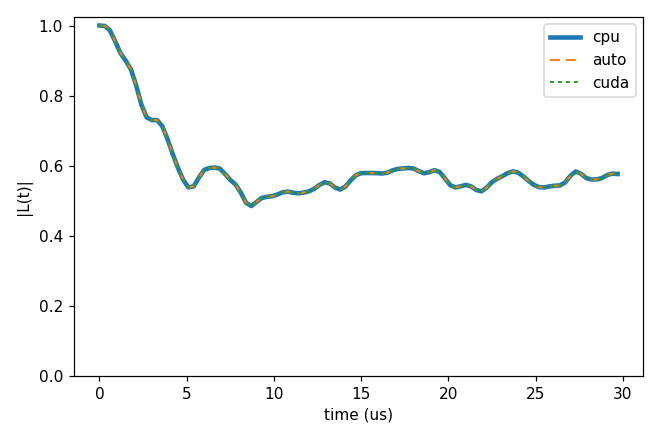
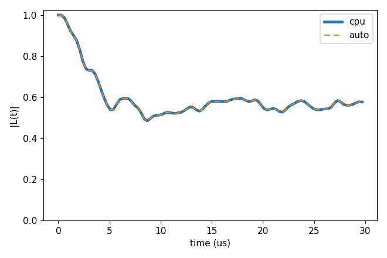
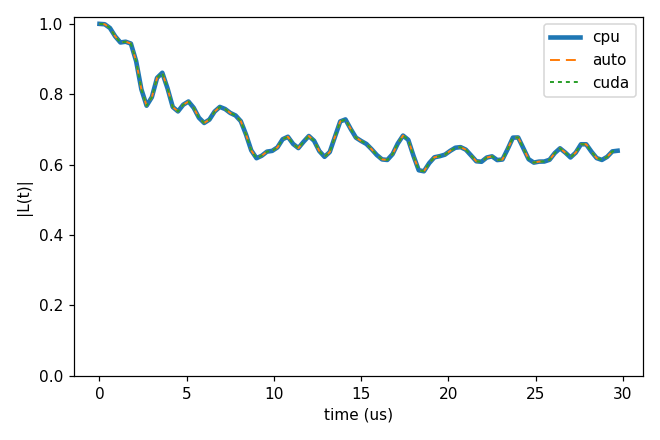
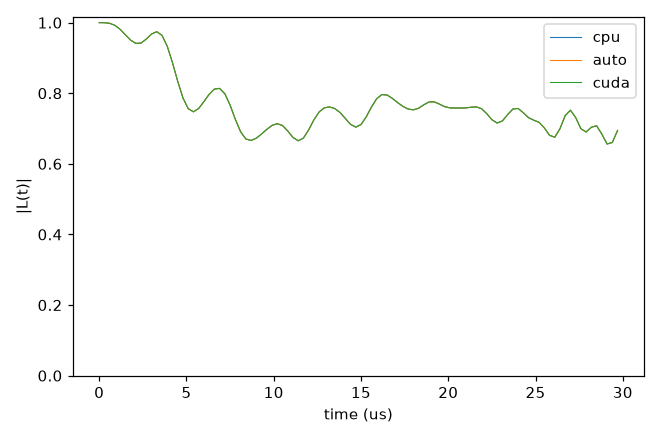

# Advanced 04: The GPU backend

Folder: `example/tutorial/advanced/04_GPU/`

The CUDA backend runs the clusters on the GPU. `execution.backend` chooses where:

- `cpu` (the default) runs every cluster on the CPU.
- `auto` runs on the GPU every cluster whose Hilbert dimension is at least `execution.gpu_options.min_dim`, the rest on
  the CPU, and everything on the CPU in a binary built without CUDA.
- `cuda` runs every cluster on the GPU, and is refused when CUDA is not available.

In the GPU build, `auto` and `cuda` with cCCE also send the clusters of bath dimension 2 and 4 to a packed kernel
(`gpu_options.packed_max_dim` 4). [GPU execution](../../../../docs/methods/gpu.md) has the details, and
`test/gpu_verification/check_gpu/` the checks.

Each folder has one input with `backend` cpu. `run.sh` runs it with `bin/main.out`, and then with `backend` auto and
cuda (`set_input_keys.py`) with `bin/main_gpu.out` when that exists. `bash do_compile.sh gpu` makes both binaries, and
`CCEX_GPU_BIN` names another GPU binary, for example one for a laptop card built with
`CUDA_HOME=/usr/local/cuda-13.2 CUDA_ARCH=86 bash do_compile.sh generic`. Without it `auto` runs on the CPU and `cuda`
is skipped. With many ranks on one GPU, start CUDA MPS in the job (`test/gpu_verification/server/mps.sh`). Every key
not written in an input has its default (`main.out -e`).

`bath/` is the P1 bath of `test/gpu_verification/check_gpu/examples/`. It holds five P1 (`bath_p1_5`, an electron and
a ¹⁵N each), the last four of them (`bath_p1_4`), the NV position (`qubit_p1`) and the P1 gyromagnetic ratio
(`gyro_P1`).

The expected figures were made on an RTX PRO 6000 with 32 ranks and MPS, with the binaries of `do_compile.sh gpu`.

This page has four cases:

1. [One large cCCE cluster on each backend](#a04_cce5) (`cCCE5_Hahn_backends/`).
2. [The gpu_options chosen at the start](#a04_auto) (`cCCE5_Hahn_autoOptions/`).
3. [gCCE on each backend](#a04_gcce4) (`gCCE4_Hahn_backends/`).
4. [pCCE on each backend](#a04_pcce2) (`pCCE2_Hahn_backends/`).

<a id="a04_cce5"></a>
## 1. One large cCCE cluster on each backend

Folder: `cCCE5_Hahn_backends/`

<a id="a04_cce5_input"></a>
### 1.1 The input

The cCCE5 Hahn echo of the NV in the five P1, with the `Defect` block of the P1 (¹⁵N, four Jahn-Teller axes). One
cluster has dimension 1024, the case the GPU is for, and takes about a minute of CPU for its 100 time steps:

```jsonc
"configuration" : {"gyrofile": "../bath/gyro_P1", "bathfile": ["../bath/bath_p1_5"], "seed": 1},
"order"         : 5,
"execution"     : {"backend": "cpu", "gpu_options": {"min_dim": 256, "evolution_batch_steps": 20}, "profile": true}
```

`min_dim` 256 sends the clusters of dimension 256 and above to the GPU under `auto`, and `profile` prints the
`[profile]` timings per backend and dimension.

<a id="a04_cce5_run"></a>
### 1.2 Running it

```sh
NP=32 bash run.sh                     # on a GPU node
```

The same run is made on each backend. The CPU part alone takes 24 s on 4 ranks of a desktop CPU, and the three runs
and the plot took 200 s on the GPU node.

<a id="a04_cce5_result"></a>
### 1.3 The result



`auto` and `cuda` are within 1.0e-10 of `cpu`.

Next, change `gpu_options.min_dim`, which sets the clusters that go to the GPU.

Input: [`ccein.jsonc`](cCCE5_Hahn_backends/ccein.jsonc)

<a id="a04_auto"></a>
## 2. The gpu_options chosen at the start

Folder: `cCCE5_Hahn_autoOptions/`

<a id="a04_auto_input"></a>
### 2.1 The input

The input of section 1 with `backend` `auto` and no `gpu_options`:

```jsonc
"execution" : {"backend": "auto", "profile": true}
```

For cCCE with `auto` or `cuda`, `bin/main_gpu.out` sets the keys an input leaves out at the start and reports them in
a `[gpu-auto]` line ([Execution tags](../../../../docs/user/InputFile_Backend.md#tag_backend)):

- `ranks_per_gpu` 4, with `auto` and more than 4 ranks per GPU on a node.
- `min_dim` 256, with `ranks_per_gpu`.
- `evolution_batch_size` 32.
- `cluster_batch_mb`, two thirds of the smallest card over the ranks that open it.

Writing a key fixes it. On an RTX PRO 6000 with 32 ranks these values were as fast as the best ones chosen by hand on
a larger bath.

<a id="a04_auto_run"></a>
### 2.2 Running it

```sh
NP=32 bash run.sh                     # on a GPU node
```

`run.sh` prints the `[gpu-auto]` line and compares the curve with the same input on `cpu`. Without `bin/main_gpu.out`
it runs `auto` on the CPU and says so. The two runs took 82 s.

<a id="a04_auto_result"></a>
### 2.3 The result



The log line is `[gpu-auto] ranks_per_gpu=4 min_dim=256 evolution_batch_size=32 cluster_batch_mb=16208`, and `auto`
is within 1.0e-10 of `cpu`.

Next, `"gpu_options": {"ranks_per_gpu": 0}` lets every rank open the GPU, to compare.

Input: [`ccein.jsonc`](cCCE5_Hahn_autoOptions/ccein.jsonc)

<a id="a04_gcce4"></a>
## 3. gCCE on each backend

Folder: `gCCE4_Hahn_backends/`

<a id="a04_gcce4_input"></a>
### 3.1 The input

The gCCE4 Hahn echo of the NV, a spin 1 with its zero-field splitting, in four P1. The cluster of all four has
dimension 768 with the qubit:

```jsonc
"method"        : "gCCE",
"configuration" : {"gyrofile": "../bath/gyro_P1", "bathfile": ["../bath/bath_p1_4"], "seed": 1},
"order"         : 4,
"execution"     : {"backend": "cpu", "gpu_options": {"min_dim": 256, "evolution_batch_steps": 64}, "profile": true}
```

<a id="a04_gcce4_run"></a>
### 3.2 Running it

```sh
NP=32 bash run.sh                     # on a GPU node
```

The CPU part alone takes 85 s on 4 ranks of a desktop CPU, and the three runs took 45 s on the GPU node. The times of
the three backends:

| Machine | `cpu` | `auto` | `cuda` |
|---|---|---|---|
| RTX PRO 6000, 32 ranks, MPS (median of three runs) | 33.8 s | 2.1 s | 4.7 s (5.8 s without MPS) |
| RTX 3050, 4 ranks | 40.9 s | 16.8 s | 16.8 s |

<a id="a04_gcce4_result"></a>
### 3.3 The result



Both GPU curves are within 1.0e-10 of `cpu`.

Next, compare `auto` with `cuda`. `cuda` sends every cluster to the GPU, the qubit alone included, and was slower than
`auto` here (4.7 s against 2.1 s).

Input: [`ccein.jsonc`](gCCE4_Hahn_backends/ccein.jsonc)

<a id="a04_pcce2"></a>
## 4. pCCE on each backend

Folder: `pCCE2_Hahn_backends/`

<a id="a04_pcce2_input"></a>
### 4.1 The input

pCCE2 with partitions of two P1 on the five P1:

```jsonc
"cluster"   : {"mode": "pcce", "pcce": {"partition_size": 2, "trials": 8, "max_iterations": 20}},
"order"     : 2,
"execution" : {"backend": "cpu", "gpu_options": {"min_dim": 256, "evolution_batch_steps": 20}, "profile": true}
```

The pair of partitions is one cluster of dimension 256, so it goes to the GPU under `auto` too.

<a id="a04_pcce2_run"></a>
### 4.2 Running it

```sh
NP=32 bash run.sh                     # on a GPU node
```

The CPU part alone takes 1 s on 4 ranks of a desktop CPU, and the three runs took 17 s on the GPU node. On the RTX PRO
6000 with 32 ranks and MPS it took 0.22 s on `cpu`, 0.29 s on `auto` and 2.8 s on `cuda` (3.8 s without MPS).

<a id="a04_pcce2_result"></a>
### 4.3 The result



`auto` and `cuda` give the `cpu` curve exactly.

Next, `partition_size` 3 makes larger clusters and puts more of them on the GPU.

Input: [`ccein.jsonc`](pCCE2_Hahn_backends/ccein.jsonc)
