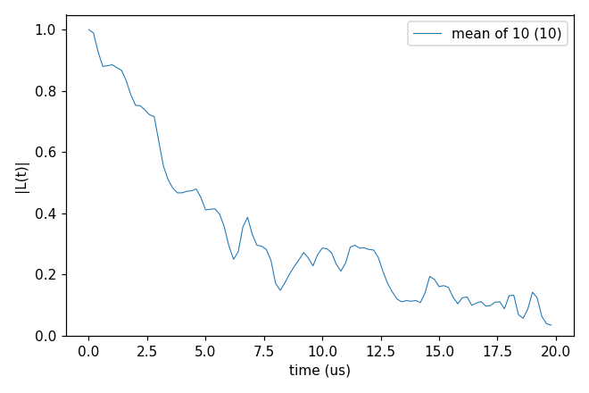

# Advanced 05: Electron-spin baths further

Folder: `example/tutorial/advanced/05_P1/`

This page goes on from the P1 bath of [Basic 06: An electron-spin bath (P1)](../../basic/06_defect_bath/README.md).
It makes such a bath, compares the two ways of writing a P1 and its ¹⁴N, checks the order of the expansion, and
pulses the P1 during the echo.

In each folder run `cd <folder> && NP=4 bash run.sh`, then compare `results/coherence.png` with `expected.png`. In the legends, a number in brackets is the number of curves averaged. Every
key not written in an input has its default (`main.out -e`). Times are for 4 ranks of a desktop CPU.

This page has four cases:

1. [Making a P1 bath](#p1_makebath) (`cCCE2_Hahn_makeBath/`).
2. [The ¹⁴N as a detuning (2e) or as a spin (2e2n)](#p1_onsite) (`cCCE2_Hahn_onsite14N/`).
3. [Checking whether order 2 is enough](#p1_order4) (`cCCE4_Hahn_states/`).
4. [A DEER pump on the bath](#p1_deer) (`gCCE2_Hahn_DEER/`).

<a id="p1_makebath"></a>
## 1. Making a P1 bath

Folder: `cCCE2_Hahn_makeBath/`

<a id="a05_makebath_input"></a>
### 1.1 The input

`example/tools/BathGenerator` puts spins on the sites of a crystal at random
([Tools](../../../../docs/user/Tools.md#tag_tool_bathgenerator)), and Basic 01 makes its ¹³C bath with it. A P1 is a nitrogen on a carbon
site, so a P1 bath is made the same way, with P1 in place of ¹³C. The folder has three files for it:

- `POSCAR_pure_P` and `POSCAR_NV_P` are the diamond cells of `basic/01_first_run/bath/genbath/` with the carbon
  sites named `P`. `POSCAR_NV_P` holds the NV, which the generator puts at the centre of the bath.
- `prob_P1_100ppm` gives three lines per spin, its name, its spin and its share of the sites in percent
  ([the prob file](../../../../docs/user/Tools.md#tag_prob_file)):

```
P1
0.5
0.01
N
1.0
0.0
```

The generator takes the element of a name by dropping its digits, so `P1` goes on 0.01 % of the `P` sites (100 ppm).
The N of the NV gets no spin.

`ccein.jsonc` computes the Hahn echo in the bath the generator writes, with the P1 in the 2e form of section 2:

```jsonc
"Qubit"         : {"qubit": [{"file": "results/bath/bath_P1_100ppm_defect"}], "alpha_state": {"ms": [1]}},
"configuration" : {"gyrofile": "../../../basic/06_defect_bath/bath/DiaP1_gyro",
                   "bathfile": ["results/bath/bath_P1_100ppm"], "s_range": [1, 10], "seed": 1},
"rbath"         : 145,
"rdip"          : 135
```

<a id="a05_makebath_run"></a>
### 1.2 Running it

```sh
NP=4 bash run.sh
```

`run.sh` makes the bath in a cube of 300 Å and then runs CCEX. The generator command is:

```sh
python3 BathGenerator.py -o results/bath/bath_P1_100ppm -i POSCAR_pure_P -I POSCAR_NV_P -p prob_P1_100ppm \
    --size 300 --Defect V
```

`run.sh` seeds the random numbers, so the same bath comes out every time. The generator may abort with "double free"
after it has written the file, so `run.sh` checks the file instead of the exit status. The bath takes 68 s and
0.16 GB on one process, and the CCEX run under a second. The generator goes through every site of the cube, so its
time grows with the volume of the cube.

<a id="a05_makebath_result"></a>
### 1.3 The result



The cube holds 443 P1, 192 of them within `rbath`, and T2 of the mean of the 10 states is 6.9 µs. The bath is small
for the example, so this T2 is not converged. A converged run needs a cube that covers `rbath` at the concentration of
interest, as the ready-made baths of Basic 06 do (cubes of 2248 Å at 1 ppm).

Next, change the share in `prob_P1_100ppm` (0.001 for 10 ppm) and `--size`. The NV sits at the centre of the cube, so
`--size` has to be at least twice `rbath`.

Inputs: [`ccein.jsonc`](cCCE2_Hahn_makeBath/ccein.jsonc), [`prob_P1_100ppm`](cCCE2_Hahn_makeBath/prob_P1_100ppm)

<a id="p1_onsite"></a>
## 2. The ¹⁴N as a detuning (2e) or as a spin (2e2n)

Folder: `cCCE2_Hahn_onsite14N/`

<a id="a05_onsite_input"></a>
### 2.1 The input

A P1 is an electron with a ¹⁴N nucleus (I = 1) next to it. CCEX can write the ¹⁴N in two ways:

- **2e.** The ¹⁴N is only a fixed shift of its electron's energy, $A_{zz} m_I$, one of 12 detunings set by the bond
  axis and $m_I$. A pair cluster is two electrons. Basic 06 uses this form.
- **2e2n.** The ¹⁴N is a spin of its own, with its full hyperfine tensor to the electron, its quadrupole coupling and
  its Zeeman term. A pair cluster is two electrons and two ¹⁴N, and a cluster of one P1 has dimension 6.

The two inputs compute the same bath, two configurations (`k_range` [1, 2]) of ten sampled states each
(`s_range` [1, 10]), and differ only in the `Defect` block. `ccein_2e.jsonc` gives the 12 detunings:

```jsonc
"Defect" : {"species": [{"name": "P1", "n_axis_states": 12,
                         "detuning": [[1, "e", 84.946496], [2, "e", 84.946496], ..., [12, "e", -114.0264]]}]}
```

`ccein_2e2n.jsonc` gives the ¹⁴N and, for each of the four Jahn-Teller axes, its hyperfine and quadrupole tensors:

```jsonc
"Defect" : {"species": [{"name": "P1", "n_onsite_spins": 1, "types": ["14N"], "spins": [1],
                         "quadrupole_moments": [2.044], "gyros": [1.9337792], "n_axis_states": 4,
                         "hyperfine": [[1, "14N", [...]], ...],
                         "efg":       [[1, "14N", [...]], ...]}]}
```

`n_onsite_spins` 1 puts one nuclear spin on every P1, and `hyperfine` and `efg` hold one tensor of nine numbers per
axis state. A defect without on-site nuclei needs no `Defect`
block, and its spin and gyromagnetic ratio come from the gyro file alone.

<a id="a05_onsite_run"></a>
### 2.2 Running it

```sh
NP=4 bash run.sh
```

It runs both inputs and plots the mean of the 20 curves of each. It takes 71 s, nearly all of it the 2e2n run, and
0.09 GB per rank.

<a id="a05_onsite_result"></a>
### 2.3 The result


T2 is 307 µs in the 2e form and 266 µs in the 2e2n form. The curves differ by up to 0.17.

Next, the on-site states can be read from a file (`configuration.defect_state_file`).

Inputs: [`ccein_2e.jsonc`](cCCE2_Hahn_onsite14N/ccein_2e.jsonc), [`ccein_2e2n.jsonc`](cCCE2_Hahn_onsite14N/ccein_2e2n.jsonc)

<a id="p1_order4"></a>
## 3. Checking whether order 2 is enough

Folder: `cCCE4_Hahn_states/`

<a id="a05_order4_input"></a>
### 3.1 The input

The expansion is cut at an order, and order 2 is enough when a higher order gives the same curve. This case computes
the P1 bath of section 2 in the 2e form, at order 2 and at order 4. The two inputs differ only in these keys:

```jsonc
"order"   : 2                                                       // ccein_order2.jsonc
"order"   : 4,                                                      // ccein_order4.jsonc
"cluster" : {"selection": {"max_per_order": [0, 0, 0, 5000, 10000]}}
```

`cluster.selection.max_per_order` keeps the 5000 strongest three-spin and 10000 strongest four-spin clusters, which
limits the number of clusters and with it the memory.

<a id="a05_order4_run"></a>
### 3.2 Running it

```sh
NP=2 bash run.sh
```

It runs both inputs and plots the mean of the 20 curves of each. The order-4 run takes 0.81 GB per rank, so two ranks
keep it within 2 GB. The two runs take 38 s on 2 ranks.

<a id="a05_order4_result"></a>
### 3.3 The result


T2 of the mean is 307.4 µs at order 2 and 306.8 µs at order 4, and the two curves differ by at most 0.045. Order 2 is
enough for this bath, and the other cases use it.

Next, `max_per_order` 0 keeps all clusters and needs much more memory.

Inputs: [`ccein_order2.jsonc`](cCCE4_Hahn_states/ccein_order2.jsonc), [`ccein_order4.jsonc`](cCCE4_Hahn_states/ccein_order4.jsonc)

<a id="p1_deer"></a>
## 4. A DEER pump

Folder: `gCCE2_Hahn_DEER/`

<a id="a05_deer_input"></a>
### 4.1 The input

A DEER pump (double electron-electron resonance) applies a π pulse to the P1 at the time of the NV's π pulse. It is
the block `pulse.bath`. `ccein_pump.jsonc` has it, and `ccein_nopump.jsonc` is the plain Hahn echo. Both compute the
NV between ms +1 and 0 in the 1 ppm bath, with ten sampled states (`s_range` [1, 10]):

```jsonc
"pulse" : {"count": 1, "bath": {"count": 1, "defect": "P1", "energy_shift": [0.0],
                                "sequence": [["1/2", "X", 180.0], ["1/2", "I", 0.0]]}}
```

`energy_shift` is the frequency of the pump tone, as a detuning in MHz. A P1 is driven when its detuning in the
`Defect` block is within `bandwidth` (by default about 1.6 kHz) of the tone, so the tone 0 MHz drives the P1 of the
central ¹⁴N line.

A pulse on the bath needs gCCE, which has the NV in every cluster's Hamiltonian, so both inputs are gCCE2. In gCCE the
NV zero-field splitting has to be written (`Qubit.intmap`). Without it the ms ±1 levels are degenerate at zero field
and the curve diverges. The NV is in ms +1 because at 500 G its ms −1 / 0 transition is close to the P1 lines, and
there the gCCE2 curve diverges.

<a id="a05_deer_run"></a>
### 4.2 Running it

```sh
NP=4 bash run.sh
```

It takes 9 s and 0.06 GB per rank.

<a id="a05_deer_result"></a>
### 4.3 The result


The NV's π pulse flips the sign of its coupling to every P1, so the phase of the first half is undone in the second.
A P1 flipped at the same moment flips the sign once more, its phase adds up instead, and the echo decays faster.
T2 of the mean of the 10 states is 150 µs for the Hahn echo and 36 µs with the pump.

Next, try another tone (`energy_shift` [84.946496], another line of the P1), or the pump at another time
(`pulse.bath.sequence` [["0.3", "X", 180], ["0.7", "I", 0]]). [DEER bath pulses](../../../../docs/methods/deer.md)
explains the pulses.

Inputs: [`ccein_nopump.jsonc`](gCCE2_Hahn_DEER/ccein_nopump.jsonc), [`ccein_pump.jsonc`](gCCE2_Hahn_DEER/ccein_pump.jsonc)
