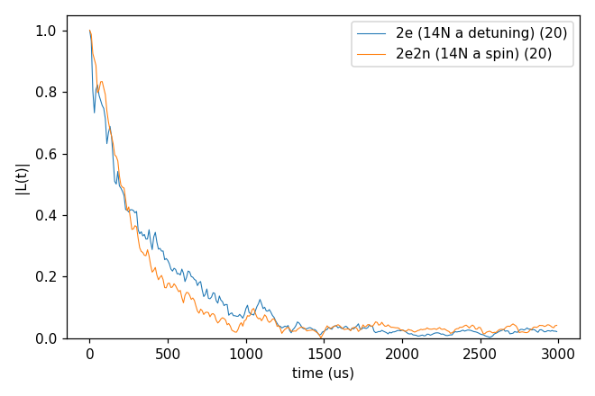
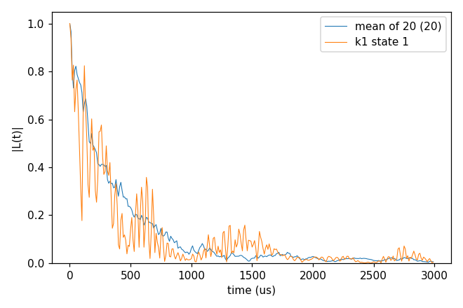
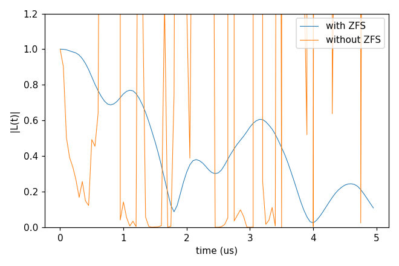
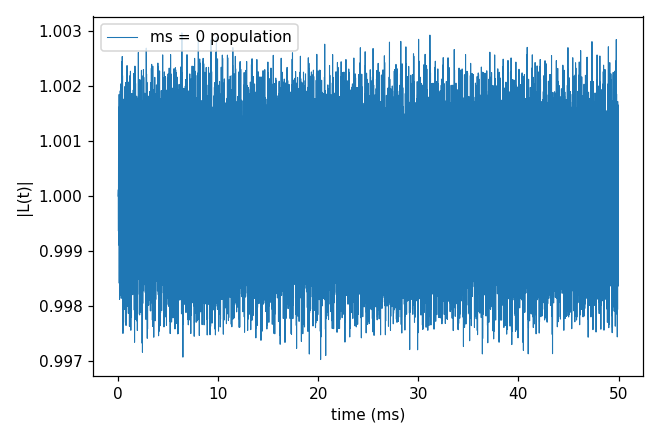
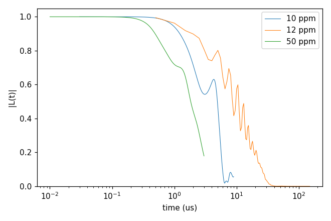
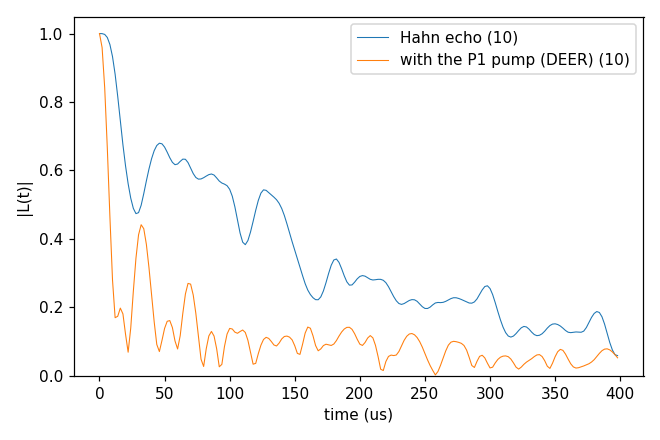

# Advanced 05: The P1 bath further

Folder: `example/tutorial/advanced/05_P1/`

This topic goes further with the P1 bath of
[Basic 06: An electron-spin bath (P1)](../../basic/06_defect_bath/README.md), and every input here reads its `bath/`.

In each folder run `cd <folder> && NP=4 bash run.sh`, then compare `results/coherence.png` with `expected.png`. Every
key not written in an input has its default (`main.out -e`). Times are for 4 ranks of a desktop CPU.

1. [cCCE2_Hahn_onsite14N](#p1_onsite): the ¹⁴N of each P1 as a nuclear spin.
2. [cCCE4_Hahn_states](#p1_order4): the expansion to order 4.
3. [gCCE2_Hahn_zfs](#p1_zfs): gCCE at zero field, where the NV zero-field splitting is needed.
4. [gCCE2_Ramsey_population](#p1_population): the qubit density matrix.
5. [cCCE2_Hahn_VpBath](#p1_vp): a Vp bath at three densities.
6. [gCCE2_Hahn_DEER](#p1_deer): a DEER pump on the bath.

## 1. cCCE2_Hahn_onsite14N: the ¹⁴N as a spin

- **What it shows:** each P1 written with its ¹⁴N as an on-site nuclear spin (`n_onsite_spins` 1, four Jahn-Teller
  axes with the ¹⁴N hyperfine and quadrupole tensors), so a cluster of one P1 is its electron and its ¹⁴N.
- **Keys that matter:** the `Defect` species, with `n_onsite_spins`, `types`, `spins`, `gyros`,
  `quadrupole_moments`, `n_axis_states` 4, `hyperfine` and `efg`.
- **How to run:** `NP=4 bash run.sh`. It takes 65 s and 0.07 GB per rank.
- **Expected result:** `expected.png`. The T2 of the mean is 266 µs, against 307 µs with the detunings of
  `basic/06_defect_bath/cCCE2_Hahn_states`.
- **What to change next:** the on-site states from a file (`configuration.defect_state_file`).

Input: [`ccein.jsonc`](cCCE2_Hahn_onsite14N/ccein.jsonc)

## 2. cCCE4_Hahn_states: order 4

- **What it shows:** the same bath to order 4, to check the convergence of the expansion.
  `cluster.selection.max_per_order` keeps the 5000 strongest three-spin and 10000 strongest four-spin clusters.
- **Keys that matter:** `order` 4 and `cluster.selection.max_per_order` [0, 0, 0, 5000, 10000].
- **How to run:** `NP=2 bash run.sh`, to stay within 2 GB. The cluster list takes 0.84 GB per rank, and the run 34 s on
  2 ranks.
- **Expected result:** `expected.png`. The T2 of the mean is 307 µs, the same as at order 2, so the expansion has
  converged at order 2 here.
- **What to change next:** `max_per_order` 0, which keeps all clusters and needs much more memory.

Input: [`ccein.jsonc`](cCCE4_Hahn_states/ccein.jsonc)

## 3. gCCE2_Hahn_zfs: zero field needs the zero-field splitting

- **What it shows:** at zero field the NV must be a spin 1 with its zero-field splitting in gCCE (D = 2.88 GHz, the
  `intmap` tensor in kHz). Without it the ms ±1 levels are degenerate and the divided curve (`_wiDiv`) diverges.
- **Keys that matter:** `method` gCCE, `bfield` 0, the `Qubit.qubit` entry and its `intmap` self tensor (present in
  `ccein_with_ZFS.jsonc`, absent in `ccein_without_ZFS.jsonc`), `s_range` [1, 1], `seed` 8810, 10 ppm and `deltat`
  50 ns.
- **How to run:** `NP=4 bash run.sh`. It takes 1.5 s and 0.06 GB per rank.
- **Expected result:** `expected.png`. The T2 with the ZFS is 3.59 µs. Without it |L| reaches 3.8e15 (cut at 1.2 in
  the plot).
- **What to change next:** a small field (`bfield` 10) without the ZFS, or more states.

Inputs: [`ccein_with_ZFS.jsonc`](gCCE2_Hahn_zfs/ccein_with_ZFS.jsonc), [`ccein_without_ZFS.jsonc`](gCCE2_Hahn_zfs/ccein_without_ZFS.jsonc)

## 4. gCCE2_Ramsey_population: the density matrix

- **What it shows:** the NV prepared in ms = 0 (`alpha_state` = `beta_state` = `{"ms": [0]}`) without a pulse, and
  the qubit density matrix (`quantity` dm) of gCCE2 over 50 ms in 10 ppm P1 at 300 G. It gives the ms = 0 population,
  which flip-flops with the bath would lower.
- **Keys that matter:** `quantity` dm, `alpha_state` and `beta_state` `{"ms": [0]}`, `pulse.count` 0, `bfield` 300,
  and `deltat` 10 µs × `nstep` 5000.
- **How to run:** `NP=4 bash run.sh`. It takes 76 s and 0.06 GB per rank.
- **Expected result:** `expected.png`, with the y range from the data. The population stays within 0.997 to 1.003.
- **What to change next:** a scan of `bfield`. Where an NV transition comes into resonance with the bath, the
  population drops.

Input: [`ccein.jsonc`](gCCE2_Ramsey_population/ccein.jsonc)

## 5. cCCE2_Hahn_VpBath: a Vp bath

- **What it shows:** the Hahn echo in a bath of Vp defects at 10, 12 and 50 ppm, one configuration and one sampled
  state each. A Vp is a spin 1/2 without on-site nuclei, so the input has no `Defect` block.
- **Keys that matter:** `configuration.gyrofile` (`Vp/DiaVp_gyro`), `bathfile`, `s_range` [1, 1], `seed`, and
  `rbath`, `rdip` and `deltat` per concentration.
- **How to run:** `NP=4 bash run.sh`. It takes 1.7 s and 0.06 GB per rank.
- **Expected result:** `expected.png`, with the time axis on a log scale (`plot_coherence.py --log-time`) since the
  T2 differ tenfold. For this one state they are 5.2 µs (10 ppm), 13.5 µs (12 ppm, a longer window) and 2.3 µs
  (50 ppm, a 10 ns step).
- **What to change next:** more states (`s_range` [1, 20]) before comparing concentrations.

Inputs: [`ccein_10ppm.jsonc`](cCCE2_Hahn_VpBath/ccein_10ppm.jsonc), [`ccein_12ppm.jsonc`](cCCE2_Hahn_VpBath/ccein_12ppm.jsonc), [`ccein_50ppm.jsonc`](cCCE2_Hahn_VpBath/ccein_50ppm.jsonc)

## 6. gCCE2_Hahn_DEER: a DEER pump

- **What it shows:** a DEER pump (`pulse.bath`), a π pulse on the P1 spins at the time of the NV's π pulse
  (`ccein_pump.jsonc`), against the plain Hahn echo (`ccein_nopump.jsonc`). It is gCCE2 with the NV in ms +1 / 0,
  1 ppm and ten sampled states. The tone `energy_shift` 0 MHz drives only the P1 whose `detuning` is within
  `bandwidth` of it, the central ¹⁴N line (axis states 4, 5, 6 and 11). Their coupling to the NV is no longer
  refocused, so the echo decays faster. The NV is in ms +1 because at 500 G its ms −1 / 0 transition is close to the
  P1 lines and its gCCE2 curve diverges.
- **Keys that matter:** `method` gCCE, `pulse.bath` {`count` 1, `defect` "P1", `energy_shift` [0.0], `sequence`
  [["1/2", "X", 180], ["1/2", "I", 0]]}, the `Defect` detunings, `s_range` [1, 10] and `seed`.
- **How to run:** `NP=4 bash run.sh`. It takes 9 s and 0.06 GB per rank.
- **Expected result:** `expected.png`. The T2 of the mean of the 10 states is 150 µs for the Hahn echo and 36 µs
  with the pump.
- **What to change next:** another tone (`energy_shift` [84.946496] drives the axis states 1–3), or the pump at
  another time (`pulse.bath.sequence` [["0.3", "X", 180], ["0.7", "I", 0]]). See
  [DEER bath pulses](../../../../docs/methods/deer.md).

Inputs: [`ccein_nopump.jsonc`](gCCE2_Hahn_DEER/ccein_nopump.jsonc), [`ccein_pump.jsonc`](gCCE2_Hahn_DEER/ccein_pump.jsonc)
