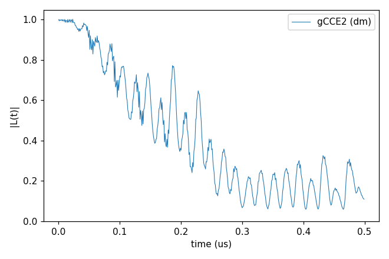
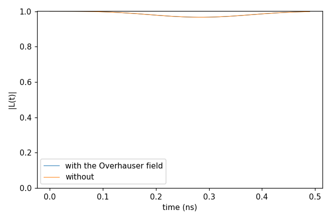

# Advanced 06: V_B⁻ in hexagonal BN

Folder: `example/tutorial/advanced/06_hBN/`

The qubit here is the boron vacancy V_B⁻ (spin 1) in hexagonal BN with natural-abundance ¹⁰B, ¹¹B and ¹⁴N. Every
nuclear spin has its DFT hyperfine tensor and, for spin > 1/2, its electric-field gradient (quadrupole).

In each folder run `cd <folder> && NP=4 bash run.sh`, then compare `results/coherence.png` with `expected.png`. Every
key not written in an input has its default (`main.out -e`). Times are for 4 ranks of a desktop CPU.

`bath/flat/` holds 50 bath configurations of a flat layer, the defect position (`bath_hBN_VB_flat_Defect`) and the
tensor files the inputs read, both made with `example/tools/SpinTensorReader`:

- `hBN_VB_flat_ATensor_HSE_CellPBE_v3`, the hyperfine of the S = 1 defect in tensor format v3 (the nearest ¹⁴N has
  $A_{zz}$ 48.6 MHz).
- `hBN_VB_flat_QTensor_HSE_CellPBE`, the electric-field gradients.

The gyromagnetic ratios are in `bath/hBN_natab_gyro`, beside the `do_*` scripts that show how the tensors were
prepared. [Advanced 07: DFT hyperfine and quadrupole tensors](../07_DFT_tensors/README.md) makes such files and
compares the coherence with and without them, and the hyperfine-mediated term on this bath is in
[Advanced 10: Corrections to cCCE](../10_cCCE_corrections/README.md).

1. [The qubit density matrix of one sampled bath state](#hbn_states) (`gCCE2_Hahn_states/`).
2. [The Overhauser field of the bath on the qubit](#hbn_overhauser) (`gCCE2_Hahn_Overhauser/`).

## 1. One sampled bath state

Folder: `gCCE2_Hahn_states/`

- **What it shows:** gCCE2 of one sampled bath state, the qubit density matrix (`quantity` dm) over 0.5 µs in a small
  bath (`rbath` 5 Å). The plot shows the element between ms +1 and 0, divided by its value at t = 0.
- **Keys that matter:** `method` gCCE, `quantity` dm, `s_range` [1, 1], `seed` 1, the two tensor files, and the
  zero-field splitting as a `Qubit.intmap` self term (D = 3.48 GHz, E = 50 MHz, as in `gCCE2_Hahn_Overhauser`).
- **How to run:** `NP=4 bash run.sh`. It takes 0.6 s and 0.05 GB per rank.
- **Expected result:** `expected.png`. The T2 is 0.25 µs, with the oscillation of the nearest ¹⁴N's hyperfine resolved
  by the 1 ns step. Over a longer window this one state diverges (|L| > 1 from about 0.85 µs).
- **What to change next:** `rbath` 10 and `s_range` [1, 10].

Input: [`ccein.jsonc`](gCCE2_Hahn_states/ccein.jsonc)

## 2. The Overhauser field

Folder: `gCCE2_Hahn_Overhauser/`

- **What it shows:** the Overhauser field of the bath on the qubit (`hamiltonian.common.qubit_bath_mean_field`) at
  zero field, between the ms ±1 superposition (`alpha_state` vector [1, 0, 1]) and ms 0.
- **Keys that matter:** `qubit_bath_mean_field` true or false, `Qubit.alpha_state` and `beta_state`, the `intmap` ZFS
  (`"unit": "MHz"`, D ≈ 3.48 GHz, E ≈ 50 MHz), `bfield` 0, and `deltat` 10 ps × `nstep` 50.
- **How to run:** `NP=4 bash run.sh`. It takes 1.7 s and 0.06 GB per rank.
- **Expected result:** `expected.png`. Both show a shallow dip to |L| 0.966 near 0.28 ns (about 1/D) and come back to
  0.998 at 0.49 ns. They differ by 9e-5 in this short window.
- **What to change next:** a longer window (`nstep` 1000) to see where the two separate.

Inputs: [`ccein_with_Overhauser.jsonc`](gCCE2_Hahn_Overhauser/ccein_with_Overhauser.jsonc), [`ccein_without_Overhauser.jsonc`](gCCE2_Hahn_Overhauser/ccein_without_Overhauser.jsonc)
