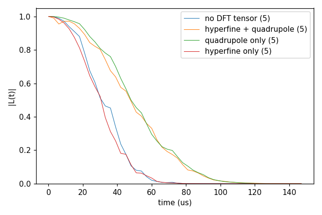

# Advanced 06: V_B⁻ in h-BN with DFT tensors

Folder: `example/tutorial/advanced/06_hBN/`

The qubit here is the boron vacancy V_B⁻ (spin 1) in hexagonal BN, and the bath is the natural-abundance ¹⁰B, ¹¹B
and ¹⁴N of the layer. The page goes from a VASP run of the defect to a CCEX run. It makes the bath, makes the
hyperfine and quadrupole tensor files from the same VASP run, and compares the coherence without and with the
tensors.

Run each case with `cd <folder> && NP=4 bash run.sh`. Case 3 writes `results/coherence.png`, to compare with
`expected.png`. Every key not written in an input has its default (`main.out -e`). Times are for 4 ranks of a desktop
CPU.

This page has three cases:

1. [Making an h-BN bath around V_B⁻](#hbn_makebath) (`hBN_makeBath/`).
2. [How the tensor files are made from a VASP run](#dft_make) (`makeTensors_hBN/`).
3. [The coherence without and with the DFT tensors](#dft_effect) (`cCCE2_Hahn_tensors/`).

<a id="hbn_makebath"></a>
## 1. Making an h-BN bath around V_B⁻

Folder: `hBN_makeBath/`

<a id="a06_makebath_input"></a>
### 1.1 The input

`example/tools/BathGenerator` repeats a pure cell into a layer and puts the relaxed cell with the defect at its
centre. On every B and N site it draws an isotope with the abundances of `bath/prob_hBN` (¹⁰B 19.9 %, ¹¹B 80.1 %,
¹⁴N 99.632 %, ¹⁵N 0.368 %). The folder has the two cells:

- `POSCAR_VB_flat` is the relaxed V_B⁻ cell of the VASP run of case 2 (`VASP_CONTCAR_flat` of
  `example/tools/SpinTensorReader/examples/02.hBN_VB_VASP`, the positions only, without the velocities VASP adds).
- `POSCAR_pure_flat` is the same lattice without the defect, the sites on the ideal grid and the vacancy filled with
  B. The generator needs the two cells to have the same lattice.

<a id="a06_makebath_run"></a>
### 1.2 Running it

```sh
bash run.sh
```

`run.sh` makes a square of 60 Å with:

```sh
python3 BathGenerator.py -o results/bath_hBN -i POSCAR_pure_flat -I POSCAR_VB_flat -p ../bath/prob_hBN \
    --size 60 --Defect VB --opt2D
```

`--opt2D` keeps the layer two-dimensional. `--Defect VB` names the vacancy, and its position goes to
`results/bath_hBN_defect`. `run.sh` seeds the random numbers, so the same bath comes out every time. The generator
may abort with "double free" after it has written the file, so `run.sh` checks the file instead of the exit status.
The run takes a second.

<a id="a06_makebath_result"></a>
### 1.3 The result

The bath has 1293 nuclei, 123 ¹⁰B, 511 ¹¹B, 652 ¹⁴N and 6 ¹⁵N, and the defect sits at (30.0, 30.0, 7.5) Å.

This bath and the tensor files of case 2 come from the same VASP cell. CCEX stops, however, on the four nuclei that
lie on the edge of that cell, where the tensor files have no row. Case 3 therefore reads the ready-made bath and
tensor files of `bath/flat/`.

Next, change `--size`, which has to be at least twice `rbath`, or the abundances in `prob_hBN`.

<a id="dft_make"></a>
## 2. Making the tensor files

Folder: `makeTensors_hBN/`

<a id="a06_make_input"></a>
### 2.1 The input

The input of this case is the VASP run of V_B⁻ kept in `example/tools/SpinTensorReader/examples/02.hBN_VB_VASP`, not a
CCEX input. `run.sh` gives `example/tools/SpinTensorReader/main.py` the relaxed cell `VASP_CONTCAR_flat`, the defect
named `VB`, and `VASP_OUTCAR_flat` for both `--A` and `--Q`:

```sh
python3 $STR/main.py VASP $EX/VASP_CONTCAR_flat VB --A $EX/VASP_OUTCAR_flat --Q $EX/VASP_OUTCAR_flat
```

<a id="a06_make_run"></a>
### 2.2 Running it

```sh
sh run.sh
```

It takes under a second and needs python3 with numpy, pandas and psutil, but not CCEX. It checks that
`results/Afile` and `results/Qfile` are the example's `Afile_v2` and `Qfile_v2`, byte for byte.

<a id="a06_make_result"></a>
### 2.3 The result

`Afile` holds, in order:

- The name of the DFT code (`VASP`) on the first line.
- On the second line, which CCEX reads, what the values are
  (`# CCEX-tensor v3: values = hyperfine of the spin-S defect (MHz), source = VASP OUTCAR, S = 1`).
- The gyromagnetic g-factors and the corners `v1` .. `v8` of the cell (Å from the defect, the range of the rows).
- One row per atom, with the position from the defect, the isotropic (contact) term and the nine components, in MHz.
  Here there are 53 B and 54 N, and the three ¹⁴N next to the vacancy have a contact term of 121 MHz.

`Qfile` has the same layout with the electric-field gradient (Hartree/Bohr²), for the nuclei with I > 1/2.

An input names the two files in `hamiltonian.common.hyperfine` (`dipole` dft, `contact` true, `file`) and
`hamiltonian.common.quadrupole` (`file`). CCEX matches a row to a bath spin by its position from the defect, so the
bath has to be built on the lattice of the DFT cell. A bath spin inside the cell without a row stops the run, and a
spin outside the cell takes the point dipole (`missing_row` point_dipole gives the point dipole to every missing
row).

Next, use your own OUTCAR. `--addhfcore False` leaves out the core term of the contact interaction, and Quantum
ESPRESSO needs `--spin S` ([Tools](../../../../docs/user/Tools.md)).

<a id="dft_effect"></a>
## 3. The coherence without and with the DFT tensors

Folder: `cCCE2_Hahn_tensors/`

<a id="a06_effect_input"></a>
### 3.1 The input

This case computes a cCCE2 Hahn echo at 3 T over five configurations of `bath/flat/` (`k_range` [1, 5]), with
`rbath` 20 Å, `rdip` 10 Å and `deltat` 3 µs × `nstep` 50. `bath/flat/` holds 50 configurations of a flat layer, the
defect position and the tensor files `hBN_VB_flat_ATensor_HSE_CellPBE_v3` and `hBN_VB_flat_QTensor_HSE_CellPBE`.
The same bath is used in [Advanced 09: Corrections to cCCE](../09_cCCE_corrections/README.md) and
[Advanced 13: Pseudospin pairs](../13_pseudospin/README.md).

The four inputs differ only in the `hamiltonian` block.
`ccein_hf0_qd0.jsonc` has none, so every nucleus couples to the defect as a point dipole at its position and has no
quadrupole term. `ccein_hf3_qd2.jsonc` has both tensors:

```jsonc
"hamiltonian" : {"common": {"hyperfine": {"dipole": "dft", "contact": true,
                                          "file": "../bath/flat/hBN_VB_flat_ATensor_HSE_CellPBE_v3"},
                            "quadrupole": {"structure": "plain",
                                           "file": "../bath/flat/hBN_VB_flat_QTensor_HSE_CellPBE"}}}
```

`ccein_hf0_qd2.jsonc` keeps the quadrupole only, and `ccein_hf3_qd0.jsonc` the hyperfine only.

<a id="a06_effect_run"></a>
### 3.2 Running it

```sh
NP=4 bash run.sh
```

It runs the four inputs and plots the mean of the five configurations of each. It takes 11 s and 0.09 GB per
rank.

<a id="a06_effect_result"></a>
### 3.3 The result



| Input | T2 |
|---|---|
| No DFT tensor | 38.2 µs |
| Hyperfine only | 34.0 µs |
| Quadrupole only | 56.6 µs |
| Both | 56.5 µs |

The quadrupole lengthens T2 from 38 to 57 µs. The DFT hyperfine shortens it by 11 % without the quadrupole, and
hardly moves it with the quadrupole.

Next, try `k_range` [1, 50], or `rbath` 30 to check convergence.

Inputs: [`ccein_hf0_qd0.jsonc`](cCCE2_Hahn_tensors/ccein_hf0_qd0.jsonc), [`ccein_hf0_qd2.jsonc`](cCCE2_Hahn_tensors/ccein_hf0_qd2.jsonc), [`ccein_hf3_qd0.jsonc`](cCCE2_Hahn_tensors/ccein_hf3_qd0.jsonc), [`ccein_hf3_qd2.jsonc`](cCCE2_Hahn_tensors/ccein_hf3_qd2.jsonc)
