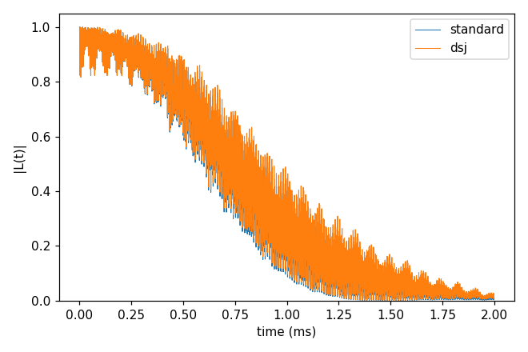
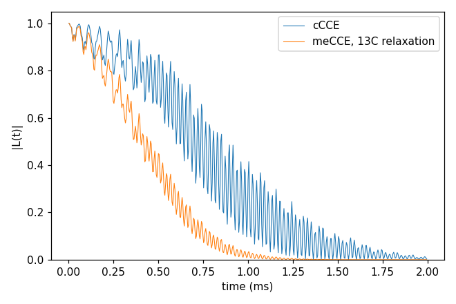
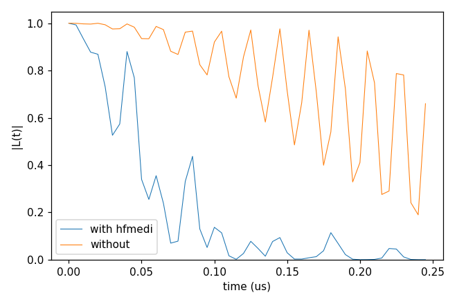

# advanced/06_terms_and_models

Options of cCCE beyond [basic/04_cCCE_vs_gCCE](../../basic/04_cCCE_vs_gCCE/README.md): disjoint clusters (`cluster.mode`
dsj), the hyperfine-mediated coupling of two nuclei through the defect (`hamiltonian.cCCE.hfmedi`, on the h-BN bath of
[advanced/02_hBN](../02_hBN/README.md)), and the master-equation CCE (meCCE), which adds Lindblad relaxation of the bath
spins. Each folder: `cd <folder> && NP=4 bash run.sh`, then compare `results/coherence.png` with `expected.png`. Every
key not written in an input has its default (`main.out -e`). Times: i7-14700K, WSL, 4 ranks.

## cCCE2_Hahn_dsj

- **What it shows:** `cluster.mode` dsj (the clusters are the disjoint groups of the coupling graph within `rdip`)
  against the standard pairs (`ccein_standard.jsonc`).
- **Keys that matter:** `cluster.mode` dsj.
- **How to run:** `NP=4 bash run.sh`: 1.1 s, 0.05 GB per rank.
- **Expected result:** `expected.png`; T2 1.092 ms (dsj) against 1.068 ms; largest difference 0.064.
- **What to change next:** `cluster.mode` itb or dsjitb (cCCE only).

Inputs: [`ccein.jsonc`](cCCE2_Hahn_dsj/ccein.jsonc), [`ccein_standard.jsonc`](cCCE2_Hahn_dsj/ccein_standard.jsonc)

## meCCE2_Hahn_bathRelaxation

- **What it shows:** `method` meCCE, the cCCE with a Lindblad master equation in each cluster: jump operators S₋ and
  S₊ on every ¹³C at γ = 0.01 rad/ms each (`rate` 1.5915e-6 MHz × 2π·10³) relax the bath spins (`ccein_meCCE.jsonc`),
  against cCCE (`ccein_cCCE.jsonc`), on basic/01_first_run's system with 500 points of 4 µs. The rates of all the ¹³C add up,
  so even this small rate halves T2. Without jump operators meCCE gives the cCCE curve (checked by
  `test/code_verification/check_master_equation`).
- **Keys that matter:** `method` meCCE, `hamiltonian.meCCE.jump_operators` [{`bath_name` "13C", `operator` "-" or
  "+", `rate` (MHz)}].
- **How to run:** `NP=4 bash run.sh`: 18-20 s (nearly all meCCE), 0.06 GB per rank.
- **Expected result:** `expected.png`; T2 1.068 ms (cCCE) and 0.53 ms (meCCE).
- **What to change next:** `operator` "z" (pure dephasing of the ¹³C); `method` megCCE with a qubit jump
  (`bath_name` "qubit", in `hamiltonian.megCCE`); see [master-equation CCE](../../../../docs/methods/master-equation.md).

Inputs: [`ccein_cCCE.jsonc`](meCCE2_Hahn_bathRelaxation/ccein_cCCE.jsonc), [`ccein_meCCE.jsonc`](meCCE2_Hahn_bathRelaxation/ccein_meCCE.jsonc)

## cCCE2_Hahn_hfMediated

- **What it shows:** the hyperfine-mediated bath-bath coupling (`hamiltonian.cCCE.hfmedi`): at 1000 G with the
  V_B⁻ zero-field splitting, two nuclei coupled through the defect's transverse hyperfine; one configuration, ensemble.
- **Keys that matter:** `hamiltonian.cCCE.hfmedi` true / absent, the ZFS as a `Qubit.intmap` self entry (kHz), `bfield` 1000, `rbath` 14 Å,
  `rdip` 8 Å, `deltat` 5 ns × `nstep` 50.
- **How to run:** `NP=4 bash run.sh`: 1.2 s, 0.05 GB per rank.
- **Expected result:** `expected.png`; T2 86 ns with the term; without it |L| is still 0.66 at 245 ns.
- **What to change next:** a higher `bfield` (the term falls off with the field).

Inputs: [`ccein_wi_hfmedi.jsonc`](cCCE2_Hahn_hfMediated/ccein_wi_hfmedi.jsonc), [`ccein_wo_hfmedi.jsonc`](cCCE2_Hahn_hfMediated/ccein_wo_hfmedi.jsonc)

