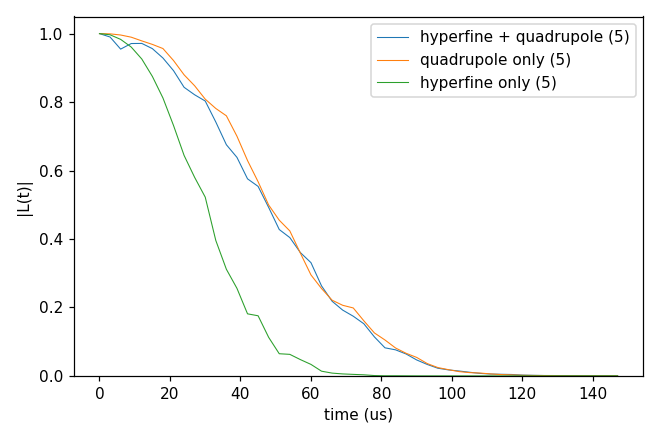

# Advanced 07: DFT hyperfine and quadrupole tensors

Folder: `example/tutorial/advanced/07_DFT_tensors/`

This topic takes the hyperfine and quadrupole tensors from DFT instead of the point dipole of the positions.
`example/tools/SpinTensorReader` reads a VASP OUTCAR (or a Quantum ESPRESSO output) and writes two files. `Afile` holds
the hyperfine tensor of each atom of the cell (MHz, tensor format v3), and `Qfile` the electric-field gradient of each
atom (for spins I > 1/2). An input names them in `hamiltonian.common.hyperfine` (`dipole` dft, `contact` true,
`file`) and `hamiltonian.common.quadrupole` (`file`).

The rows are matched to the bath spins by position from the defect, so the bath has to be built on the lattice of the
DFT cell. A bath spin inside the cell without a row stops the run, and spins outside the cell take the point dipole
(`missing_row` point_dipole extends that to every missing row). The cell of `makeTensors_hBN` is not the one of the
tutorial bath, so `cCCE2_Hahn_tensors` uses the files kept with
[Advanced 06: V_B⁻ in hexagonal BN](../06_hBN/README.md).

In each folder run `cd <folder> && NP=4 bash run.sh`, then compare `results/coherence.png` with `expected.png`. Every
key not written in an input has its default (`main.out -e`). Times are for 4 ranks of a desktop CPU.

This page has two cases:

1. [How the tensor files are made from a VASP run](#dft_make) (`makeTensors_hBN/`).
2. [What the DFT tensors change](#dft_effect) (`cCCE2_Hahn_tensors/`).

<a id="dft_make"></a>
## 1. Making the tensor files

Folder: `makeTensors_hBN/`

<a id="a07_make_input"></a>
### 1.1 The input

The input of this case is the VASP run of V_B⁻ kept in `example/tools/SpinTensorReader/examples/02.hBN_VB_VASP`, not a
CCEX input. `run.sh` gives `example/tools/SpinTensorReader/main.py` the relaxed cell `VASP_CONTCAR_flat`, the defect
named `VB`, and `VASP_OUTCAR_flat` for both `--A` and `--Q`:

```sh
python3 $STR/main.py VASP $EX/VASP_CONTCAR_flat VB --A $EX/VASP_OUTCAR_flat --Q $EX/VASP_OUTCAR_flat
```

<a id="a07_make_run"></a>
### 1.2 Running it

```sh
sh run.sh
```

It takes under a second and needs python3 with numpy, pandas and psutil, but not CCEX. It checks that
`results/Afile` and `results/Qfile` are the example's `Afile_v2` and `Qfile_v2`, byte for byte.

<a id="a07_make_result"></a>
### 1.3 The result

`Afile` holds, in order:

- The name of the DFT code (`VASP`) on the first line.
- On the second line, which CCEX reads, what the values are
  (`# CCEX-tensor v3: values = hyperfine of the spin-S defect (MHz), source = VASP OUTCAR, S = 1`).
- The gyromagnetic g-factors and the corners `v1` .. `v8` of the cell (Å from the defect, the range of the rows).
- One row per atom, with the position from the defect, the isotropic (contact) term and the nine components, in MHz.
  Here there are 53 B and 54 N, and the three ¹⁴N next to the vacancy have a contact term of 121 MHz.

`Qfile` has the same layout with the field gradient (Hartree/Bohr²).

Next, use your own OUTCAR. `--addhfcore False` leaves out the core term of the contact interaction, and Quantum
ESPRESSO needs `--spin S` ([Tools](../../../../docs/user/Tools.md)).

<a id="dft_effect"></a>
## 2. What the tensors change

Folder: `cCCE2_Hahn_tensors/`

<a id="a07_effect_input"></a>
### 2.1 The input

This case computes a cCCE2 Hahn echo at 3 T over five configurations (`k_range` [1, 5]), with `rbath` 20 Å, `rdip` 10 Å and `deltat`
3 µs × `nstep` 50. The three inputs differ only in the `hamiltonian` block. `ccein_hf3_qd2.jsonc` has both tensors:

```jsonc
"hamiltonian" : {"common": {"hyperfine": {"dipole": "dft", "contact": true,
                                          "file": "../../06_hBN/bath/flat/hBN_VB_flat_ATensor_HSE_CellPBE_v3"},
                            "quadrupole": {"structure": "plain",
                                           "file": "../../06_hBN/bath/flat/hBN_VB_flat_QTensor_HSE_CellPBE"}}}
```

`ccein_hf0_qd2.jsonc` keeps the quadrupole only, so the hyperfine is a point dipole, and `ccein_hf3_qd0.jsonc` keeps
the hyperfine only.

<a id="a07_effect_run"></a>
### 2.2 Running it

```sh
NP=4 bash run.sh
```

It takes 8 s and 0.07 GB per rank.

<a id="a07_effect_result"></a>
### 2.3 The result



The T2 is 56.5 µs with both tensors, 56.6 µs with the quadrupole only and 34.0 µs with the hyperfine only.

Next, try `k_range` [1, 50], or `rbath` 30 to check convergence.

Inputs: [`ccein_hf0_qd2.jsonc`](cCCE2_Hahn_tensors/ccein_hf0_qd2.jsonc), [`ccein_hf3_qd0.jsonc`](cCCE2_Hahn_tensors/ccein_hf3_qd0.jsonc), [`ccein_hf3_qd2.jsonc`](cCCE2_Hahn_tensors/ccein_hf3_qd2.jsonc)
