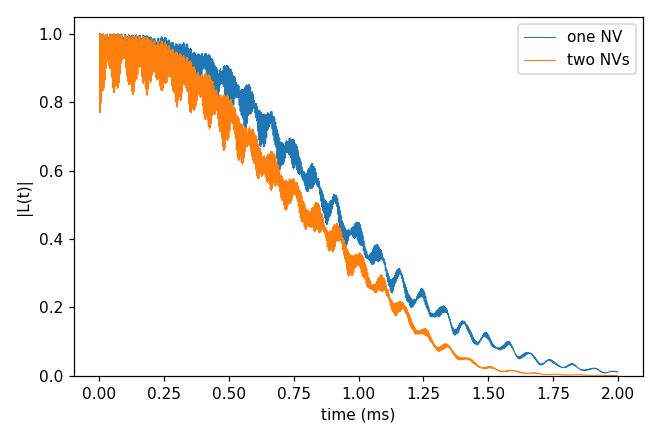
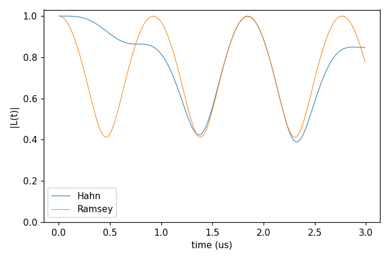

# Advanced 07: Multiple qubits

Folder: `example/tutorial/advanced/07_multi_qubits/`

A run can hold several qubits as one register. The examples here are NV centres in a ¹³C bath, computed with gCCE,
and the input writes them as follows:

- `Qubit.qubit` lists the qubits, each with a `name` and its position (`xyz`, or a `file`).
- `Qubit.intmap` gives each qubit its zero-field splitting, as a tensor between the qubit and itself (in kHz).
- Two qubits not paired in `intmap` couple through the point dipole of their positions.

In these examples every NV has its axis along z, the same for all. Each ZFS tensor is diag(−D/3, −D/3, 2D/3) with
D = 2.88 GHz. All qubits share one frame and one `bfield`. A qubit whose axis is tilted is written with its ZFS
tensor turned to that axis, and its states with `"index"` or `"vector"`, since `"ms"` counts along the common z
([alpha_state](../../../../docs/user/InputFile_Qubit.md#tag_alpha_state)).

In each folder run `cd <folder> && NP=4 bash run.sh`, then compare `results/coherence.png` with `expected.png`. Every
key not written in an input has its default (`main.out -e`). Times are for 4 ranks of a desktop CPU.

This page has two cases:

1. [One NV against two in a ¹³C bath](#mq_one_two) (`gCCE2_Hahn_oneVsTwoNV/`).
2. [Three NVs and the coupling between them, with almost no bath](#mq_nv3) (`gCCE2_HahnRamsey_NV3/`).

<a id="mq_one_two"></a>
## 1. One NV against two in a ¹³C bath

Folder: `gCCE2_Hahn_oneVsTwoNV/`

<a id="a07_one_two_input"></a>
### 1.1 The input

This case puts a second NV into the ¹³C bath of Basic 01 and compares its Hahn echo with that of one NV, both with
gCCE. The single NV (`ccein_single.jsonc`) takes its position from a file (`Qubit.qubit[].file`) and has its ZFS as a
`Qubit.intmap` self entry:

```jsonc
"Qubit" : {"qubit": [{"file": "../../../basic/01_first_run/bath/bath_Diamond_NV_natab_defect"}],
           "intmap": [{"between": ["q0", "q0"], "tensor": [[-960000, 0, 0], [0, -960000, 0], [0, 0, 1920000]],
                       "unit": "kHz"}]}
```

The two NVs (`ccein_multi2.jsonc`) are two entries with `xyz`, 25 Å apart along z, and one ZFS tensor each:

```jsonc
"Qubit" : {"qubit": [{"name": "qubit1", "xyz": [73.73895, 75.72808, 73.97033]},
                     {"name": "qubit2", "xyz": [73.73895, 75.72808, 98.97033]}],
           "intmap": [{"between": ["qubit1", "qubit1"], "tensor": [[-960000, 0, 0], [0, -960000, 0], [0, 0, 1920000]]},
                      {"between": ["qubit2", "qubit2"], "tensor": [[-960000, 0, 0], [0, -960000, 0], [0, 0, 1920000]]}]}
```

The coherence of the two NVs is the one between |+1,+1⟩ and |0,0⟩, the defaults of `alpha_state` and
`beta_state` for two qubits.

<a id="a07_one_two_run"></a>
### 1.2 Running it

```sh
NP=4 bash run.sh
```

It takes 2 min, most of it the two-NV run, and 0.07 GB per rank.

<a id="a07_one_two_result"></a>
### 1.3 The result



T2 is 1.084 ms for one NV and 0.956 ms for two, so the coherence of the register decays faster than that of one NV.

Next, move the second NV further away (`xyz`), or choose another pair of register states with `alpha_state` and
`beta_state`.

Inputs: [`ccein_multi2.jsonc`](gCCE2_Hahn_oneVsTwoNV/ccein_multi2.jsonc), [`ccein_single.jsonc`](gCCE2_Hahn_oneVsTwoNV/ccein_single.jsonc)

<a id="mq_nv3"></a>
## 2. Three NVs and the coupling between them, with almost no bath

Folder: `gCCE2_HahnRamsey_NV3/`

<a id="a07_nv3_input"></a>
### 2.1 The input

This case keeps the bath almost empty, so that the coupling between the qubits shows. Three NVs, each 50 Å from the
first, sit beside a pair of ¹³C, and the run writes the 3-qubit density matrix (`quantity` dm) for the Hahn echo
(`ccein_hahn.jsonc`) and for Ramsey (`ccein_ramsey.jsonc`, `pulse.count` 0) over 3 µs. The bath, gyro and state files
of the folder are written by hand. `bath` holds a count line, then x y z name, and `state1` one m per bath spin, read
with `s_range` [1, 1]. The qubits and their zero-field splittings are:

```jsonc
"qubit"  : [{"name": "q1", "xyz": [75.663, 74.2628, 74.1348]},
            {"name": "q2", "xyz": [75.663, 74.2628, 124.1348]},
            {"name": "q3", "xyz": [75.663, 124.2628, 74.1348]}],
"intmap" : [{"between": ["q1", "q1"], "tensor": [[-960000, 0, 0], [0, -960000, 0], [0, 0, 1920000]]},
            {"between": ["q2", "q2"], "tensor": [[-960000, 0, 0], [0, -960000, 0], [0, 0, 1920000]]},
            {"between": ["q3", "q3"], "tensor": [[-960000, 0, 0], [0, -960000, 0], [0, 0, 1920000]]}],
"deltat" : 1e-05,
"nstep"  : 300
```

The register has dimension 3³ = 27, and with the two ¹³C the clusters have dimension 108.

<a id="a07_nv3_run"></a>
### 2.2 Running it

```sh
NP=4 bash run.sh
```

It takes 1.2 s and writes 30 MB of output, since each file holds nstep × 27² complex numbers.

<a id="a07_nv3_result"></a>
### 2.3 The result



The plot shows ρ between |+1,+1,+1⟩ and |0,0,0⟩, divided by its value at t = 0. The qubits' dipolar coupling (50 Å
apart) makes L oscillate. The Ramsey curve falls to 0.41 at 0.46 µs and comes back
to 1.0 at 0.92 µs, about three periods in the window. The Hahn echo removes the first oscillation and then follows it,
ending at 0.85.

Next, add a fourth qubit, with one more `qubit` and `intmap` entry. The qubit space grows threefold with every NV,
and the output ninefold.

Inputs: [`ccein_hahn.jsonc`](gCCE2_HahnRamsey_NV3/ccein_hahn.jsonc), [`ccein_ramsey.jsonc`](gCCE2_HahnRamsey_NV3/ccein_ramsey.jsonc)
