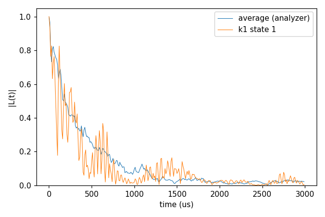
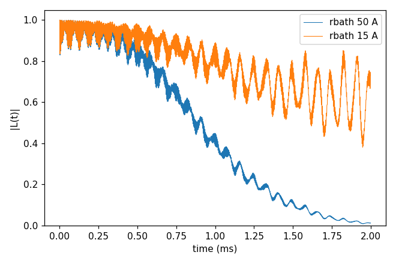

# Advanced 08: Analysis of the output

Folder: `example/tutorial/advanced/08_analysis/`

What to do with the output. `cCCE2_Hahn_analyzer` runs the analyzer of `example/analysis`
([Analysis](../../../../docs/user/Analysis.md)) on the curves of a sampled P1 bath: error correction, the average and
the T2 fit. `cCCE2_Hahn_clusterReport` asks the run itself which clusters matter. Each folder: `cd <folder> && NP=4 bash
run.sh`, then compare `results/coherence.png` with `expected.png`. Every key not written in an input has its default
(`main.out -e`). Times: i7-14700K, WSL, 4 ranks.

## cCCE2_Hahn_analyzer

- **What it shows:** the three steps of the analyzer on the 20 curves of
  [Basic 06: An electron-spin bath (P1)](../../basic/06_defect_bath/README.md)'s `cCCE2_Hahn_states` (the same input, run here).
  `run.py -err` repairs each `_wiDiv` against its `_noDiv` where the two differ by the tolerance (here no point: no
  division blew up); `-ea` averages the 20 corrected curves as complex numbers (`results/ccein_Avg_conv20`); `-fit_w`
  fits $\exp(-(t/T_2)^n)$ to the average and writes `results/ccein_Avg_params` (number of curves, T2 in ms, n).
- **Options that matter:** `-fi` with the variables in the file name (`ccein_kCONF_stateST_wiDiv`), `-vn CONF ST` and
  one `-v` per variable; `-uc ms` in both calls, because the files the analyzer writes keep their time in the `-uc` unit
  and the next call reads them as ms.
- **How to run:** `NP=4 bash run.sh`: 3 s, 0.05 GB per rank; needs numpy, scipy and matplotlib.
- **Expected result:** `expected.png`; the fit gives T2 348 µs and n 0.82. `plot_coherence.py` prints 307 µs for the same
  average: its T2 is the last time |L| ≥ 1/e, not a fit.
- **What to change next:** `-pl -fit` for the analyzer's own figure; `-err_tol` smaller to see the correction act.

Input: [`ccein.jsonc`](cCCE2_Hahn_analyzer/ccein.jsonc)

## cCCE2_Hahn_clusterReport

- **What it shows:** what a run can report about its clusters, on basic/01_first_run's system. `ccein_contributions.jsonc`
  (`output.cluster_contributions`): `results/ccein_contributions.contributions.state-0.tsv`, one row per cluster
  (sites, dimension, the largest |log L̃| over the time points and the step where it is reached, ...), and
  `.contributions.sites.tsv` (each site's name, spin, γ and position); `savemode` with `nodiv` false writes `_wiDiv`
  alone. `ccein_plan.jsonc` (`output.cluster_only` true): the cluster list in `results/ccein_plan.clusters.json`, no
  dynamics. `ccein_curves.jsonc` (`output.savemode` `cluster_coherence`, `rbath` 15 Å): beside the result, the
  coherence of each of its 97 clusters, `results/ccein_curves_<bath indices>_wiDiv` and `_noDiv`.
- **Keys that matter:** `output.cluster_contributions` {`enabled` true}, `output.savemode` {`mode`, `nodiv`},
  `output.cluster_only`.
- **How to run:** `NP=4 bash run.sh`: 1.3 s, 0.05 GB per rank. Sorting the table by its fifth column
  (`sort -k5 -g -r`; the columns are tab-separated and hold no spaces) lists the clusters that matter most: here the pair 621,655 (|log L̃| 0.58).
- **Expected result:** `expected.png`; T2 1.084 ms (rbath 50 Å, the curve of basic/01_first_run); |L| 0.73 at 2 ms
  with rbath 15 Å.
- **What to change next:** `savemode` `cluster_density_matrix` with gCCE on a few spins.

Inputs: [`ccein_contributions.jsonc`](cCCE2_Hahn_clusterReport/ccein_contributions.jsonc), [`ccein_curves.jsonc`](cCCE2_Hahn_clusterReport/ccein_curves.jsonc), [`ccein_plan.jsonc`](cCCE2_Hahn_clusterReport/ccein_plan.jsonc)

