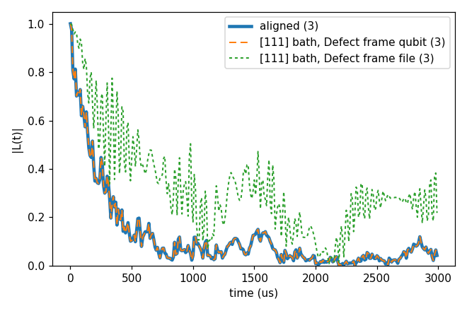

# Advanced 08: Coordinate rotation

Folder: `example/tutorial/advanced/08_coordinate_rotation/`

A bath file, the qubit positions and the position columns of a tensor file are written in the lab or crystal frame
(the file frame). CCEX builds the Hamiltonian in the computational frame, whose z is the qubit's axis, and reads
`bfield` in it. Without a rotation the two frames are the same. In a bath written in the conventional cubic cell of
diamond the NV axis points along [111], so the qubit's frame is tilted from the file frame.

The `frame.rotation` block turns the file frame onto the computational one, and it is on when it is written:

- `qubit_axis` is the qubit's axis in the file frame. CCEX turns every position about the qubit so that this
  axis becomes z.
- `bfield` is then read along `qubit_axis`, so `"bfield": 500` is 500 G along the NV axis.
- A tensor or `Defect` species written in the input says in which frame it is with its key `"frame"`, `"file"` for
  the file frame (it is turned with the positions) and `"qubit"` for the computational one. With the rotation on the
  key is required, since a tensor turned twice or not at all still looks like a tensor. Case 2 shows it.

[The coordinate frame rotation](../../../../docs/methods/coordinate-frame-rotation.md) explains what is turned and what
is not.

`bath/make_cubic_frame.py` turns a bath about its qubit so that the NV axis points along [111], as a bath written in
the cubic cell would be. It made `bath/bath_Diamond_NV_natab_cubic_1` from the ¹³C bath of Basic 01, and
`bath/bath_DiaP1_1ppm_cubic_1` from the first P1 bath of Basic 06.

In each folder run `cd <folder> && NP=4 bash run.sh`, then compare `results/coherence.png` with `expected.png`. Every key not written in an input has its default (`main.out -e`). Times are for 4 ranks of a desktop
CPU.

This page has two cases:

1. [A qubit axis tilted from the bath frame](#rot_case) (`cCCE2_Hahn_rotation/`).
2. [A Defect species when the qubit axis is tilted](#rot_defect) (`cCCE2_Hahn_rotationDefect/`).

<a id="rot_case"></a>
## 1. A qubit axis tilted from the bath frame

Folder: `cCCE2_Hahn_rotation/`

<a id="a08_rot_input"></a>
### 1.1 The input

The three inputs compute the Hahn echo of the NV of Basic 01 and differ only in the bath file and the rotation. The
first uses the bath as generated, with the NV axis along z (`ccein_aligned.jsonc`):

```jsonc
"configuration" : {"gyrofile": "../../../basic/01_first_run/bath/gyro_13C",
                   "bathfile": ["../../../basic/01_first_run/bath/bath_Diamond_NV_natab_1"]}
```

The second uses the bath with the NV axis along [111], with the rotation on (`ccein_cubic_rotated.jsonc`):

```jsonc
"configuration" : {"gyrofile": "../../../basic/01_first_run/bath/gyro_13C",
                   "bathfile": ["../bath/bath_Diamond_NV_natab_cubic_1"]},
"frame"         : {"rotation": {"qubit_axis": [1, 1, 1]}}
```

The third uses the same bath without the `frame` block (`ccein_cubic_norotation.jsonc`), so the field is
54.7° off the NV axis.

<a id="a08_rot_run"></a>
### 1.2 Running it

```sh
NP=4 bash run.sh
```

It runs the three inputs and plots them together. It takes 1.8 s and 0.05 GB per rank.

<a id="a08_rot_result"></a>
### 1.3 The result


The aligned and the rotated run give the same curve, T2 1.084 ms, within 1e-10 (the dashed line on the thick one).
Without the rotation the field is off the NV axis, T2 is 1.154 ms and the curve differs by up to 0.20.

Next, give `bfield` as a vector to tilt the field on purpose. This works without the rotation only, since with it a
transverse field is refused. Or use a bath with DFT tensors (`hamiltonian.common.hyperfine.frame`, `quadrupole.frame`).

Inputs: [`ccein_aligned.jsonc`](cCCE2_Hahn_rotation/ccein_aligned.jsonc), [`ccein_cubic_norotation.jsonc`](cCCE2_Hahn_rotation/ccein_cubic_norotation.jsonc), [`ccein_cubic_rotated.jsonc`](cCCE2_Hahn_rotation/ccein_cubic_rotated.jsonc)

<a id="rot_defect"></a>
## 2. A Defect species when the qubit axis is tilted

Folder: `cCCE2_Hahn_rotationDefect/`

<a id="a08_defect_input"></a>
### 2.1 The input

The bath is the P1 bath of [Advanced 05: Electron-spin baths further](../05_P1/README.md) in its 2e2n form, where the
`Defect` species gives the ¹⁴N of every P1 with its hyperfine and EFG tensors per axis state. These tensors are
written in the NV frame, whose z is the NV axis. The run takes one configuration and three sampled states. The three
inputs are:

- `ccein_aligned.jsonc` reads the bath as generated, with the NV axis along z, and no rotation.
- `ccein_cubic_qubit.jsonc` reads the bath turned so that the NV axis points along [111], with the rotation on. The tensors are the
  same numbers, so the species is declared in the computational frame.
- `ccein_cubic_file.jsonc` is the same with the species declared in the file frame.

The last two differ only in the key `frame` of the species:

```jsonc
"frame"  : {"rotation": {"qubit_axis": [1, 1, 1]}},
"Defect" : {"species": [{"name": "P1", "frame": "qubit", "n_onsite_spins": 1, ...}]}   // ccein_cubic_qubit.jsonc
"Defect" : {"species": [{"name": "P1", "frame": "file",  "n_onsite_spins": 1, ...}]}   // ccein_cubic_file.jsonc
```

<a id="a08_defect_run"></a>
### 2.2 Running it

```sh
NP=4 bash run.sh
```

It runs the three inputs and plots the mean of the three states of each. It takes 32 s and 0.08 GB per rank.

<a id="a08_defect_result"></a>
### 2.3 The result



With `"frame": "qubit"` the rotated run gives the aligned curve within 1.2e-9 (the dashed line on the thick one). With
`"frame": "file"` CCEX turns the tensors once more, so every ¹⁴N tensor points along the wrong axis, and the curve
differs by up to 0.55. The run gives no warning, since a turned tensor is still a valid tensor.

Next, write the qubit's zero-field splitting in `Qubit.intmap` with gCCE. With the rotation on, that tensor needs its
own `frame` too ([intmap frame](../../../../docs/user/InputFile_Qubit.md#tag_intmap_frame)).

Inputs: [`ccein_aligned.jsonc`](cCCE2_Hahn_rotationDefect/ccein_aligned.jsonc), [`ccein_cubic_qubit.jsonc`](cCCE2_Hahn_rotationDefect/ccein_cubic_qubit.jsonc), [`ccein_cubic_file.jsonc`](cCCE2_Hahn_rotationDefect/ccein_cubic_file.jsonc)
