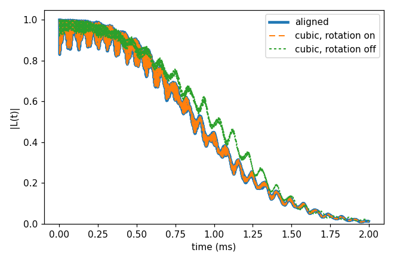

# Advanced 08: Coordinate rotation

Folder: `example/tutorial/advanced/08_coordinate_rotation/`

CCEX takes the qubit's axis as z. It builds the Hamiltonian in that frame and reads `bfield` along it. Without a
rotation this z is the z of the bath file. In a bath written in the conventional cubic cell of diamond, the NV axis
points along [111] instead.

The `frame.rotation` block rotates such a bath, and it is on when it is written:

- `qubit_axis` is the qubit's axis in the bath file's frame. CCEX turns every position about the qubit so that this
  axis becomes z.
- `bfield` is then read along `qubit_axis`, so `"bfield": 500` is 500 G along the NV axis.
- A tensor or `Defect` species written in the input says with its key `"frame"` whether it is in the bath file's frame
  or already in the turned one. This example has none.

[The coordinate frame rotation](../../../../docs/methods/coordinate-frame-rotation.md) explains what is turned and what
is not.

`bath/bath_Diamond_NV_natab_cubic_1` is the bath of Basic 01 turned so that the NV axis points along [111], as a bath
written in the cubic cell would be. `bath/make_cubic_frame.py` made it from `basic/01_first_run/bath/` and says how.

Run the case with `cd cCCE2_Hahn_rotation && NP=4 bash run.sh`, then compare `results/coherence.png` with
`expected.png`. Every key not written in an input has its default (`main.out -e`). Times are for 4 ranks of a desktop
CPU.

This page has one case:

1. [The same NV three ways](#rot_case) (`cCCE2_Hahn_rotation/`).

<a id="rot_case"></a>
## 1. The same NV three ways

Folder: `cCCE2_Hahn_rotation/`

<a id="a08_rot_input"></a>
### 1.1 The input

The three inputs compute the Hahn echo of the NV of Basic 01 and differ only in the bath file and the rotation. The
first uses the bath as generated, with the NV axis along z (`ccein_aligned.jsonc`):

```jsonc
"configuration" : {"gyrofile": "../../../basic/01_first_run/bath/gyro_13C",
                   "bathfile": ["../../../basic/01_first_run/bath/bath_Diamond_NV_natab_1"]}
```

The second uses the cubic-frame bath with the rotation on (`ccein_cubic_rotated.jsonc`):

```jsonc
"configuration" : {"gyrofile": "../../../basic/01_first_run/bath/gyro_13C",
                   "bathfile": ["../bath/bath_Diamond_NV_natab_cubic_1"]},
"frame"         : {"rotation": {"qubit_axis": [1, 1, 1]}}
```

The third uses the cubic-frame bath without the `frame` block (`ccein_cubic_norotation.jsonc`), so the field is
54.7° off the NV axis.

<a id="a08_rot_run"></a>
### 1.2 Running it

```sh
NP=4 bash run.sh
```

It runs the three inputs and plots them together. It takes 1.8 s and 0.05 GB per rank.

<a id="a08_rot_result"></a>
### 1.3 The result



The aligned and the rotated run give the same curve, T2 1.084 ms, within 1e-10 (the dashed line on the thick one).
Without the rotation the field is off the NV axis, T2 is 1.154 ms and the curve differs by up to 0.20.

Next, give `bfield` as a vector to tilt the field on purpose. This works without the rotation only, since with it a
transverse field is refused. Or use a bath with DFT tensors (`hamiltonian.common.hyperfine.frame`, `quadrupole.frame`).

Inputs: [`ccein_aligned.jsonc`](cCCE2_Hahn_rotation/ccein_aligned.jsonc), [`ccein_cubic_norotation.jsonc`](cCCE2_Hahn_rotation/ccein_cubic_norotation.jsonc), [`ccein_cubic_rotated.jsonc`](cCCE2_Hahn_rotation/ccein_cubic_rotated.jsonc)
