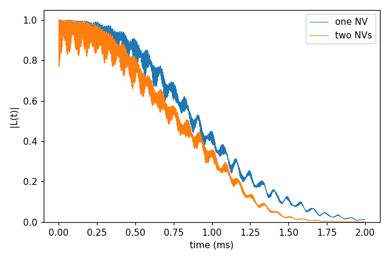
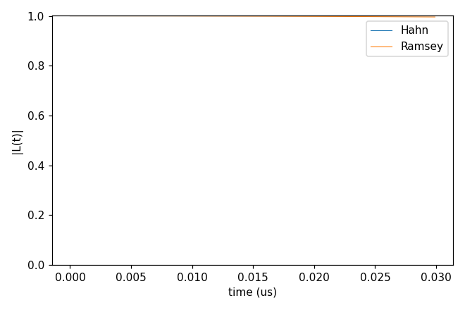
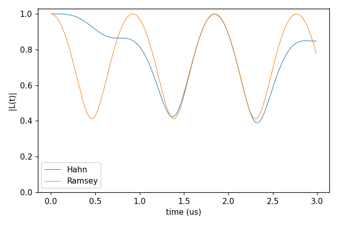

# Advanced 08: Multiple qubits

Folder: `example/tutorial/advanced/08_multi_qubits/`

A run can hold several qubits as one register, written as a list in `Qubit.qubit`, with their zero-field splittings
and couplings in `Qubit.intmap`. The examples here are NV centres in a shared ¹³C bath, computed with gCCE. Every
qubit is a spin 1 with its zero-field splitting (the `intmap` self tensors, in kHz), and the qubits couple through
their dipolar interaction from the positions.

In each folder run `cd <folder> && NP=4 bash run.sh`, then compare `results/coherence.png` with `expected.png`. Every
key not written in an input has its default (`main.out -e`). Times are for 4 ranks of a desktop CPU.

This page has three cases:

1. [One NV against two in the same bath](#mq_one_two) (`gCCE2_Hahn_oneVsTwoNV/`).
2. [The density matrix of two NVs and a ¹³C pair](#mq_nv2) (`gCCE2_HahnRamsey_NV2/`).
3. [The same with a third NV](#mq_nv3) (`gCCE2_HahnRamsey_NV3/`).

<a id="mq_one_two"></a>
## 1. One NV against two

Folder: `gCCE2_Hahn_oneVsTwoNV/`

<a id="a08_one_two_input"></a>
### 1.1 The input

Both inputs compute the Hahn echo with gCCE in the bath of Basic 01. The single NV (`ccein_single.jsonc`) takes its
position from a file (`Qubit.qubit[].file`) and has its ZFS as a `Qubit.intmap` self entry:

```jsonc
"Qubit" : {"qubit": [{"file": "../../../basic/01_first_run/bath/bath_Diamond_NV_natab_defect"}],
           "intmap": [{"between": ["q0", "q0"], "tensor": [[-960000, 0, 0], [0, -960000, 0], [0, 0, 1920000]],
                       "unit": "kHz"}]}
```

The two NVs (`ccein_multi2.jsonc`) are two entries with `xyz`, 25 Å apart along z, and one ZFS tensor each:

```jsonc
"Qubit" : {"qubit": [{"name": "qubit1", "xyz": [73.73895, 75.72808, 73.97033]},
                     {"name": "qubit2", "xyz": [73.73895, 75.72808, 98.97033]}],
           "intmap": [{"between": ["qubit1", "qubit1"], "tensor": [[-960000, 0, 0], [0, -960000, 0], [0, 0, 1920000]]},
                      {"between": ["qubit2", "qubit2"], "tensor": [[-960000, 0, 0], [0, -960000, 0], [0, 0, 1920000]]}]}
```

The coherence of the two NVs is the one between |+1,+1⟩ and |0,0⟩.

<a id="a08_one_two_run"></a>
### 1.2 Running it

```sh
NP=4 bash run.sh
```

It takes 2 min, most of it the two-NV run, and 0.07 GB per rank.

<a id="a08_one_two_result"></a>
### 1.3 The result



T2 is 1.084 ms for one NV and 0.956 ms for two.

Next, move the second NV further away (`xyz`), or choose another pair of register states with `alpha_state` and
`beta_state`.

Inputs: [`ccein_multi2.jsonc`](gCCE2_Hahn_oneVsTwoNV/ccein_multi2.jsonc), [`ccein_single.jsonc`](gCCE2_Hahn_oneVsTwoNV/ccein_single.jsonc)

<a id="mq_nv2"></a>
## 2. The density matrix of two NVs

Folder: `gCCE2_HahnRamsey_NV2/`

<a id="a08_nv2_input"></a>
### 2.1 The input

Two NVs 50 Å apart sit beside a pair of ¹³C near the first. The run writes the 2-qubit density matrix
(`quantity` dm) for the bath state in the file `state1`, for the Hahn echo (`ccein_hahn.jsonc`) and for Ramsey
(`ccein_ramsey.jsonc`, `pulse.count` 0), over 30 ns:

```jsonc
"method"        : "gCCE",
"quantity"      : "dm",
"configuration" : {"gyrofile": "gyro_13C", "bathfile": ["bath"], "bath_state_file": ["state"], "s_range": [1, 1]},
"rbath"         : 10000,
"rdip"          : 50000,
"deltat"        : 1e-07,
"nstep"         : 300,
"pulse"         : {"count": 1}
```

`rbath` and `rdip` are large enough to take every spin, and `deltat` 0.1 ns × `nstep` 300 is the 30 ns window. The
`Qubit` block holds the two entries `q1` and `q2` and their `intmap` self tensors. The bath, gyro and state files of
this folder are written by hand, and `bath` holds a count line, then x y z name.

<a id="a08_nv2_run"></a>
### 2.2 Running it

```sh
NP=4 bash run.sh
```

It takes under 1 s and 0.05 GB per rank.

<a id="a08_nv2_result"></a>
### 2.3 The result



The plot shows ρ between |+1,+1⟩ and |0,0⟩ divided by its value at t = 0. |L| is 1.000 for the Hahn echo and 0.996
for Ramsey at 30 ns.

Next, try a longer window (`deltat`), or order 1 to see what the pair cluster adds.

Inputs: [`ccein_hahn.jsonc`](gCCE2_HahnRamsey_NV2/ccein_hahn.jsonc), [`ccein_ramsey.jsonc`](gCCE2_HahnRamsey_NV2/ccein_ramsey.jsonc)

<a id="mq_nv3"></a>
## 3. Three NVs

Folder: `gCCE2_HahnRamsey_NV3/`

<a id="a08_nv3_input"></a>
### 3.1 The input

It is the calculation of `gCCE2_HahnRamsey_NV2` with a third NV, on a window 100 times longer. The run reads the
bath, gyro and state files of `../gCCE2_HahnRamsey_NV2/`. The third entry and its zero-field splitting are added, and
the step is 10 ns:

```jsonc
"qubit"  : [{"name": "q1", "xyz": [75.663, 74.2628, 74.1348]},
            {"name": "q2", "xyz": [75.663, 74.2628, 124.1348]},
            {"name": "q3", "xyz": [75.663, 124.2628, 74.1348]}],
"intmap" : [{"between": ["q1", "q1"], "tensor": [[-960000, 0, 0], [0, -960000, 0], [0, 0, 1920000]]},
            {"between": ["q2", "q2"], "tensor": [[-960000, 0, 0], [0, -960000, 0], [0, 0, 1920000]]},
            {"between": ["q3", "q3"], "tensor": [[-960000, 0, 0], [0, -960000, 0], [0, 0, 1920000]]}],
"deltat" : 1e-05,
"nstep"  : 300
```

The register has dimension 3³ = 27, and with the two ¹³C the clusters have dimension 108.

<a id="a08_nv3_run"></a>
### 3.2 Running it

```sh
NP=4 bash run.sh
```

It takes 1.2 s and writes 30 MB of output, since each file holds nstep × 27² complex numbers.

<a id="a08_nv3_result"></a>
### 3.3 The result



The qubits' dipolar coupling (50 Å apart) makes L oscillate. The Ramsey curve falls to 0.41 at 0.46 µs and comes back
to 1.0 at 0.92 µs, about three periods in the window. The Hahn echo removes the first oscillation and then follows it,
ending at 0.85.

Next, add a fourth qubit, with one more `qubit` and `intmap` entry. The qubit space grows threefold with every NV,
and the output ninefold.

Inputs: [`ccein_hahn.jsonc`](gCCE2_HahnRamsey_NV3/ccein_hahn.jsonc), [`ccein_ramsey.jsonc`](gCCE2_HahnRamsey_NV3/ccein_ramsey.jsonc)
