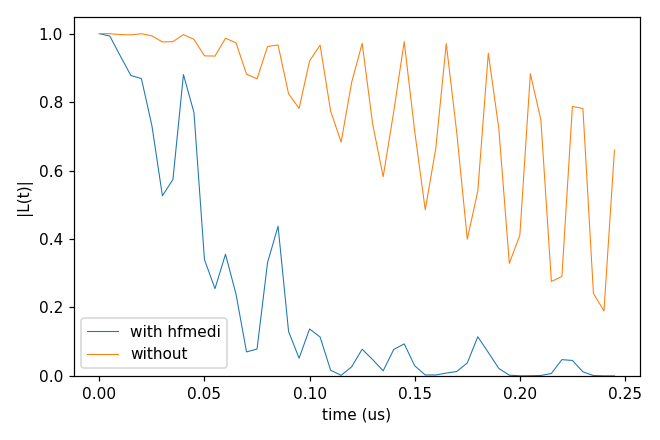
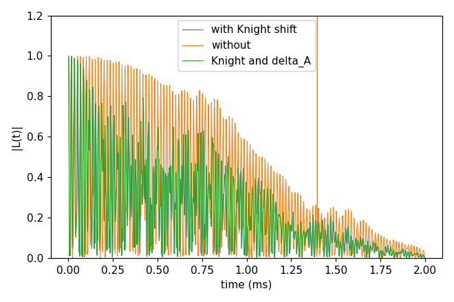

# Advanced 09: Corrections to cCCE

Folder: `example/tutorial/advanced/09_cCCE_corrections/`

cCCE projects the qubit onto its two states and keeps only the $S_z$ part of the hyperfine coupling. The keys of
`hamiltonian.cCCE` add back second-order pieces of the rest, for a spin-1 qubit with a zero-field splitting. The two
examples are the hyperfine-mediated coupling of two nuclei through the defect (`hfmedi`, on the h-BN bath of
[Advanced 06: V_B⁻ in h-BN with DFT tensors](../06_hBN/README.md)) and the Knight shift in a tilted field (`knight`), with the
second-order term `delta_A` added in the same case. How they are derived is in
[cCCE and gCCE](../../../../docs/methods/cce.md#cce_corrections), and gCCE is their exact reference
([Basic 05: cCCE against gCCE](../../basic/05_cCCE_vs_gCCE/README.md)).

In each folder run `cd <folder> && NP=4 bash run.sh`, then compare `results/coherence.png` with `expected.png`. Every
key not written in an input has its default (`main.out -e`). Times are for 4 ranks of a desktop CPU.

This page has two cases:

1. [The hyperfine-mediated coupling](#corr_hfmedi) (`cCCE2_Hahn_hfMediated/`).
2. [The Knight shift in a tilted field](#corr_knight) (`cCCE2_Hahn_knightShift/`).

<a id="corr_hfmedi"></a>
## 1. The hyperfine-mediated coupling

Folder: `cCCE2_Hahn_hfMediated/`

<a id="a09_hfmedi_input"></a>
### 1.1 The input

The run is the V_B⁻ of Advanced 06 at 1000 G with its zero-field splitting, one configuration and the ensemble.
`ccein_wi_hfmedi.jsonc` turns the hyperfine-mediated bath-bath coupling on, and `ccein_wo_hfmedi.jsonc` is the same
without it. Pairs of nuclei couple through the defect's transverse hyperfine:

```jsonc
"Qubit"       : {"qubit": [{"file": "../../06_hBN/bath/flat/bath_hBN_VB_flat_Defect"}],
                 "intmap": [{"between": ["q0", "q0"], "tensor": [[-1080000, 0, 0], [0, -1180000, 0], [0, 0, 2320000]],
                             "unit": "kHz"}]},
"bfield"      : 1000,
"rbath"       : 14,
"rdip"        : 8,
"deltat"      : 5e-06,
"nstep"       : 50,
"hamiltonian" : {"common": {...the DFT hyperfine and quadrupole files of Advanced 06...},
                 "cCCE": {"hfmedi": true}}
```

The ZFS is a `Qubit.intmap` self entry in kHz, and `deltat` 5 ns × `nstep` 50 is the window.

<a id="a09_hfmedi_run"></a>
### 1.2 Running it

```sh
NP=4 bash run.sh
```

It takes 1.2 s and 0.05 GB per rank.

<a id="a09_hfmedi_result"></a>
### 1.3 The result



T2 is 86 ns with the term. Without it |L| is still 0.66 at 245 ns.

Next, try a higher `bfield`, since the term falls off with the field.

Inputs: [`ccein_wi_hfmedi.jsonc`](cCCE2_Hahn_hfMediated/ccein_wi_hfmedi.jsonc), [`ccein_wo_hfmedi.jsonc`](cCCE2_Hahn_hfMediated/ccein_wo_hfmedi.jsonc)

<a id="corr_knight"></a>
## 2. The Knight shift

Folder: `cCCE2_Hahn_knightShift/`

<a id="a09_knight_input"></a>
### 2.1 The input

In a field tilted from the NV axis ([50, 0, 100] G), the part of the field across the NV axis shifts the ¹³C
precession through the qubit (the Knight shift). The NV of Basic 01 has its ZFS as a `Qubit.intmap` self entry, and
the three inputs differ only in `hamiltonian.cCCE`:

```jsonc
"bfield"      : [50, 0, 100],
"hamiltonian" : {"cCCE": {"knight": true}}                     // ccein_wi_knight.jsonc
"hamiltonian" : {"cCCE": {"knight": true, "delta_A": true}}    // ccein_wi_knight_deltaA.jsonc
```

`ccein_wo_knight.jsonc` has no `hamiltonian` block. `delta_A` is the second-order term of the nuclei close to the NV.

<a id="a09_knight_run"></a>
### 2.2 Running it

```sh
NP=4 bash run.sh
```

It takes 1.2 s and 0.05 GB per rank.

<a id="a09_knight_result"></a>
### 2.3 The result



T2 is 1.082 ms with the Knight shift. Without it the divided curve (`_wiDiv`) diverges, with |L| up to 16 (cut at 1.2
in the plot). The analyzer's error correction (`example/analysis/Analyzer`, `-err`) repairs such curves against
`_noDiv`. With `delta_A` as well T2 stays 1.082 ms, and the curve moves by at most 0.011.

Next, run the same input with `method` gCCE and without `hamiltonian.cCCE`, the exact reference.

Inputs: [`ccein_wi_knight.jsonc`](cCCE2_Hahn_knightShift/ccein_wi_knight.jsonc), [`ccein_wo_knight.jsonc`](cCCE2_Hahn_knightShift/ccein_wo_knight.jsonc), [`ccein_wi_knight_deltaA.jsonc`](cCCE2_Hahn_knightShift/ccein_wi_knight_deltaA.jsonc)
