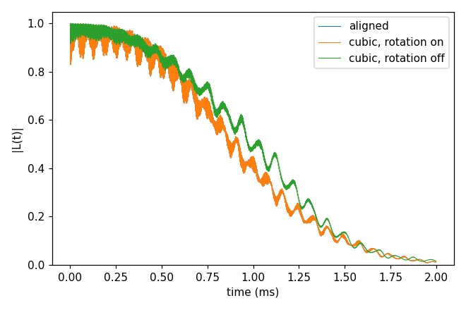

# Advanced 09: Coordinate rotation

Folder: `example/tutorial/advanced/09_coordinate_rotation/`

CCEX builds the Hamiltonian in a frame whose z is the qubit's axis, and reads `bfield` in that frame. Without a
rotation that frame is the bath file's own, so a bath written in a frame where the defect axis is not z has to be
turned, by hand or with the `frame.rotation` block. The block turns every position about the qubit so that
`qubit_axis` (written in the bath file's frame) becomes z, and `"bfield": 500` is then 500 G along `qubit_axis` in the
lab. The block is on when it is written.

Tensors and Defect species written in the input say with the key `"frame"`
whether they are in the bath file's frame (`"file"`, turned with the positions) or already in the turned one
(`"qubit"`). This example has none, since the NV's zero-field splitting is not in the input.
[The coordinate frame rotation](../../../../docs/methods/coordinate-frame-rotation.md) explains what moves and what
does not. Every key not written in an input has its default (`main.out -e`). Times are for 4 ranks of a desktop CPU.

`bath/bath_Diamond_NV_natab_cubic_1` is the bath of Basic 01 turned so that the NV axis points along [111], as a bath
written in the conventional cubic cell would be. `bath/make_cubic_frame.py` made it from `basic/01_first_run/bath/`
and says how.

This page has one case:

1. [The same NV three ways](#rot_case) (`cCCE2_Hahn_rotation/`).

<a id="rot_case"></a>
## 1. The same NV three ways

Folder: `cCCE2_Hahn_rotation/`

<a id="a09_rot_input"></a>
### 1.1 The input

The three inputs compute the Hahn echo of the NV of Basic 01 and differ only in the bath file and the rotation. The
first uses the bath as generated, with the NV axis along z (`ccein_aligned.jsonc`):

```jsonc
"configuration" : {"gyrofile": "../../../basic/01_first_run/bath/gyro_13C",
                   "bathfile": ["../../../basic/01_first_run/bath/bath_Diamond_NV_natab_1"]}
```

The second uses the cubic-frame bath with the rotation on (`ccein_cubic_rotated.jsonc`):

```jsonc
"configuration" : {"gyrofile": "../../../basic/01_first_run/bath/gyro_13C",
                   "bathfile": ["../bath/bath_Diamond_NV_natab_cubic_1"]},
"frame"         : {"rotation": {"qubit_axis": [1, 1, 1]}}
```

The third uses the cubic-frame bath without the `frame` block (`ccein_cubic_norotation.jsonc`), so the field is
54.7° off the NV axis.

<a id="a09_rot_run"></a>
### 1.2 Running it

```sh
cd cCCE2_Hahn_rotation && NP=4 bash run.sh
```

It takes 1.8 s and 0.05 GB per rank.

<a id="a09_rot_result"></a>
### 1.3 The result



The rotated run reproduces the aligned one, with a largest difference of 1e-10 and T2 1.084 ms. Without the rotation
T2 is 1.154 ms and the curve differs by up to 0.20.

Next, give `bfield` as a vector to tilt the field on purpose, without the rotation (with it a transverse field is
refused), or use a bath with DFT tensors (`hamiltonian.common.hyperfine.frame`, `quadrupole.frame`).

Inputs: [`ccein_aligned.jsonc`](cCCE2_Hahn_rotation/ccein_aligned.jsonc), [`ccein_cubic_norotation.jsonc`](cCCE2_Hahn_rotation/ccein_cubic_norotation.jsonc), [`ccein_cubic_rotated.jsonc`](cCCE2_Hahn_rotation/ccein_cubic_rotated.jsonc)
