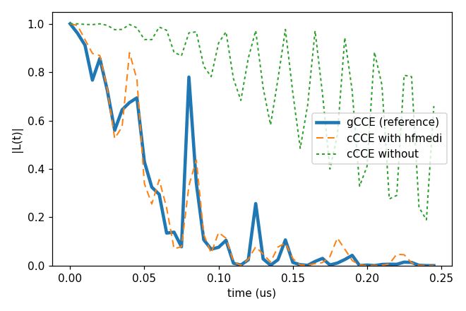
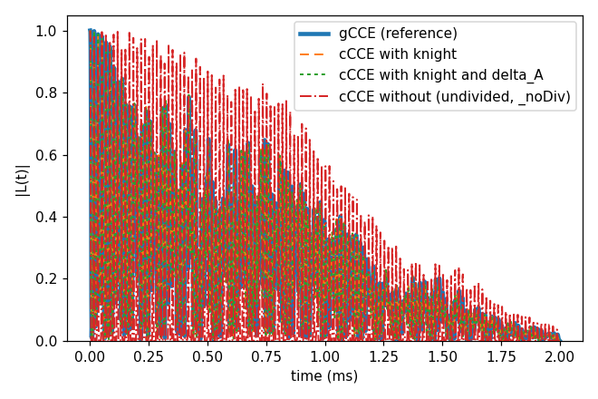
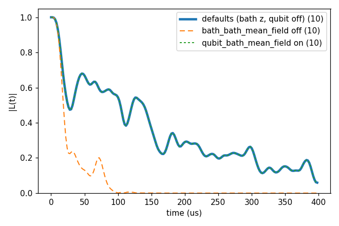

# Advanced 09: The terms of the cluster Hamiltonian

Folder: `example/tutorial/advanced/09_hamiltonian_terms/`

gCCE keeps the qubit in every cluster's Hamiltonian,

$$H_C = H_q + H_{\rm bath} + \sum_{n \in C} \mathbf{S}\cdot\mathsf{A}_n\cdot\mathbf{I}_n ,$$

with $H_q$ the qubit's Zeeman term and zero-field splitting and $\mathsf{A}_n$ the hyperfine tensor of bath spin $n$.
Its cluster Hamiltonian is complete, so it is the reference for cCCE
([Basic 05: cCCE against gCCE](../../basic/05_cCCE_vs_gCCE/README.md)). cCCE puts the qubit in one of its two states, $k \in \{\alpha, \beta\}$ with $S_z$ sublevel $m_k$, and solves only the bath in that state:

$$H_C^{(k)} = H_{\rm bath} + m_k \sum_{n \in C} \mathbf{A}_{z,n}\cdot\mathbf{I}_n ,$$

with $\mathbf{A}_{z,n}$ the z row of $\mathsf{A}_n$. This is fast, but it drops the transverse part
$S_x\,\mathbf{A}_x\cdot\mathbf{I} + S_y\,\mathbf{A}_y\cdot\mathbf{I}$ of the hyperfine coupling, which changes $m_s$
and acts at second order through virtual qubit transitions. For a spin-1 qubit with the zero-field splitting
$\Delta = \tfrac32 D_{zz}$, the keys of `hamiltonian.cCCE` add three pieces of it back to $H_C^{(k)}$:

| Key | Adds to $H_C^{(k)}$ | Where it matters |
|---|---|---|
| `knight` | The Knight shift by the field across the qubit axis, $-(3\lvert m_k\rvert - 2)(\gamma_q/\Delta)\,\mathbf{B}\cdot\tilde{\mathsf{A}}_n\cdot\mathbf{I}_n$, with $\tilde{\mathsf{A}}_n$ the tensor without its z row and $\lvert m_k\rvert$ taken as $\langle S_z^2\rangle$ of the qubit eigenstate closest to the branch state (1 for ms ±1 and 0 for ms 0 in a field along the axis). | A tilted field. |
| `delta_A` | The second-order term of each nucleus on its own, $\delta\mathbf{A}_n\cdot\mathbf{I}_n$ with $\delta\mathbf{A}_n = -m_k(\mathbf{A}_{x,n}\times\mathbf{A}_{y,n})/(2\Delta)$. | Close nuclei at low field. |
| `hfmedi` | The whole second order, $\sum_{b\neq a} E_{ab}E_{ba}/(\omega_a-\omega_b)$, with $a$ the eigenstate of the qubit Hamiltonian closest to the branch state, $b$ every other eigenstate and $E_{ab} = \sum_n \langle a\rvert\mathbf{S}\lvert b\rangle\cdot\mathsf{A}_n\cdot\mathbf{I}_n$. Its terms with two nuclei are their coupling through the qubit, and those with one nucleus are the terms of `delta_A`. | Close nuclei at low field. |

`knight` and `delta_A` divide by $\Delta$ and are refused without a zero-field splitting, and `delta_A` is refused
with `hfmedi`, which already holds it. How they are derived is in
[cCCE and gCCE](../../../../docs/methods/cce.md#cce_corrections). Each case below compares cCCE with and without the
key against gCCE.

In each folder run `cd <folder> && NP=4 bash run.sh`, then compare `results/coherence.png` with `expected.png`. In the legends, a number in brackets is the number of curves averaged. Every
key not written in an input has its default (`main.out -e`). Times are for 4 ranks of a desktop CPU.

This page has two sections:

1. [The corrections to cCCE, against gCCE](#corr_cases), with two cases:
   [the hyperfine-mediated coupling](#corr_hfmedi) (`cCCE2_Hahn_hfMediated/`) and
   [the Knight shift in a tilted field](#corr_knight) (`cCCE2_Hahn_knightShift/`).
2. [The mean fields of the spins outside a cluster](#corr_meanfield) (`gCCE2_Hahn_meanField/`), the other terms the cluster
   Hamiltonian can hold.

<a id="corr_cases"></a>
## 1. The corrections to cCCE, against gCCE

<a id="corr_hfmedi"></a>
### 1.1 The hyperfine-mediated coupling

Folder: `cCCE2_Hahn_hfMediated/`

<a id="a09_hfmedi_input"></a>
#### 1.1.1 The input

Two nuclei that both couple to the qubit can exchange a flip through a virtual transition of the qubit. cCCE leaves
this coupling out, and `hfmedi` adds it. The run is the V_B⁻ of Advanced 06 at 1000 G with its zero-field splitting,
one configuration and the ensemble.
`ccein_wi_hfmedi.jsonc` turns the hyperfine-mediated coupling on, `ccein_wo_hfmedi.jsonc` is the same without it,
and `ccein_gcce.jsonc` is the same with `method` gCCE, the reference:

```jsonc
"Qubit"       : {"qubit": [{"file": "../../06_hBN/bath/flat/bath_hBN_VB_flat_Defect"}],
                 "intmap": [{"between": ["q0", "q0"], "tensor": [[-1080000, 0, 0], [0, -1180000, 0], [0, 0, 2320000]],
                             "unit": "kHz"}]},
"bfield"      : 1000,
"rbath"       : 14,
"rdip"        : 8,
"deltat"      : 5e-06,
"nstep"       : 50,
"hamiltonian" : {"common": {...the DFT hyperfine and quadrupole files of Advanced 06...},
                 "cCCE": {"hfmedi": true}}
```

The ZFS is a `Qubit.intmap` self entry in kHz, and `deltat` 5 ns × `nstep` 50 is the window.

<a id="a09_hfmedi_run"></a>
#### 1.1.2 Running it

```sh
NP=4 bash run.sh
```

It runs the three inputs and plots them together. It takes 13 s, most of it gCCE, and 0.09 GB per rank.

<a id="a09_hfmedi_result"></a>
#### 1.1.3 The result



| Run | T2 |
|---|---|
| gCCE (reference) | 84.7 ns |
| cCCE with `hfmedi` | 86.1 ns |
| cCCE without | \|L\| is still 0.66 at 245 ns |

With the term cCCE decays as gCCE does, although the two curves still differ by up to 0.45 at single points.

Next, try a smaller `deltat`, or a higher `bfield`, where the term matters less.

Inputs: [`ccein_gcce.jsonc`](cCCE2_Hahn_hfMediated/ccein_gcce.jsonc), [`ccein_wi_hfmedi.jsonc`](cCCE2_Hahn_hfMediated/ccein_wi_hfmedi.jsonc), [`ccein_wo_hfmedi.jsonc`](cCCE2_Hahn_hfMediated/ccein_wo_hfmedi.jsonc)

<a id="corr_knight"></a>
### 1.2 The Knight shift in a tilted field

Folder: `cCCE2_Hahn_knightShift/`

<a id="a09_knight_input"></a>
#### 1.2.1 The input

In a field tilted from the NV axis ([50, 0, 100] G), the part of the field across the NV axis shifts the ¹³C
precession through the qubit (the Knight shift). The NV of Basic 01 has its ZFS as a `Qubit.intmap` self entry, and
the three cCCE inputs differ only in `hamiltonian.cCCE`:

```jsonc
"bfield"      : [50, 0, 100],
"hamiltonian" : {"cCCE": {"knight": true}}                     // ccein_wi_knight.jsonc
"hamiltonian" : {"cCCE": {"knight": true, "delta_A": true}}    // ccein_wi_knight_deltaA.jsonc
```

`ccein_wo_knight.jsonc` has no `hamiltonian` block. `ccein_gcce.jsonc` is the reference with `method` gCCE. In a tilted
field `"ms"` +1 and 0 are not eigenstates of the NV, and gCCE with them diverges, so the reference gives the states as
eigenstates of the qubit Hamiltonian ([alpha_state](../../../../docs/user/InputFile_Qubit.md#tag_alpha_state)):

```jsonc
"method" : "gCCE",
"Qubit"  : {"alpha_state": {"index": 0}, "beta_state": {"index": 2}, ...}
```

The index counts by descending energy, so 0 and 2 are the levels of ms +1 and 0 in this field.

<a id="a09_knight_run"></a>
#### 1.2.2 Running it

```sh
NP=4 bash run.sh
```

It runs the four inputs and plots them together. It takes 8 s and 0.09 GB per rank.

<a id="a09_knight_result"></a>
#### 1.2.3 The result



| Run | T2 |
|---|---|
| gCCE (reference) | 1.082 ms |
| cCCE with `knight` | 1.082 ms |
| cCCE with `knight` and `delta_A` | 1.082 ms |
| cCCE without | 1.219 ms from the undivided curve (`_noDiv`). The divided curve (`_wiDiv`) jumps to \|L\| 15.7 at one point, 1.396 ms. |

The divided curve is the CCE product, in which each cluster is divided by its sub-clusters. Where a sub-cluster's
coherence is near zero the division can jump ([wiDiv, noDiv](../../../../docs/methods/cce.md#cce_divergence)), so the
plot shows the undivided curve of the run without the term. With the Knight shift cCCE has the T2 of gCCE, and the
curves still differ by up to 0.17 in the fast ¹³C oscillation. `delta_A` moves the curve by at most 0.011 here.

Next, lower `bfield`, where `delta_A` matters more.

Inputs: [`ccein_gcce.jsonc`](cCCE2_Hahn_knightShift/ccein_gcce.jsonc), [`ccein_wi_knight.jsonc`](cCCE2_Hahn_knightShift/ccein_wi_knight.jsonc), [`ccein_wo_knight.jsonc`](cCCE2_Hahn_knightShift/ccein_wo_knight.jsonc), [`ccein_wi_knight_deltaA.jsonc`](cCCE2_Hahn_knightShift/ccein_wi_knight_deltaA.jsonc)

<a id="corr_meanfield"></a>
## 2. The mean fields of the spins outside a cluster

Folder: `gCCE2_Hahn_meanField/`

<a id="a09_meanfield_input"></a>
### 2.1 The input

With sampled bath states (`s_range`), every bath spin outside a cluster sits in a fixed sublevel, and its static field
still acts on the cluster. Two keys of `hamiltonian.common` add that field as a mean field
([mean fields](../../../../docs/user/InputFile_General.md#gen_mf)). In the ensemble neither is used.

| Key | Adds the field of the outside spins $j$, in their sublevels $m_j$, to | Methods | Default |
|---|---|---|---|
| `bath_bath_mean_field` | The bath spins of the cluster, $\sum_{j \notin C} J^{zz}_{nj}\, m_j\, I_{z,n}$ (`"z"`), or the whole vector $\mathsf{J}_{nj}(0,0,m_j)$ (`"xyz"`). | Every method. | `"z"` |
| `qubit_bath_mean_field` | The qubit, the Overhauser field $\sum_{j \notin C} A_{zz,j}\, m_j\, S_z$. | gCCE and megCCE. | `false` |

The run is the NV in the 1 ppm P1 bath of
[Advanced 05: Electron-spin baths further](../05_P1/README.md) (`gCCE2_Hahn_DEER/ccein_nopump.jsonc`), gCCE2 Hahn echo
with ten sampled states. gCCE is needed for `qubit_bath_mean_field`, which acts on the qubit. The three inputs write
both keys and differ only in them:

```jsonc
"hamiltonian" : {"common": {"bath_bath_mean_field": "z",   "qubit_bath_mean_field": false}}   // ccein_default.jsonc
"hamiltonian" : {"common": {"bath_bath_mean_field": "off", "qubit_bath_mean_field": false}}   // ccein_bath_off.jsonc
"hamiltonian" : {"common": {"bath_bath_mean_field": "z",   "qubit_bath_mean_field": true}}    // ccein_qubit_on.jsonc
```

`ccein_default.jsonc` writes the defaults, so it gives the curve of an input without the block.

<a id="a09_meanfield_run"></a>
### 2.2 Running it

```sh
NP=4 bash run.sh
```

It runs the three inputs and plots the mean of the ten states of each. It takes 14 s and 0.09 GB per rank.

<a id="a09_meanfield_result"></a>
### 2.3 The result



| Input | T2 |
|---|---|
| Defaults (`bath_bath_mean_field` `"z"`, `qubit_bath_mean_field` false) | 149.9 µs |
| `bath_bath_mean_field` `"off"` | 20.9 µs |
| `qubit_bath_mean_field` true | 149.9 µs, within 1.3e-4 of the defaults |

Without the field on the bath spins the P1 pairs flip-flop freely and the echo decays seven times faster. The field
on the qubit changes the curve by at most 1.3e-4 here, and the dotted line lies on the thick one.

Next, try `bath_bath_mean_field` `"xyz"`, which adds the whole field vector.
[Basic 06: An electron-spin bath (P1)](../../basic/06_defect_bath/README.md) compares `"z"`, `"xyz"` and `"off"` with
cCCE.

Inputs: [`ccein_default.jsonc`](gCCE2_Hahn_meanField/ccein_default.jsonc), [`ccein_bath_off.jsonc`](gCCE2_Hahn_meanField/ccein_bath_off.jsonc), [`ccein_qubit_on.jsonc`](gCCE2_Hahn_meanField/ccein_qubit_on.jsonc)
