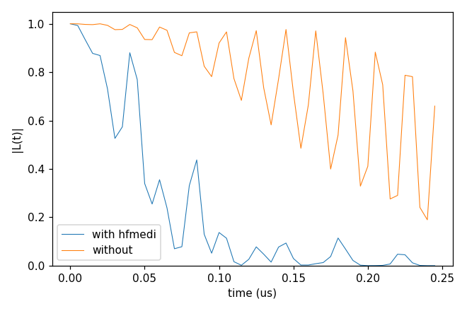
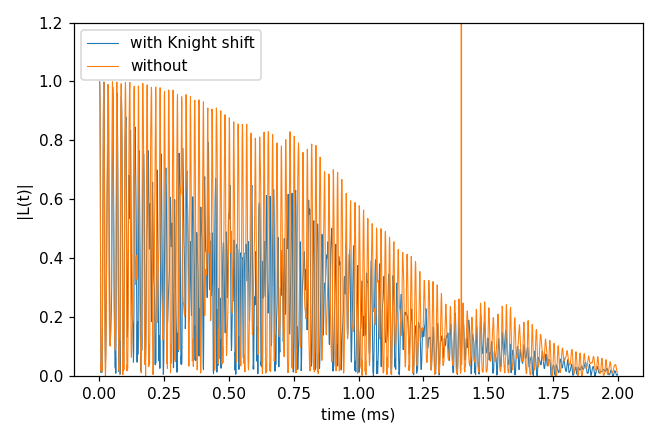

# Advanced 10: Corrections to cCCE

Folder: `example/tutorial/advanced/10_cCCE_corrections/`

cCCE projects the qubit onto its two states and keeps only the $S_z$ part of the hyperfine coupling. The keys of
`hamiltonian.cCCE` add back second-order pieces of the rest, for a spin-1 qubit with a zero-field splitting. The two
examples are the hyperfine-mediated coupling of two nuclei through the defect (`hfmedi`, on the h-BN bath of
[Advanced 06: V_B⁻ in hexagonal BN](../06_hBN/README.md)) and the Knight shift in a tilted field (`knight`), with the second-order term `delta_A` added in the
same case. How they
are made is in [cCCE and gCCE](../../../../docs/methods/cce.md#cce_corrections), and gCCE is their exact reference
([Basic 05: cCCE against gCCE](../../basic/05_cCCE_vs_gCCE/README.md)).

In each folder run `cd <folder> && NP=4 bash run.sh`, then compare `results/coherence.png` with `expected.png`. Every
key not written in an input has its default (`main.out -e`). Times are for 4 ranks of a desktop CPU.

1. [The hyperfine-mediated coupling](#corr_hfmedi) (`cCCE2_Hahn_hfMediated/`).
2. [The Knight shift in a tilted field](#corr_knight) (`cCCE2_Hahn_knightShift/`).

## 1. The hyperfine-mediated coupling

Folder: `cCCE2_Hahn_hfMediated/`

- **What it shows:** the hyperfine-mediated bath-bath coupling (`hamiltonian.cCCE.hfmedi`) at 1000 G with the V_B⁻
  zero-field splitting. Pairs of nuclei couple through the defect's transverse hyperfine. The run uses one
  configuration and the ensemble.
- **Keys that matter:** `hamiltonian.cCCE.hfmedi` true or absent, the ZFS as a `Qubit.intmap` self entry (kHz),
  `bfield` 1000, `rbath` 14 Å, `rdip` 8 Å, and `deltat` 5 ns × `nstep` 50.
- **How to run:** `NP=4 bash run.sh`. It takes 1.2 s and 0.05 GB per rank.
- **Expected result:** `expected.png`. T2 is 86 ns with the term. Without it |L| is still 0.66 at 245 ns.
- **What to change next:** a higher `bfield`, since the term falls off with the field.

Inputs: [`ccein_wi_hfmedi.jsonc`](cCCE2_Hahn_hfMediated/ccein_wi_hfmedi.jsonc), [`ccein_wo_hfmedi.jsonc`](cCCE2_Hahn_hfMediated/ccein_wo_hfmedi.jsonc)

## 2. The Knight shift

Folder: `cCCE2_Hahn_knightShift/`

- **What it shows:** in a field tilted from the NV axis ([50, 0, 100] G), the part of the field across the NV axis
  shifts the ¹³C precession through the qubit (the Knight shift). `hamiltonian.cCCE.knight` adds that shift to cCCE (`ccein_wi_knight.jsonc`), compared with a run
  without it (`ccein_wo_knight.jsonc`). `ccein_wi_knight_deltaA.jsonc` adds `delta_A` as well, the second-order term of the
  nuclei close to the NV.
- **Keys that matter:** `hamiltonian.cCCE.knight` true and `delta_A` true, `bfield` [50, 0, 100], and the ZFS
  (`Qubit.intmap` self entry).
- **How to run:** `NP=4 bash run.sh`. It takes 1.2 s and 0.05 GB per rank.
- **Expected result:** `expected.png`. T2 is 1.082 ms with the Knight shift. Without it the divided curve (`_wiDiv`)
  diverges, with |L| up to 16 (cut at 1.2 in the plot). The analyzer's error correction (`example/analysis/Analyzer`,
  `-err`) repairs such curves against `_noDiv`. With `delta_A` as well T2 stays 1.082 ms, and the curve moves by
  at most 0.011.
- **What to change next:** the same input with `method` gCCE and without `hamiltonian.cCCE`, the exact reference.

Inputs: [`ccein_wi_knight.jsonc`](cCCE2_Hahn_knightShift/ccein_wi_knight.jsonc), [`ccein_wo_knight.jsonc`](cCCE2_Hahn_knightShift/ccein_wo_knight.jsonc)
