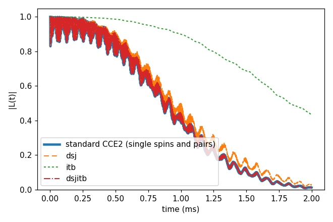
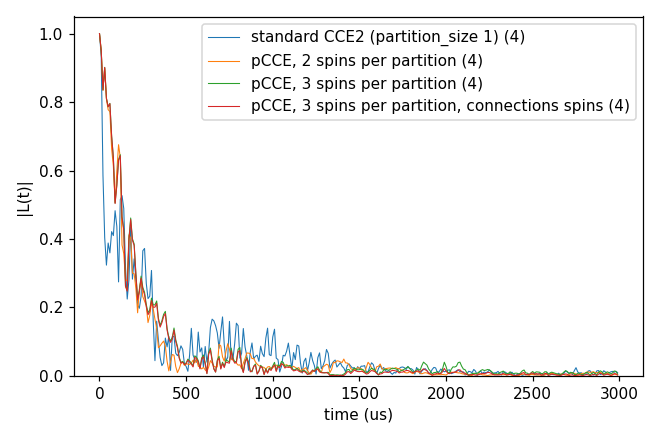
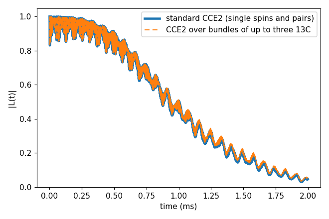
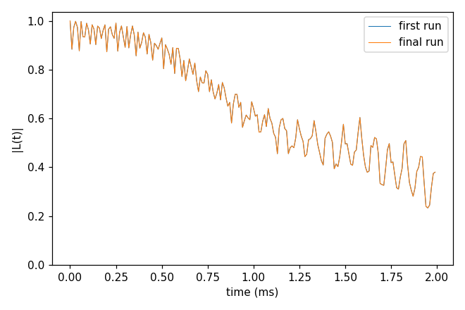
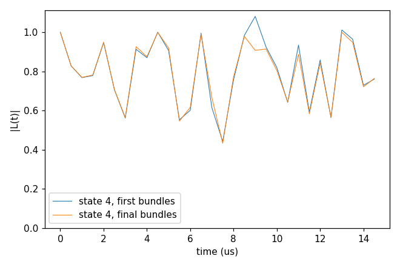

# Advanced 10: The cluster modes (dsj, pCCE, bundles) and adaptive refinement

Folder: `example/tutorial/advanced/10_cluster_modes/`

At order 2, CCE computes every bath spin and every pair of spins within `rdip` on its own. Three spins that couple
strongly to each other are then seen only as pairs, and computing them together needs order 3, with all the clusters
of three spins in the bath. The modes of `cluster.mode` put strongly coupled spins into one unit first and compute
that unit exactly. pCCE and bundles then run the expansion over these units, so the order need not grow:

- **dsj** (cCCE only) splits the bath into disjoint groups of at most `order` spins, joining the most strongly coupled
  pairs first, and computes each group as one cluster. It leaves out the couplings between groups and needs fewer
  clusters than the standard expansion (541 against 4314 in case 1).
- **pCCE** cuts the bath into partitions of `partition_size` spins close in space (k-means on the positions) and runs
  the expansion over partitions. A partition enters a cluster whole, so order 2 means pairs of partitions.
- **Bundles** join strongly coupled spins into bundles, from the coupling strengths and up to the dimension
  `cluster.bundle.max_dim`, and run the expansion over bundles. `order` counts bundles.

The `cluster.adaptive` block then changes the bundles from the results. It repeats the bundled calculation, changes
the bundles where they do badly, and runs again ([Cluster tags](../../../../docs/user/InputFile_Cluster.md#tag_adaptive)).
It has two policies, case 4 and case 5:

| | Merge (the default, case 4) | Regroup (`"regroup": true`, case 5) |
|---|---|---|
| What it looks for | A large error at the bundle boundaries. A few neighbouring bundles are computed exactly as one cluster and compared with the expansion over them. | An unphysical curve, with \|L\| > 1. At the worst point it finds the bundle pairs that cause the excess. |
| What it changes | It merges two bundles. | It merges, splits, moves or exchanges sites around those pairs. |
| When it stops | Every patch passes, no merge helps, or `max_rounds` is reached. | Every state and time point has \|L\| ≤ 1.01. |
| What it needs | Bundles. | cCCE, `order` 2 and the links by distance (`rdip`). |

The cluster reports (the contribution of each cluster, the plan) are in
[Advanced 02: Analysis of the output](../02_analysis/README.md).

In each folder run `cd <folder> && NP=4 bash run.sh`, then compare `results/coherence.png` with `expected.png`. In the legends, a number in brackets is the number of curves averaged. Every
key not written in an input has its default (`main.out -e`). Times are for 4 ranks of a desktop CPU.

This page has five cases:

1. [Disjoint groups, the pairs between them, and both, against the standard pairs](#cs_dsj) (`cCCE2_Hahn_dsj/`).
2. [Partitions of 1, 2 and 3 P1](#cs_pcce) (`pCCE2_Hahn_states/`).
3. [Bundles of up to three ¹³C](#cs_bundle) (`cCCE2_Hahn_bundle/`).
4. [Refining the bundles where the error is large (merge)](#cs_adaptive) (`cCCE2_Hahn_adaptive/`).
5. [Refining the bundles where |L| > 1 (regroup)](#cs_regroup) (`cCCE2_Hahn_regroup/`).

<a id="cs_dsj"></a>
## 1. Disjoint groups

Folder: `cCCE2_Hahn_dsj/`

<a id="a10_dsj_input"></a>
### 1.1 The input

The system is the NV of Basic 01 with `rbath` 50 Å and `rdip` 10 Å. The four inputs differ only in `cluster.mode`:

```jsonc
"cluster" : {"mode": "dsj"}       // ccein.jsonc
"cluster" : {"mode": "itb"}       // ccein_itb.jsonc
"cluster" : {"mode": "dsjitb"}    // ccein_dsjitb.jsonc
                                  // ccein_standard.jsonc has no cluster block, the standard pairs
```

The three modes start from the same groups. The pairs of spins within `rdip` are taken from the strongest
$\lvert J_{zz}\rvert$ down, and two spins (or their groups) are joined while the group stays at most `order` spins.
A linked pair whose spins end in different groups is an inter-bath pair. The modes differ in what they compute:

| `cluster.mode` | Computes | What it holds |
|---|---|---|
| `dsj` | $\prod_G L_G$, every group $G$ as one cluster. | The couplings inside the groups. Those between groups are left out. |
| `itb` | $\prod_{(a,b)} L_{ab}/(L_a L_b)$ over the inter-bath pairs. | Only the factor that the couplings between groups add, a part of the decay and not the coherence. |
| `dsjitb` | Both products. | Both. At `order` 2 it equals standard CCE2. |

The three modes run with cCCE only ([dsj, itb and dsjitb](../../../../docs/methods/cce.md#cce_dsj)).

<a id="a10_dsj_run"></a>
### 1.2 Running it

```sh
NP=4 bash run.sh
```

It runs the four inputs and plots them together. The four runs take 2.5 s and 0.05 GB per rank.

<a id="a10_dsj_result"></a>
### 1.3 The result



dsj computes 541 clusters, against 4314 for the standard pairs (the log line `Clusters per order`). T2 is 1.158 ms
with dsj against 1.084 ms for the standard pairs, with a largest difference of 0.065. dsjitb gives the
standard curve exactly. itb alone is still 0.43 at 2 ms.

Next, try `order` 3. There dsjitb is no longer CCE3, since only pairs enter between the groups.

Inputs: [`ccein.jsonc`](cCCE2_Hahn_dsj/ccein.jsonc), [`ccein_itb.jsonc`](cCCE2_Hahn_dsj/ccein_itb.jsonc), [`ccein_dsjitb.jsonc`](cCCE2_Hahn_dsj/ccein_dsjitb.jsonc), [`ccein_standard.jsonc`](cCCE2_Hahn_dsj/ccein_standard.jsonc)

<a id="cs_pcce"></a>
## 2. Partitions, pCCE

Folder: `pCCE2_Hahn_states/`

<a id="a10_pcce_input"></a>
### 2.1 The input

The system is the NV in 1 ppm P1, the bath of
[Basic 06: An electron-spin bath (P1)](../../basic/06_defect_bath/README.md), with one configuration and four sampled
states (`s_range` [1, 4]). The clustering block is:

```jsonc
"cluster" : {"mode": "pcce", "pcce": {"partition_size": 2, "trials": 1000, "max_iterations": 1000}}
```

pCCE works in three steps ([Partition CCE](../../../../docs/methods/pcce.md)):

1. The bath spins within `rbath` are cut into partitions of exactly `partition_size` spins that are close in space,
   by a k-means search on the positions. `trials` and `max_iterations` set the search.
2. The N mod `partition_size` spins that do not fill a partition are left out. The log names them in the line
   `pCCE spins left out`.
3. The expansion runs over partitions. A cluster of order n is n linked partitions, and a partition always enters a
   cluster whole, so the couplings inside it are computed exactly. With `partition_size` 1 pCCE is standard CCE.

`partition_size` is 2 in the input, and `run.sh` sets it to 1, 2 and 3, or to the values of `SIZES`.

<a id="a10_pcce_run"></a>
### 2.2 Running it

```sh
NP=4 bash run.sh
```

It runs sizes 1, 2 and 3, and size 3 once more with `cluster.pcce.connections` spins. By default (`centers`) two
partitions are linked when their centroids are within `rdip`, and with `spins` when any of their spins are. It takes
8 s and 0.06 GB per rank. `SIZES="1 2 3 4" bash run.sh` adds size 4, which takes much longer.

<a id="a10_pcce_result"></a>
### 2.3 The result



The bath has 469 P1, and sizes 2 and 3 leave out one of them (the last in the file, 743.5 Å from the NV).

| `partition_size` | Partitions | Linked partition pairs | T2 |
|---|---|---|---|
| 1 (standard CCE2) | 469 | 25929 | 260 µs |
| 2 | 234 | 6488 | 183 µs |
| 3 | 156 | 2909 | 202 µs |
| 3, `connections` spins | 156 | 4226 | 201.5 µs |

The T2 are those of these four states. With `connections` spins, size 3 links 4226 of the 12090 partition pairs
instead of 2909, and gives nearly the same curve as with `centers`.

Next, compute more states (`s_range`) before reading the differences.

Input: [`ccein.jsonc`](pCCE2_Hahn_states/ccein.jsonc)

<a id="cs_bundle"></a>
## 3. Bundles

Folder: `cCCE2_Hahn_bundle/`

<a id="a10_bundle_input"></a>
### 3.1 The input

The system is the NV of Basic 01 with `rbath` 30 Å. `ccein_standard.jsonc` uses ordinary clusters, and
`ccein_bundle.jsonc` makes bundles:

```jsonc
"cluster" : {"mode": "bundle", "bundle": {"max_dim": 8}}
```

The bundles are made from the coupling strength of two sites $a$ and $b$, a bound on their point-dipole interaction,
$w_{ab} = \sum_{i \in a,\, j \in b} 3\, I_i I_j\, \lVert \mathsf{J}_{ij} \rVert_F$
([Bundle clustering](../../../../docs/methods/bundle-adaptive.md#bundle_partition)):

1. Every spin starts as its own bundle, of dimension $2I+1$.
2. The pairs within `rdip` are taken from the largest $w_{ab}$ down (with `rdip` written, as here; without it CCEX
   checks the links itself). A pair joins the two bundles that hold its spins when the product of their dimensions is
   at most `max_dim`.
3. Two bundles are linked, and can be in one cluster, when such a pair joins them. The expansion then runs over the
   bundles, and `order` counts bundles.

`max_dim` 8 allows bundles of up to three ¹³C ($2^3$).

<a id="a10_bundle_run"></a>
### 3.2 Running it

```sh
NP=4 bash run.sh
```

It runs both inputs and prints the `[adaptive]` log line, which says how the spins were bundled. One
`[adaptive-bundle]` line per bundle in `results/ccein_bundle.log` gives its dimension and its spins. It takes 2.7 s
and 0.05 GB per rank.

<a id="a10_bundle_result"></a>
### 3.3 The result



The 197 ¹³C within `rbath` make 83 bundles, 49 of three spins, 16 of two and 18 single spins. T2 is 1.165 ms with
standard clusters and 1.169 ms with bundles, and the largest difference is 0.015.

Next, try `max_dim` 4 (pairs) or 16.

Inputs: [`ccein_bundle.jsonc`](cCCE2_Hahn_bundle/ccein_bundle.jsonc), [`ccein_standard.jsonc`](cCCE2_Hahn_bundle/ccein_standard.jsonc)

<a id="cs_adaptive"></a>
## 4. Refining the bundles where the error is large (merge)

Folder: `cCCE2_Hahn_adaptive/`

<a id="a10_adaptive_input"></a>
### 4.1 The input

The merge refinement makes the bundles larger where the error at their boundaries is large. It computes a few
neighbouring bundles exactly as one cluster, compares that with the expansion over them, and merges the pair of
bundles that lowers the difference most. This case is the bundled calculation with `rbath` 20 Å over 2 ms, refined
with `atol` 1e-3:

```jsonc
"configuration" : {"gyrofile": "../../../basic/01_first_run/bath/gyro_13C",
                   "bathfile": ["../../../basic/01_first_run/bath/bath_Diamond_NV_natab_1"], "seed": 9407},
"cluster"       : {"mode": "bundle", "bundle": {"max_dim": 8},
                   "adaptive": {"workdir": "./results/adaptive", "atol": 0.001, "rtol": 0, "max_rounds": 4}}
```

`adaptive` needs an explicit `seed`, since every round recomputes the same system. `workdir` is the folder of the
steps. A round of the merge goes through four steps
([a round of the merge policy](../../../../docs/methods/bundle-adaptive.md#adaptive_round)):

1. **Run.** The current bundles are computed, as in case 3.
2. **Patches.** Small sets of neighbouring bundles are chosen, at order 2 a bundle with its two most strongly linked
   neighbours.
3. **Local error.** Each patch is computed directly as one cluster and compared with the expansion over its bundles,
   at every bath state and time point, as $\lvert L_{\rm exp} - L_{\rm direct}\rvert / (\text{atol} +
   \text{rtol}\,\lvert L_{\rm direct}\rvert)$. A patch passes when the largest value is at most 1.
4. **Merge.** Of the pairs of bundles in a failing patch whose merged dimension is at most `max_dim`, the one that
   lowers the local error most for its cost is merged, and the next round runs the new bundles.

The rounds stop when every patch passes, when `max_rounds` is reached, or when no merge helps.

<a id="a10_adaptive_run"></a>
### 4.2 Running it

```sh
NP=4 bash run.sh
```

It runs the refinement and plots the first and the final run. It takes 48 s and 0.12 GB per process.
`results/adaptive/` holds one folder per step and `summary.json`.

<a id="a10_adaptive_result"></a>
### 4.3 The result



The refinement runs two rounds (27 → 26 bundles) and then stops with the status `no_feasible_improving_merge`, since
no merge lowers the error further. Its exit status 2 means that the run stopped without passing the checks, and the
result is the last run ([when it stops](../../../../docs/methods/bundle-adaptive.md#adaptive_stop)). |L| is 0.38 at
2 ms in the first and the final run, and the largest difference is 1.6e-5, so the merges hardly move this curve.

Next, try `atol` 1e-4, or `max_rounds` 8.

Input: [`ccein.jsonc`](cCCE2_Hahn_adaptive/ccein.jsonc)

<a id="cs_regroup"></a>
## 5. Refining the bundles where |L| > 1 (regroup)

Folder: `cCCE2_Hahn_regroup/`

<a id="a10_regroup_input"></a>
### 5.1 The input

The system is the NV in six P1 electron spins (`bath/bath_p1_6`) with five sampled states and bundles up to
dimension 4. The NV position and the P1 gyromagnetic ratio are those of
[Advanced 04: The GPU backend](../04_GPU/README.md). The refinement is regroup. It changes the bundles where the curve
is unphysical, with |L| > 1, instead of where the local error is large. At the worst point it finds the bundle pairs
that cause the excess and merges, splits or moves sites around them. It needs cCCE and `order` 2
([regroup](../../../../docs/methods/bundle-adaptive.md#adaptive_regroup)):

```jsonc
"configuration" : {"gyrofile": "../../04_GPU/bath/gyro_P1", "bathfile": ["../bath/bath_p1_6"],
                   "s_range": [1, 5], "seed": 1},
"cluster"       : {"mode": "bundle", "bundle": {"max_dim": 4},
                   "adaptive": {"workdir": "./results/adaptive", "atol": 0.001, "rtol": 0, "regroup": true}}
```

<a id="a10_regroup_run"></a>
### 5.2 Running it

```sh
NP=4 bash run.sh
```

It runs the refinement and prints each round. It takes 1 s and 0.06 GB per rank.

<a id="a10_regroup_result"></a>
### 5.3 The result



The figure shows state 4 before and after. The first bundles [0,3] [1,5] [2,4] give three states with |L| > 1.01.
At the worst point the run measures, for every linked bundle pair, $g = \log\lvert L_{ij}/(L_i L_j)\rvert$, and the
pairs with $g > 0$ are the culprit pairs, here [0,3]-[1,5] (g 1.63), [0,3]-[2,4] (0.10) and [1,5]-[2,4] (5e-4). It accepts
one change, splitting [2,4]. The rerun has no unphysical state (status `physical`, exit 0), and the final bundles are
[[0,3], [1,5], [2], [4]].

Next, try `max_dim` 8, or more states.

Input: [`ccein.jsonc`](cCCE2_Hahn_regroup/ccein.jsonc)
