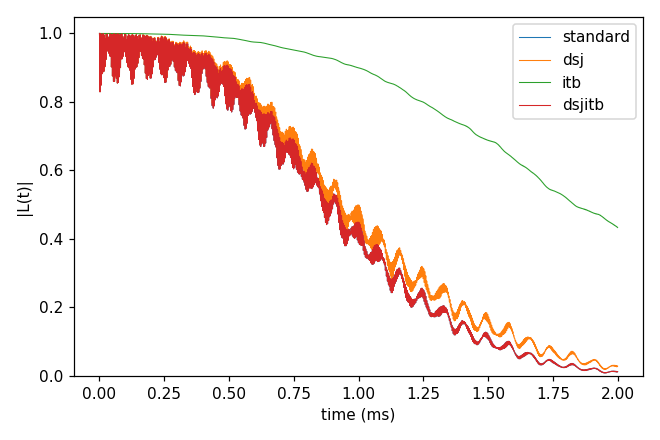
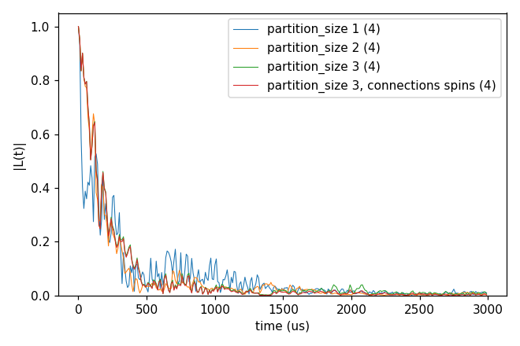
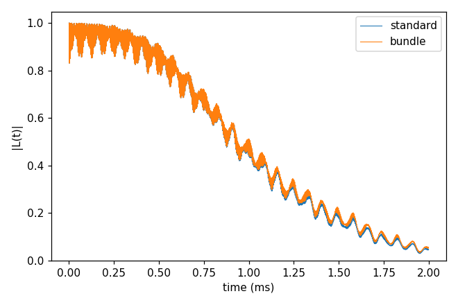
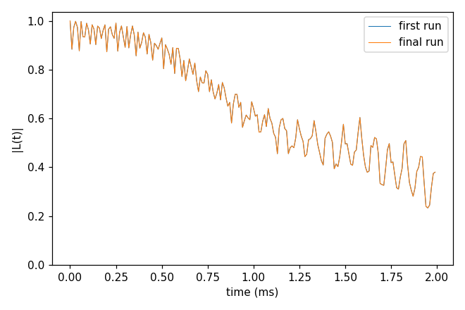
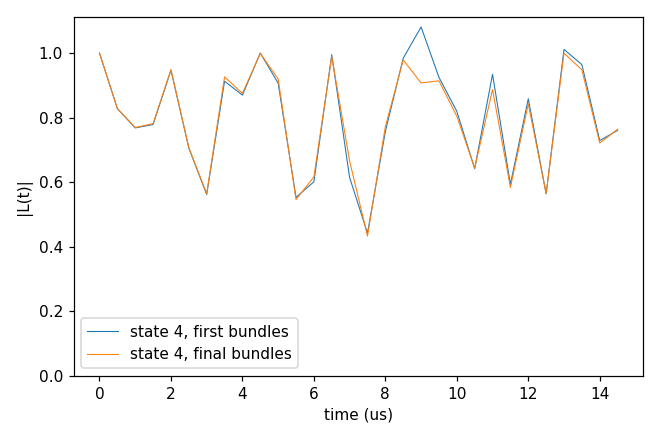

# Advanced 10: Cluster shapes (dsj, pCCE and bundles)

Folder: `example/tutorial/advanced/10_cluster_shapes/`

These are other ways of cutting the bath into clusters than the standard one.

- **dsj** (`cluster.mode` dsj, cCCE only) splits the bath into disjoint groups of the coupling graph and computes each
  group as one cluster.
- **pCCE** (`cluster.mode` pcce) groups the bath into partitions of `partition_size` spins by k-means on the positions
  and runs the expansion over partitions, so order 2 means pairs of partitions.
- **Bundle clustering** (`cluster.mode` bundle) bundles strongly coupled spins, from the coupling strengths and under
  the dimension cap `cluster.bundle.max_dim`. Every bundle enters a cluster whole, and `order` counts bundles.
- **Adaptive refinement** (the `cluster.adaptive` block,
  [Cluster tags](../../../../docs/user/InputFile_Cluster.md#tag_adaptive)) repeats the bundled calculation, measures
  the error at the bundle boundaries and re-bundles.

The cluster reports (the contribution of each cluster, the plan) are in
[Advanced 02: Analysis of the output](../02_analysis/README.md).

In each folder run `cd <folder> && NP=4 bash run.sh`, then compare `results/coherence.png` with `expected.png`. Every
key not written in an input has its default (`main.out -e`). Times are for 4 ranks of a desktop CPU.

This page has five cases:

1. [Disjoint groups, the pairs between them, and both, against the standard pairs](#cs_dsj) (`cCCE2_Hahn_dsj/`).
2. [Partitions of 1, 2 and 3 P1](#cs_pcce) (`pCCE2_Hahn_states/`).
3. [Bundles of up to three ¹³C](#cs_bundle) (`cCCE2_Hahn_bundle/`).
4. [The merge refinement of the bundles](#cs_adaptive) (`cCCE2_Hahn_adaptive/`).
5. [Regroup, aimed at |L| > 1](#cs_regroup) (`cCCE2_Hahn_regroup/`).

<a id="cs_dsj"></a>
## 1. Disjoint groups

Folder: `cCCE2_Hahn_dsj/`

<a id="a10_dsj_input"></a>
### 1.1 The input

The system is the NV of Basic 01 with `rbath` 50 Å and `rdip` 10 Å. The four inputs differ only in `cluster.mode`:

```jsonc
"cluster" : {"mode": "dsj"}       // ccein.jsonc
"cluster" : {"mode": "itb"}       // ccein_itb.jsonc
"cluster" : {"mode": "dsjitb"}    // ccein_dsjitb.jsonc
                                  // ccein_standard.jsonc has no cluster block, the standard pairs
```

dsj computes only the disjoint groups of the coupling graph within `rdip`. itb computes only the pairs between the
groups, the factor the couplings between groups add, so it is a part of the decay and not the coherence. dsjitb
computes both, and at order 2 it is the standard CCE2 written another way. The three modes run with cCCE only.

<a id="a10_dsj_run"></a>
### 1.2 Running it

```sh
NP=4 bash run.sh
```

It runs the four inputs and plots them together. The four runs take 2.5 s and 0.05 GB per rank.

<a id="a10_dsj_result"></a>
### 1.3 The result



T2 is 1.158 ms with dsj against 1.084 ms for the standard pairs, with a largest difference of 0.065. dsjitb gives the
standard curve exactly. itb alone is still 0.43 at 2 ms.

Next, try `order` 3. There dsjitb is no longer CCE3, since only pairs enter between the groups.

Inputs: [`ccein.jsonc`](cCCE2_Hahn_dsj/ccein.jsonc), [`ccein_itb.jsonc`](cCCE2_Hahn_dsj/ccein_itb.jsonc), [`ccein_dsjitb.jsonc`](cCCE2_Hahn_dsj/ccein_dsjitb.jsonc), [`ccein_standard.jsonc`](cCCE2_Hahn_dsj/ccein_standard.jsonc)

<a id="cs_pcce"></a>
## 2. Partitions, pCCE

Folder: `pCCE2_Hahn_states/`

<a id="a10_pcce_input"></a>
### 2.1 The input

The system is the NV in 1 ppm P1, the bath of
[Basic 06: An electron-spin bath (P1)](../../basic/06_defect_bath/README.md), with one configuration and four sampled
states (`s_range` [1, 4]). The clustering block is:

```jsonc
"cluster" : {"mode": "pcce", "pcce": {"partition_size": 2, "trials": 1000, "max_iterations": 1000}}
```

`partition_size` is 2 in the input, and `run.sh` sets it to 1, 2 and 3, or to the values of `SIZES`. Size 1 is
ordinary CCE2 over single spins. `trials` and `max_iterations` set the k-means search.

<a id="a10_pcce_run"></a>
### 2.2 Running it

```sh
NP=4 bash run.sh
```

It runs sizes 1, 2 and 3, and size 3 once more with `cluster.pcce.connections` spins, which links two partitions when
any of their spins are within `rdip`. It takes 8 s and 0.06 GB per rank. `SIZES="1 2 3 4" bash run.sh` adds size 4,
which takes much longer.

<a id="a10_pcce_result"></a>
### 2.3 The result



T2 is 260 µs for size 1, 183 µs for 2 and 202 µs for 3, for these four states. With `connections` spins, size 3
connects 4226 of the 12090 partition pairs instead of 2909, and gives T2 201.5 µs, nearly the same curve as with
centers.

Next, compute more states (`s_range`) before reading the differences.

Input: [`ccein.jsonc`](pCCE2_Hahn_states/ccein.jsonc)

<a id="cs_bundle"></a>
## 3. Bundles

Folder: `cCCE2_Hahn_bundle/`

<a id="a10_bundle_input"></a>
### 3.1 The input

The system is the NV of Basic 01 with `rbath` 30 Å. `ccein_standard.jsonc` uses ordinary clusters, and
`ccein_bundle.jsonc` adds bundles of up to three ¹³C:

```jsonc
"cluster" : {"mode": "bundle", "bundle": {"max_dim": 8}}
```

<a id="a10_bundle_run"></a>
### 3.2 Running it

```sh
NP=4 bash run.sh
```

It runs both inputs and prints the `[adaptive]` log line, which says how the 199 spins were bundled, into 84 bundles.
It takes 2.7 s and 0.05 GB per rank.

<a id="a10_bundle_result"></a>
### 3.3 The result



T2 is 1.165 ms with standard clusters and 1.169 ms with bundles, and the largest difference is 0.015.

Next, try `max_dim` 4 (pairs) or 16.

Inputs: [`ccein_bundle.jsonc`](cCCE2_Hahn_bundle/ccein_bundle.jsonc), [`ccein_standard.jsonc`](cCCE2_Hahn_bundle/ccein_standard.jsonc)

<a id="cs_adaptive"></a>
## 4. The merge refinement

Folder: `cCCE2_Hahn_adaptive/`

<a id="a10_adaptive_input"></a>
### 4.1 The input

It is the bundled calculation with `rbath` 20 Å over 2 ms, refined by the adaptive merge with `atol` 1e-3:

```jsonc
"configuration" : {"gyrofile": "../../../basic/01_first_run/bath/gyro_13C",
                   "bathfile": ["../../../basic/01_first_run/bath/bath_Diamond_NV_natab_1"], "seed": 9407},
"cluster"       : {"mode": "bundle", "bundle": {"max_dim": 8},
                   "adaptive": {"workdir": "./results/adaptive", "atol": 0.001, "rtol": 0, "max_rounds": 4}}
```

`adaptive` needs an explicit `seed`, since every round recomputes the same system. `workdir` is the folder of the
steps.

<a id="a10_adaptive_run"></a>
### 4.2 Running it

```sh
NP=4 bash run.sh
```

It runs the refinement and plots the first and the final run. It takes 48 s and 0.12 GB per process.
`results/adaptive/` holds one folder per step and `summary.json`.

<a id="a10_adaptive_result"></a>
### 4.3 The result



The refinement runs two rounds (27 → 26 bundles) and then stops with the status `no_feasible_improving_merge` (exit
status 2). |L| is 0.38 at 2 ms in the first and the final run, and the largest difference is 1.6e-5, so the merges
hardly move this curve.

Next, try `atol` 1e-4, or `max_rounds` 8.

Input: [`ccein.jsonc`](cCCE2_Hahn_adaptive/ccein.jsonc)

<a id="cs_regroup"></a>
## 5. Regroup, aimed at |L| > 1

Folder: `cCCE2_Hahn_regroup/`

<a id="a10_regroup_input"></a>
### 5.1 The input

The system is the NV in six P1 electron spins (`bath/bath_p1_6`) with five sampled states and bundles up to
dimension 4. The NV position and the P1 gyromagnetic ratio are those of
[Advanced 04: The GPU backend](../04_GPU/README.md). The refinement is regroup:

```jsonc
"configuration" : {"gyrofile": "../../04_GPU/bath/gyro_P1", "bathfile": ["../bath/bath_p1_6"],
                   "s_range": [1, 5], "seed": 1},
"cluster"       : {"mode": "bundle", "bundle": {"max_dim": 4},
                   "adaptive": {"workdir": "./results/adaptive", "atol": 0.001, "rtol": 0, "regroup": true}}
```

<a id="a10_regroup_run"></a>
### 5.2 Running it

```sh
NP=4 bash run.sh
```

It runs the refinement and prints each round. It takes 1 s and 0.06 GB per rank.

<a id="a10_regroup_result"></a>
### 5.3 The result



The figure shows state 4 before and after. The first bundles [0,3] [1,5] [2,4] give three states with |L| > 1.01.
The run finds the culprit pairs [0,3]-[1,5] (g 1.63), [0,3]-[2,4] (0.10) and [1,5]-[2,4] (5e-4), and accepts one
change, splitting [2,4]. The rerun has no unphysical state (status `physical`, exit 0), and the final bundles are
[[0,3], [1,5], [2], [4]].

Next, try `max_dim` 8, or more states.

Input: [`ccein.jsonc`](cCCE2_Hahn_regroup/ccein.jsonc)
