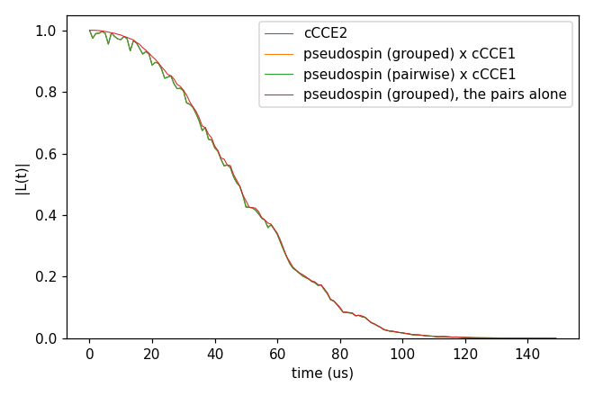

# Advanced 10: Pseudospin pairs

Folder: `example/tutorial/advanced/10_pseudospin/`

Method `pseudospin`: the pair clusters of the cCCE in the pseudospin model of nuclear flip-flops (Seo et al., Nat.
Commun. 7, 12935 (2016), Supplementary eqs. 20–24; Lee, Park, Seo, npj 2D Mater. Appl. 6, 60 (2022)), for any nuclear
spin. Each pair's Hamiltonian, in each qubit state, is written in the basis of the two nuclei's own eigenstates and
cut there to its diagonal and the elements that change both spins, the channels (flip-flops, flip-flips, and with a
quadrupole that mixes the |m⟩ the double-quantum ones). The output is the product of the pairs' terms alone, without
the single spins' ESEEM; times cCCE order 1 it is comparable with cCCE order 2. It is meant for reading which pairs
drive a decay, not for the best curve. The model and its two ways of evolving the channels (`channels` `grouped`,
the default, and `pairwise`) are in
[InputFile_General](../../../../docs/user/InputFile_General.md#tag_pseudospin_channels). Each folder:
`cd <folder> && NP=4 bash run.sh`, then compare `results/coherence.png` with `expected.png`. Times: i7-14700K, WSL.

## pseudospin2_Hahn_vsCCE

- **What it shows:** the V_B⁻ of `advanced/02_hBN` (one configuration of the flat layer, DFT hyperfine and quadrupole, 3 T,
  Hahn echo, ensemble, 459 nuclei within 20 Å): cCCE2 (`ccein_cce2.jsonc`), cCCE1 (`ccein_cce1.jsonc`, the single
  nuclei alone) and method pseudospin with `channels` `grouped` and `pairwise`. `run.sh` multiplies each pseudospin
  curve by cCCE1 and plots it with cCCE2; it also plots the pseudospin curve alone, the pairs' part of the decay.
- **Keys that matter:** `method` `pseudospin` (`order` is 2 by default and the only one accepted),
  `hamiltonian.pseudospin.channels`; the rest as `advanced/04_DFT_tensors/cCCE2_Hahn_tensors` (`ccein_hf3_qd2.jsonc`).
- **How to run:** `NP=4 bash run.sh`: 12 s for the four runs, 0.06 GB per rank. Each pseudospin run also writes
  `results/ccein_<name>_pseudospin_channels` (about 100 MB here): one line per channel with the two nuclei, their
  |m⟩ labels, Ω (the splitting 2|⟨m₁,m₂|H|m₁′,m₂′⟩|) and Δ (the level gap) in kHz, in the qubit's α and β states.
- **Expected result:** `expected.png`; T2 58.0 µs by cCCE2 and 58.1 µs by pseudospin × cCCE1, both `channels`
  within 2.3e-3 of cCCE2. The pairs alone (58.2 µs) are within 3.9e-2 of cCCE2: at 3 T the decay is the pairs'.
  Here `grouped` and `pairwise` agree, because the quadrupole splits the levels of a chain; for two spins 1 without a
  quadrupole pairwise is off by 0.43 and grouped exact ([InputFile_General](../../../../docs/user/InputFile_General.md#tag_pseudospin_channels)).
- **What to change next:** `bfield` 3000 (0.3 T): the single nuclei's ESEEM grows, and pseudospin × cCCE1 is farther
  from cCCE2 (2.2e-2 on the h-BN case of `check_numerics`).

Inputs: [`ccein_cce2.jsonc`](pseudospin2_Hahn_vsCCE/ccein_cce2.jsonc), [`ccein_cce1.jsonc`](pseudospin2_Hahn_vsCCE/ccein_cce1.jsonc), [`ccein_grouped.jsonc`](pseudospin2_Hahn_vsCCE/ccein_grouped.jsonc), [`ccein_pairwise.jsonc`](pseudospin2_Hahn_vsCCE/ccein_pairwise.jsonc)
