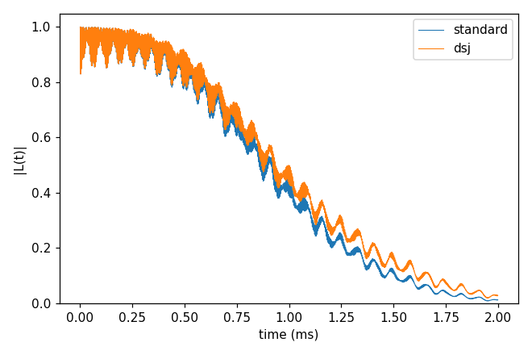
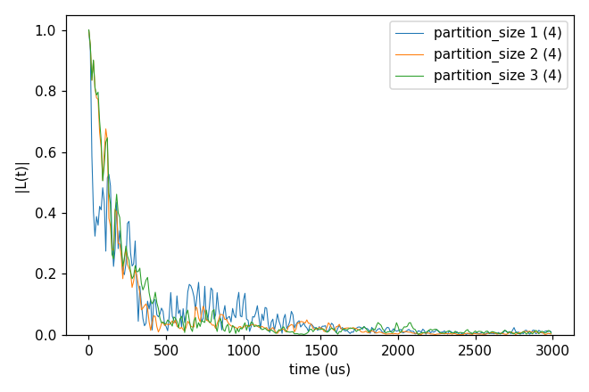
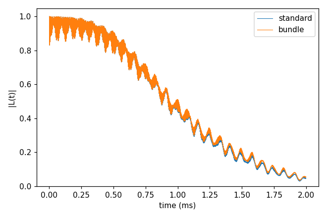
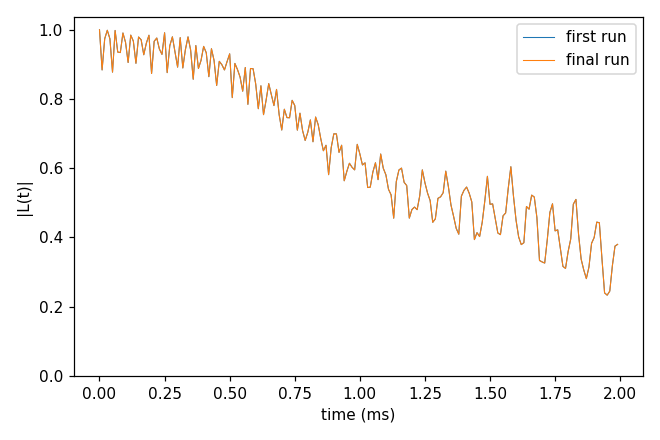
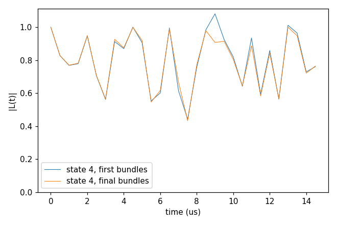

# Advanced 11: Cluster shapes (dsj, pCCE and bundles)

Folder: `example/tutorial/advanced/11_cluster_shapes/`

These are other ways of cutting the bath into clusters than the standard one.

- **dsj** (`cluster.mode` dsj, cCCE only) splits the bath into disjoint groups of the coupling graph and computes each
  group as one cluster.
- **pCCE** (`cluster.mode` pcce) groups the bath into partitions of `partition_size` spins by k-means on the positions
  and runs the expansion over partitions, so order 2 means pairs of partitions.
- **Bundle clustering** (`cluster.mode` bundle) bundles strongly coupled spins, from the coupling strengths and under
  the dimension cap `cluster.bundle.max_dim`. Every bundle enters a cluster whole, and `order` counts bundles.
- **Adaptive refinement** (the `cluster.adaptive` block,
  [Cluster tags](../../../../docs/user/InputFile_Cluster.md#tag_adaptive)) repeats the bundled calculation, measures
  the error at the bundle boundaries and re-bundles.

The cluster reports (the contribution of each cluster, the plan) are in
[Advanced 02: Analysis of the output](../02_analysis/README.md).

In each folder run `cd <folder> && NP=4 bash run.sh`, then compare `results/coherence.png` with `expected.png`. Every
key not written in an input has its default (`main.out -e`). Times are for 4 ranks of a desktop CPU.

1. [cCCE2_Hahn_dsj](#cs_dsj): disjoint groups against the standard pairs.
2. [pCCE2_Hahn_states](#cs_pcce): partitions of 1, 2 and 3 P1.
3. [cCCE2_Hahn_bundle](#cs_bundle): bundles of up to three ¹³C.
4. [cCCE2_Hahn_adaptive](#cs_adaptive): the merge refinement of the bundles.
5. [cCCE2_Hahn_regroup](#cs_regroup): regroup, aimed at |L| > 1.

## 1. cCCE2_Hahn_dsj: disjoint groups

- **What it shows:** `cluster.mode` dsj, whose clusters are the disjoint groups of the coupling graph within `rdip`,
  against the standard pairs (`ccein_standard.jsonc`).
- **Keys that matter:** `cluster.mode` dsj.
- **How to run:** `NP=4 bash run.sh`. It takes 1.1 s and 0.05 GB per rank.
- **Expected result:** `expected.png`. T2 is 1.158 ms with dsj against 1.084 ms, and the largest difference is 0.065.
- **What to change next:** `cluster.mode` itb or dsjitb (cCCE only).

Inputs: [`ccein.jsonc`](cCCE2_Hahn_dsj/ccein.jsonc), [`ccein_standard.jsonc`](cCCE2_Hahn_dsj/ccein_standard.jsonc)

## 2. pCCE2_Hahn_states: partitions

- **What it shows:** pCCE2 of the NV in 1 ppm P1, the bath of
  [Basic 06: An electron-spin bath (P1)](../../basic/06_defect_bath/README.md) with one configuration and four sampled
  states, with partitions of 1, 2 and 3 P1. `partition_size` 1 is ordinary CCE2 over single spins.
- **Keys that matter:** `cluster.mode` pcce, `cluster.pcce.partition_size` (2 in the input, and `run.sh` sets 1, 2,
  3 or `SIZES`), `trials` and `max_iterations`.
- **How to run:** `NP=4 bash run.sh`. It takes 8 s and 0.06 GB per rank. `SIZES="1 2 3 4" bash run.sh` adds size 4,
  which takes much longer.
- **Expected result:** `expected.png`. T2 is 260 µs for size 1, 183 µs for 2 and 202 µs for 3, for these four states.
- **What to change next:** more states (`s_range`) before reading the differences, or `cluster.pcce.connections`
  spins.

Input: [`ccein.jsonc`](pCCE2_Hahn_states/ccein.jsonc)

## 3. cCCE2_Hahn_bundle: bundles

- **What it shows:** the NV of Basic 01 (`rbath` 30) with ordinary clusters (`ccein_standard.jsonc`) and with bundles
  of up to three ¹³C (`bundle.max_dim` 8, `ccein_bundle.jsonc`). The `[adaptive]` log line says how the 199 spins
  were bundled, into 84 bundles.
- **Keys that matter:** `cluster.mode` bundle and `cluster.bundle.max_dim` 8.
- **How to run:** `NP=4 bash run.sh`. It takes 2.7 s and 0.05 GB per rank.
- **Expected result:** `expected.png`. T2 is 1.165 ms with standard clusters and 1.169 ms with bundles, and the
  largest difference is 0.015.
- **What to change next:** `max_dim` 4 (pairs) or 16.

Inputs: [`ccein_bundle.jsonc`](cCCE2_Hahn_bundle/ccein_bundle.jsonc), [`ccein_standard.jsonc`](cCCE2_Hahn_bundle/ccein_standard.jsonc)

## 4. cCCE2_Hahn_adaptive: the merge refinement

- **What it shows:** the bundled calculation (`rbath` 20, 2 ms) with the adaptive merge refinement and `atol`
  1e-3. It runs two rounds (27 → 26 bundles) and then stops with the status `no_feasible_improving_merge` (exit status 2).
  `results/adaptive/` holds one folder per step and `summary.json`. `adaptive` needs an explicit `seed`, since every
  round recomputes the same system.
- **Keys that matter:** `cluster.adaptive` {`workdir`, `atol`, `rtol`, `max_rounds`} and `configuration.seed`.
- **How to run:** `NP=4 bash run.sh`. It takes 48 s and 0.12 GB per process.
- **Expected result:** `expected.png`, with the first and the final run. |L| is 0.38 at 2 ms in both, and the largest
  difference is 1.6e-5, so the merges hardly move this curve.
- **What to change next:** `atol` 1e-4, or `max_rounds` 8.

Input: [`ccein.jsonc`](cCCE2_Hahn_adaptive/ccein.jsonc)

## 5. cCCE2_Hahn_regroup: regroup

- **What it shows:** the NV in six P1 electron spins (`bath/bath_p1_6`, five sampled states, bundles up to dimension 4)
  with `"regroup": true`. The bundles [0,3] [1,5] [2,4] give three states with |L| > 1.01. The run finds the culprit
  pairs and accepts one change, splitting [2,4], and the rerun has no unphysical state (status `physical`, exit 0).
  The NV position and the P1 gyromagnetic ratio are those of [Advanced 04: The GPU backend](../04_GPU/README.md).
- **Keys that matter:** `cluster.adaptive.regroup` true, `cluster.bundle.max_dim` 4, `s_range` [1, 5] and `seed`.
- **How to run:** `NP=4 bash run.sh`. It takes 1 s and 0.06 GB per rank.
- **Expected result:** `expected.png`, with state 4 before and after. The printed rounds give the culprit pairs
  [0,3]-[1,5] (g 1.63), [0,3]-[2,4] (0.10) and [1,5]-[2,4] (5e-4), and the final bundles [[0,3], [1,5], [2], [4]].
- **What to change next:** `max_dim` 8, or more states.

Input: [`ccein.jsonc`](cCCE2_Hahn_regroup/ccein.jsonc)
