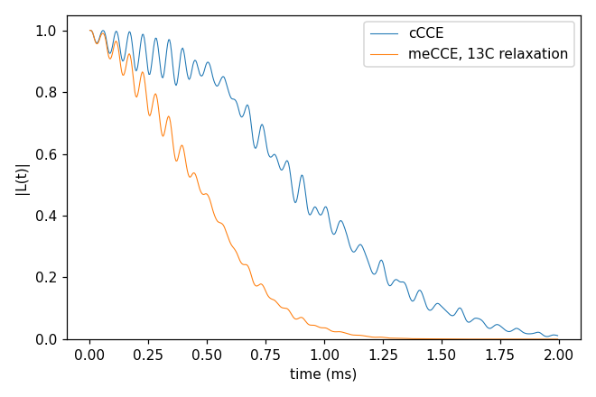
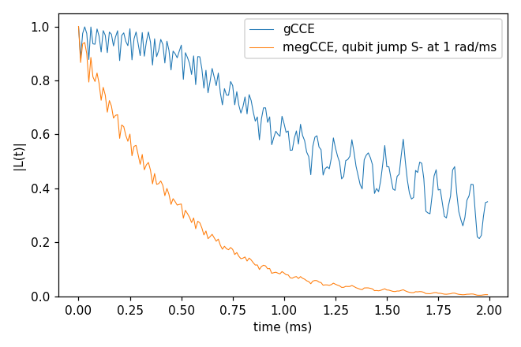

# Advanced 11: Dissipation (meCCE and megCCE)

Folder: `example/tutorial/advanced/11_dissipation/`

The usual CCE treats the qubit and its bath as a closed system. The master-equation CCE adds dissipation, a spin
relaxing or dephasing through its surroundings, to every cluster. Each cluster's density matrix then follows the
Lindblad equation

$$\dot\rho=-i[H,\rho]+\sum_k\Big(C_k\rho C_k^\dagger-\tfrac12\lbrace C_k^\dagger C_k,\rho\rbrace \Big),\qquad C_k=\sqrt{\gamma_k}\,S^{(k)}_{op},$$

with one jump operator $C_k$ per entry of `jump_operators`:

- `bath_name` names the spins it acts on, every spin of a cluster with that name, or `"qubit"` for the qubit.
- `operator` is $S_{op}$, one of `"-"`, `"+"`, `"z"`, `"x"` and `"y"` ($S_-$, $S_+$, $S_z$, $S_x$, $S_y$).
- `rate` is in MHz. $\gamma_k$ is the rate times $2\pi\cdot10^3$, in rad/ms, so `rate` 1.5915e-4 is
  $\gamma$ = 1 rad/ms.

There are two methods ([Master-equation CCE](../../../../docs/methods/master-equation.md)):

| `method` | Built on | Jumps on | Pulses |
|---|---|---|---|
| `meCCE` | cCCE, the qubit projected out. | Bath spins. | Ideal π flips from `pulse.count`. |
| `megCCE` | gCCE, the qubit in the cluster. | Bath spins and the qubit (one qubit). | Any sequence, as in gCCE. |

Without jump operators meCCE gives the cCCE curve and megCCE the gCCE curve.

In each folder run `cd <folder> && NP=4 bash run.sh`, then compare `results/coherence.png` with `expected.png`. Every
key not written in an input has its default (`main.out -e`). Times are for 4 ranks of a desktop CPU.

This page has two cases:

1. [The relaxation of the bath spins, meCCE against cCCE](#ds_bath) (`meCCE2_Hahn_bathRelaxation/`).
2. [The relaxation of the qubit, megCCE against gCCE](#ds_qubit) (`megCCE2_Hahn_qubitRelaxation/`).

<a id="ds_bath"></a>
## 1. The relaxation of the bath spins

Folder: `meCCE2_Hahn_bathRelaxation/`

<a id="a11_bath_input"></a>
### 1.1 The input

The system is that of Basic 01, with 500 points 4 µs apart (2 ms). `ccein_cCCE.jsonc` is the plain cCCE run, and
`ccein_meCCE.jsonc` adds the method and the jump operators:

```jsonc
"method"      : "meCCE",
"hamiltonian" : {"meCCE": {"jump_operators": [{"bath_name": "13C", "operator": "-", "rate": 1.5915e-06},
                                              {"bath_name": "13C", "operator": "+", "rate": 1.5915e-06}]}}
```

$S_-$ and $S_+$ act on every ¹³C with $\gamma$ = 0.01 rad/ms each. With equal rates up and down they relax each ¹³C
towards the unpolarised state.

<a id="a11_bath_run"></a>
### 1.2 Running it

```sh
NP=4 bash run.sh
```

It runs both inputs and plots them. It takes 21 s, nearly all of it meCCE, and 0.09 GB per rank.

<a id="a11_bath_result"></a>
### 1.3 The result



T2 is 1.08 ms with cCCE and 0.57 ms with meCCE.

Next, try `operator` "z", a pure dephasing of the ¹³C.

Inputs: [`ccein_cCCE.jsonc`](meCCE2_Hahn_bathRelaxation/ccein_cCCE.jsonc), [`ccein_meCCE.jsonc`](meCCE2_Hahn_bathRelaxation/ccein_meCCE.jsonc)

<a id="ds_qubit"></a>
## 2. The relaxation of the qubit

Folder: `megCCE2_Hahn_qubitRelaxation/`

<a id="a11_qubit_input"></a>
### 2.1 The input

A jump on the qubit needs megCCE, which has the qubit in every cluster. The system is the NV of Basic 01 with its
zero-field splitting in a small ¹³C bath (`rbath` 20 Å, `rdip` 8 Å), over 2 ms. `ccein_gCCE.jsonc` is the plain gCCE
run, and `ccein_megCCE.jsonc` adds the method and one jump on the qubit:

```jsonc
"method"      : "megCCE",
"hamiltonian" : {"megCCE": {"jump_operators": [{"bath_name": "qubit", "operator": "-", "rate": 1.5915e-4}]}}
```

$S_-$ on the NV with $\gamma$ = 1 rad/ms takes ms +1 towards 0 and 0 towards −1.

<a id="a11_qubit_run"></a>
### 2.2 Running it

```sh
NP=4 bash run.sh
```

It runs both inputs and plots them. It takes 84 s and 0.09 GB per rank. The gCCE run takes 0.02 s of it and megCCE
81 s, since megCCE evolves each cluster in the Liouville space, of dimension $(d_q d_B)^2$, with a matrix exponential,
because the eigendecomposition of gCCE does not apply there.

<a id="a11_qubit_result"></a>
### 2.3 The result



T2 is 1.93 ms with gCCE and 0.44 ms with the qubit jump.

Next, add a bath jump beside the qubit one, or try `operator` "z" on the qubit, a pure dephasing of the NV.

Inputs: [`ccein_gCCE.jsonc`](megCCE2_Hahn_qubitRelaxation/ccein_gCCE.jsonc), [`ccein_megCCE.jsonc`](megCCE2_Hahn_qubitRelaxation/ccein_megCCE.jsonc)
