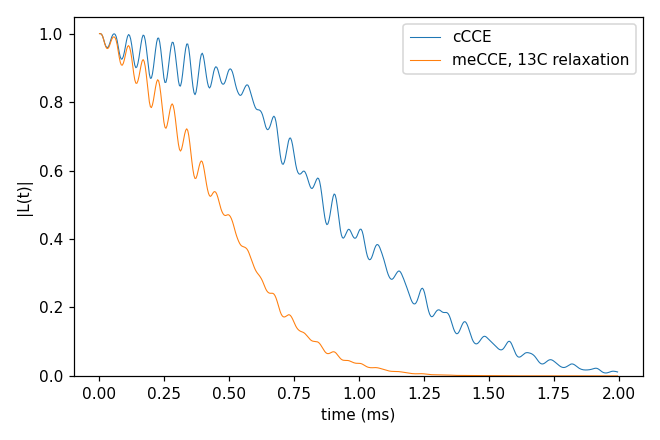

# Advanced 12: Dissipation (meCCE and megCCE)

Folder: `example/tutorial/advanced/12_dissipation/`

The master-equation CCE adds Lindblad dissipation to every cluster. meCCE is the cCCE with jump operators on the bath
spins, and megCCE the gCCE with jump operators on the bath spins and on the qubit. How they work is in
[Master-equation CCE](../../../../docs/methods/master-equation.md). Each folder: `cd <folder> && NP=4 bash run.sh`,
then compare `results/coherence.png` with `expected.png`. Every key not written in an input has its default
(`main.out -e`). Times: i7-14700K, WSL, 4 ranks.

## meCCE2_Hahn_bathRelaxation

- **What it shows:** `method` meCCE, the cCCE with a Lindblad master equation in each cluster: jump operators S₋ and
  S₊ on every ¹³C at γ = 0.01 rad/ms each (`rate` 1.5915e-6 MHz × 2π·10³) relax the bath spins (`ccein_meCCE.jsonc`),
  against cCCE (`ccein_cCCE.jsonc`), on basic/01_first_run's system with 500 points of 4 µs. The rates of all the ¹³C add up,
  so even this small rate halves T2. Without jump operators meCCE gives the cCCE curve (checked by
  `test/code_verification/check_master_equation`).
- **Keys that matter:** `method` meCCE, `hamiltonian.meCCE.jump_operators` [{`bath_name` "13C", `operator` "-" or
  "+", `rate` (MHz)}].
- **How to run:** `NP=4 bash run.sh`: 18-20 s (nearly all meCCE), 0.06 GB per rank.
- **Expected result:** `expected.png`; T2 1.08 ms (cCCE) and 0.57 ms (meCCE).
- **What to change next:** `operator` "z" (pure dephasing of the ¹³C); `method` megCCE with a qubit jump
  (`bath_name` "qubit", in `hamiltonian.megCCE`); see [master-equation CCE](../../../../docs/methods/master-equation.md).

Inputs: [`ccein_cCCE.jsonc`](meCCE2_Hahn_bathRelaxation/ccein_cCCE.jsonc), [`ccein_meCCE.jsonc`](meCCE2_Hahn_bathRelaxation/ccein_meCCE.jsonc)
