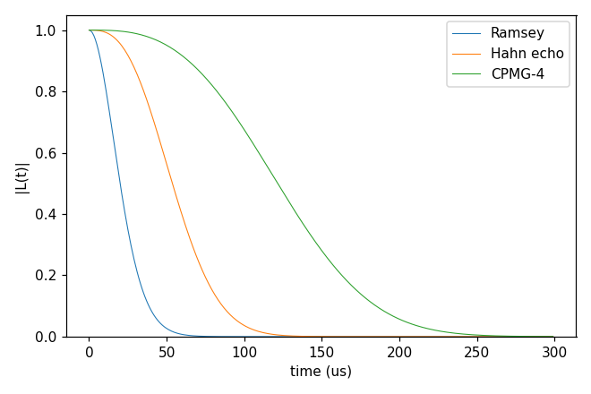
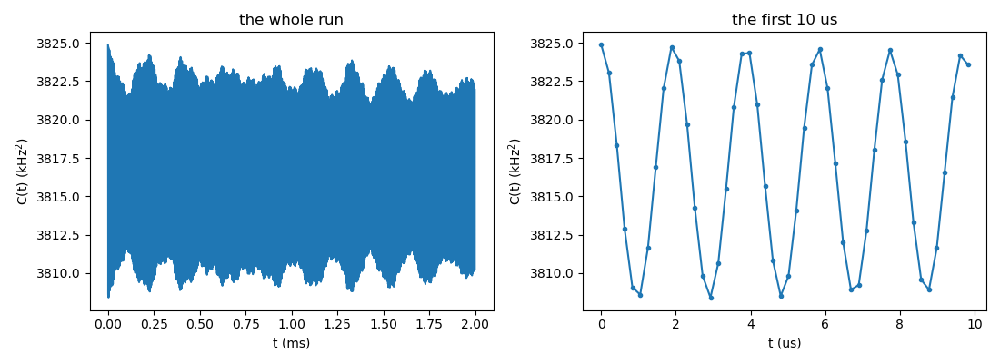
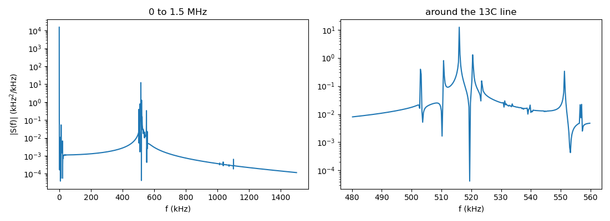
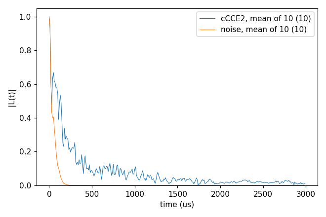

# Advanced 12: Semiclassical noise (method noise)

Folder: `example/tutorial/advanced/12_noise/`

Method `noise` treats the bath as a fluctuating frequency $\delta\omega(t)$ seen by the qubit. Under ideal π pulses the
qubit picks up the phase $\varphi = \int f(t)\,\delta\omega(t)\,dt$, where $f = \pm 1$ changes sign at each pulse. For
Gaussian noise the coherence is

$$W(T) = e^{-\chi(T)}, \qquad \chi = \langle\varphi^2\rangle/2 .$$

The noise comes either from the bath or from a model ([Semiclassical noise](../../../../docs/methods/noise.md)):

- **From a model** of the frequency noise, without a bath. `{"model": "OU", ...}` is Ornstein–Uhlenbeck noise,
  $\langle\delta\nu(t)\delta\nu(0)\rangle = \sigma^2 e^{-|t|/\tau_c}$, and `{"model": "power", ...}` a power-law spectrum
  $S(f) = A\,(f/1\,\text{kHz})^{-\beta}$ between $f_\text{min}$ and $f_\text{max}$.
- **From the bath** (`hamiltonian.noise.spectrum` `"bath"`, the default). Every cCCE cluster adds, from the
  eigenstates $|a\rangle$ of $H_\text{bath} + p\sum_i \mathbf{A}_{z,i}\cdot\mathbf{I}_i$ with
  $p = (|m_\alpha| + |m_\beta|)/2$ and their frequency differences $\omega_{ab}$,

  $$\chi_C = \frac{1}{2D}\sum_{ab}\lvert\langle a\rvert\delta\omega\lvert b\rangle\rvert^2\,\lvert Y(\omega_{ab})\rvert^2,\qquad Y(\omega) = \int f(t)\,e^{i\omega t}\,dt ,$$

  with $D$ the cluster's dimension and $\delta\omega = (m_\alpha - m_\beta)\sum_i A_{zz,i} I_{z,i}$. The pulse sequence
  enters only through the filter $Y$.

The Gaussian approximation leaves out the qubit's back-action on the bath and the non-Gaussian part of the noise, so
it is meant for many weakly coupled noise sources. Strongly coupled spins need cCCE or gCCE, as case 3 shows. The keys
are in
[General tags](../../../../docs/user/InputFile_General.md#tag_noise_spectrum).

In each folder run `cd <folder> && NP=4 bash run.sh`, then compare `results/coherence.png` with `expected.png`. In the
legends, a number in brackets is the number of curves averaged. Times are for 4 ranks of a desktop CPU.

This page has three cases:

1. [The noise from a model, without a bath](#nz_ou) (`noiseModel_OU/`).
2. [The noise spectrum of a ¹³C bath](#nz_spectrum) (`noiseSpectrum_13C/`).
3. [The noise from a P1 bath, against cCCE2](#nz_vscce) (`noise2_Hahn_vsCCE/`).

<a id="nz_ou"></a>
## 1. The noise from a model, without a bath

Folder: `noiseModel_OU/`

<a id="a12_ou_input"></a>
### 1.1 The input

The noise is Ornstein–Uhlenbeck noise with σ = 10 kHz and τ_c = 50 µs. No bath is read, so `order`, `bfield`, `rbath`, `rdip` and `Qubit` are left out:

```jsonc
"method"      : "noise",
"hamiltonian" : {"noise": {"spectrum": {"model": "OU", "sigma": 10, "tau_c": {"value": 50, "unit": "us"}}}},
"deltat"      : 0.001,
"nstep"       : 300,
"pulse"       : {"count": 1}
```

σ is in kHz and τ_c in ms, and both take a unit.

<a id="a12_ou_run"></a>
### 1.2 Running it

```sh
bash run.sh
```

It runs the input as a Hahn echo, then with `pulse.count` 0 (Ramsey) and 4 (CPMG-4), and plots the three. It takes
1 s on one rank, since a model run has no clusters to share.

<a id="a12_ou_result"></a>
### 1.3 The result



T2 is 24 µs for Ramsey, 62 µs for the Hahn echo and 138 µs for CPMG-4. The echo and the decoupling sequence filter
the slow noise out. For OU noise χ is computed exactly for any sequence of ideal π pulses.

For $\tau_c \gg T$ the Hahn echo goes to the slow-noise limit $\chi \approx (2\pi\sigma)^2 T^3 / (12 \tau_c)$. With
`tau_c` 50 ms this input gives χ within 0.3 % of it up to 0.3 ms.

Next, try `{"model": "power", "amplitude": 50, "beta": 1, "f_min": 0.01, "f_max": 200}`, 1/f noise between f_min and
f_max (kHz).

Input: [`ccein.jsonc`](noiseModel_OU/ccein.jsonc)

<a id="nz_spectrum"></a>
## 2. The noise spectrum of a ¹³C bath

Folder: `noiseSpectrum_13C/`

<a id="a12_spectrum_input"></a>
### 2.1 The input

This case writes the noise itself, its correlation function and spectrum, which noise spectroscopy measures. The NV
of `basic/01_first_run` in its natural-abundance ¹³C (978 ¹³C within 50 Å, 500 G, Hahn echo) is run by method `noise`.
The two inputs differ only in what is computed:

```jsonc
"hamiltonian" : {"noise": {"compute": "spectrum"}}     // ccein_spectrum.jsonc
"hamiltonian" : {"noise": {"compute": "coherence"}}    // ccein_coherence.jsonc
```

The three values of `compute` are:

- `"coherence"` (the default) takes χ straight from the clusters' eigenmodes, with no time grid.
- `"spectrum"` writes the correlation $C(t) = \operatorname{Re}\operatorname{Tr}[\rho\{B(t), B\}]/2$ of
  $B = \sum_i A_{zz,i} I_{z,i}$ (in kHz, $\delta\omega$ without its factor $m_\alpha - m_\beta$) on a time grid, its
  two-sided spectrum S(f) (negative and positive f) by FFT, and the coherence from S(f).
- `"correlation"` writes C(t) alone, at the run's times.

The rest of the input is the cCCE2 system of Basic 01: `rbath` 50 Å, `rdip` 10 Å, `deltat` 1 µs × `nstep` 2000 and
`pulse.count` 1. `deltat` and `nstep` set the times of the coherence, and the grid of C(t) is set apart, by the block
`hamiltonian.noise.fft` ([fft](../../../../docs/user/InputFile_General.md#tag_noise_fft)):

| Key | Meaning | Default |
|---|---|---|
| `time_max` | The end of the grid of C(t), in ms. | The run's last time. |
| `nstep` | The number of intervals of the grid. | 8 points per period of the fastest bath mode kept. |
| `window` | A window on C(t) before the FFT, `"none"`, `"hann"`, `"tukey"` or `"exp"`. | `"none"` |
| `pad_factor` | The FFT length in units of the grid. | 1 |
| `subtract_mean` | Subtract the mean of the tail of C(t) before the FFT. | `false` |
| `clamp_negative` | Set S(f) < 0 to 0. | `false` |

The input leaves the block out, and the log line `hamiltonian.noise.fft:` gives what the run chose, `time_max`
1.999 ms and `nstep` 9560 (the fastest mode kept is 597.8 kHz). The grid then sets the spectrum. Its step is
$\Delta t$ = `time_max`/`nstep` = 0.209 µs, so S(f) reaches $f_\text{max} = 1/(2\Delta t)$ = 2391 kHz, and its
resolution is $\Delta f = 1/(2\,$`time_max`$)$ = 0.25 kHz. The block written out with these values gives the same
files, to rounding:

```jsonc
"hamiltonian" : {"noise": {"compute": "spectrum",
                           "fft": {"time_max": 1.999, "nstep": 9560, "window": "none", "pad_factor": 1}}}
```

<a id="a12_spectrum_run"></a>
### 2.2 Running it

```sh
NP=4 bash run.sh
```

It takes 4 s for both and 0.05 GB per rank. It writes `results/ccein_spectrum_noise_correlation` (t in ms, C in kHz²)
and `results/ccein_spectrum_noise_spectrum` (f in kHz, S in kHz²/kHz, two-sided), 0.4 MB each.

<a id="a12_spectrum_result"></a>
### 2.3 The result

The run writes three figures.

**The coherence.** Both routes give T2 0.973 ms, and the two curves are within 1e-10 of each other, which checks the
FFT grid.


**The correlation C(t).** It stays near 3816 kHz² over the whole run, from 3825 kHz² at t = 0 to 3810 kHz² at 2 ms,
so the noise of this bath changes little in 2 ms. A small oscillation, ±8 kHz² with a period of 1.94 µs, rides on it
(right, the first 10 µs). In the whole run (left) it is too fast to resolve and looks like a band.



**The spectrum S(f).** Nearly all its weight is at f ≈ 0, 3816 of the 3821 kHz² of its integral within ±50 kHz. That
is the slow part of the noise. A group of lines between 500 and 560 kHz (right), the strongest at 516 kHz, holds
4 kHz² and gives the oscillation of C(t). They lie near the ¹³C Larmor frequency at 500 G, 535 kHz. The integral of
S(f) over f, 3821 kHz², equals C(0), 3825 kHz², to 0.1 %.



Next, try `"fft": {"window": "hann"}` in `hamiltonian.noise`, a window on C(t) before the FFT
([fft](../../../../docs/user/InputFile_General.md#tag_noise_fft)), or `pulse.count` 4, another filter on the same
S(f).

Inputs: [`ccein_spectrum.jsonc`](noiseSpectrum_13C/ccein_spectrum.jsonc), [`ccein_coherence.jsonc`](noiseSpectrum_13C/ccein_coherence.jsonc)

<a id="nz_vscce"></a>
## 3. The noise from a P1 bath, against cCCE2

Folder: `noise2_Hahn_vsCCE/`

<a id="a12_vscce_input"></a>
### 3.1 The input

The system is the Hahn echo of the NV (ms +1 / 0) in 1 ppm P1, the bath of `basic/06_defect_bath` with one
configuration and 10 sampled states. The rest is as in `basic/06_defect_bath/cCCE2_Hahn_states`. The two inputs
differ only in the method:

```jsonc
"method"      : "noise",                            // ccein_noise.jsonc
"hamiltonian" : {"noise": {"spectrum": "bath"}},
"method"      : "cCCE",                             // ccein_cce.jsonc
```

<a id="a12_vscce_run"></a>
### 3.2 Running it

```sh
NP=4 bash run.sh
```

It runs both inputs and plots the mean of the 10 states of each. It takes 8 s for both and 0.05 GB per rank.

<a id="a12_vscce_result"></a>
### 3.3 The result



T2 of the mean of 10 states is 56 µs by `noise` and 150 µs by cCCE2. The two methods compute different quantities:

- `noise` averages every cluster at infinite temperature with the one bath Hamiltonian of the opening, and keeps only
  the Gaussian part of the noise. A sampled state enters only through the static field of the other bath spins.
- cCCE2 evolves each sampled state as a pure state under the two Hamiltonians of the qubit's branches.

Next, try `"pseudo_secular": true` in `hamiltonian.noise`, the noise of a bath spin with $A_{zx} I_x + A_{zy} I_y$ as
well as $A_{zz} I_z$, or `pulse.count` 0 or 4.

Inputs: [`ccein_noise.jsonc`](noise2_Hahn_vsCCE/ccein_noise.jsonc), [`ccein_cce.jsonc`](noise2_Hahn_vsCCE/ccein_cce.jsonc)
