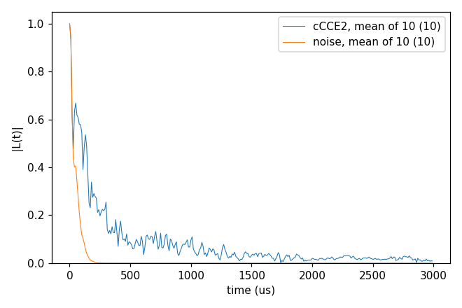
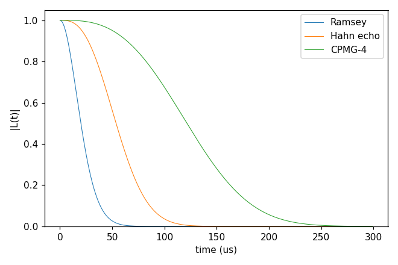
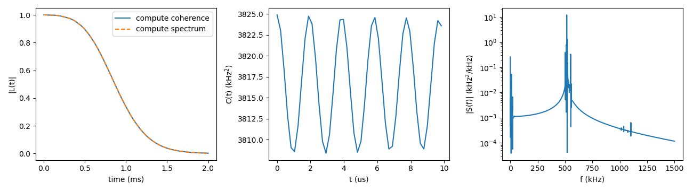

# Advanced 13: Semiclassical noise (method noise)

Folder: `example/tutorial/advanced/13_noise/`

Method `noise` gives the coherence as the Gaussian decay $W(T) = e^{-\chi(T)}$ of the qubit's phase noise, with
$\chi = \langle\varphi^2\rangle/2$ of the phase $\varphi = \int f(t)\,\delta\omega(t)\,dt$, where $f = \pm 1$ flips at
each ideal π pulse. The noise δω comes either from the bath or from a model.

- **From the bath** (`hamiltonian.noise.spectrum` `"bath"`, the default), each cCCE cluster gives its share of χ from
  its eigenmodes. This is the semi-classical CCE.
- **From a model** of the frequency noise, without a bath (`{"model": "OU", ...}` or `{"model": "power", ...}`).

The Gaussian approximation leaves out the qubit's back-action on the bath and the non-Gaussian part of the noise, so
it is meant for many weakly coupled noise sources. The keys are in
[General tags](../../../../docs/user/InputFile_General.md#tag_noise_spectrum).

In each folder run `cd <folder> && NP=4 bash run.sh`, then compare `results/coherence.png` with `expected.png`. Times are for a desktop CPU.

1. [noise2_Hahn_vsCCE](#nz_vscce): the noise of a P1 bath against cCCE2.
2. [noiseModel_OU](#nz_ou): Ornstein–Uhlenbeck noise under three sequences.
3. [noiseSpectrum_13C](#nz_spectrum): the correlation C(t) and the spectrum S(f) of a ¹³C bath.

## 1. noise2_Hahn_vsCCE: against cCCE2

- **What it shows:** the Hahn echo of the NV (ms +1 / 0) in 1 ppm P1, the bath of `basic/06_defect_bath` with one
  configuration and 10 sampled states, by method `noise` and by cCCE2. They are not the same quantity. In `noise` a
  sampled state only sets the static field of the other spins, and every cluster is averaged at infinite temperature,
  with one bath Hamiltonian for both branches of the qubit. cCCE2 evolves each state as a pure initial state under the
  two branches' Hamiltonians. Here the Gaussian curve decays faster than the cCCE2 mean.
- **Keys that matter:** `method` `noise` and `hamiltonian.noise.spectrum` `"bath"`. The rest is as in
  `basic/06_defect_bath/cCCE2_Hahn_states`, and `ccein_cce.jsonc` is the same input with `method` `cCCE`.
- **How to run:** `NP=4 bash run.sh`. It takes 8 s for both and 0.05 GB per rank.
- **Expected result:** `expected.png`. T2 of the mean of 10 states is 56 µs by `noise` and 150 µs by cCCE2.
- **What to change next:** `"pseudo_secular": true` in `hamiltonian.noise`, the noise of a bath spin with
  $A_{zx} I_x + A_{zy} I_y$ as well as $A_{zz} I_z$, or `pulse.count` 0 or 4.

Inputs: [`ccein_noise.jsonc`](noise2_Hahn_vsCCE/ccein_noise.jsonc), [`ccein_cce.jsonc`](noise2_Hahn_vsCCE/ccein_cce.jsonc)

## 2. noiseModel_OU: a model spectrum

- **What it shows:** Ornstein–Uhlenbeck frequency noise,
  $\langle\delta\nu(t)\delta\nu(0)\rangle = \sigma^2 e^{-|t|/\tau_c}$ with σ = 10 kHz and τ_c = 50 µs, under a Ramsey
  sequence, a Hahn echo and CPMG-4. The echo and the decoupling sequence filter the slow noise out. χ is computed
  exactly for ideal π pulses. No bath is read, so `order`, `bfield`, `rbath`, `rdip` and `Qubit` are left out of the
  input.
- **Keys that matter:** `hamiltonian.noise.spectrum` `{"model": "OU", "sigma", "tau_c"}` (σ in kHz and τ_c in ms,
  both of which take a unit) and `pulse.count`.
- **How to run:** `bash run.sh`. It takes 1 s on one rank, since a model run has no clusters to share.
- **Expected result:** `expected.png`. T2 is 24 µs for Ramsey, 62 µs for the Hahn echo and 138 µs for CPMG-4.
- **What to change next:** `{"model": "power", "amplitude": 50, "beta": 1, "f_min": 0.01, "f_max": 200}`, 1/f noise
  between f_min and f_max (kHz). Or a longer τ_c, toward the quasi-static limit
  $\chi \approx (2\pi\sigma)^2 T^3 / (12 \tau_c)$ for the Hahn echo.

Input: [`ccein.jsonc`](noiseModel_OU/ccein.jsonc)

## 3. noiseSpectrum_13C: the correlation and the spectrum

- **What it shows:** the noise itself, as a noise-spectroscopy experiment sees it. The NV of `basic/01_first_run` in
  its natural-abundance ¹³C (978 ¹³C within 50 Å, 500 G, Hahn echo) is run by method `noise` with
  `hamiltonian.noise.compute` `"spectrum"`. It writes the correlation C(t) of the qubit's frequency noise, its spectrum
  S(f) by FFT and the coherence from S(f). `ccein_coherence.jsonc` is the same run with `compute` `"coherence"`, χ
  straight from the clusters' eigenmodes. The two coherences agree, which checks the FFT grid. The figure shows the
  two coherences, C(t) over its first 10 µs and |S(f)| up to 1.5 MHz.
- **Keys that matter:** `hamiltonian.noise.compute`. `hamiltonian.noise.fft` is left out, so its defaults hold, with
  `time_max` the run's last time (1.999 ms) and 9,560 intervals from the bath's fastest mode, as the log line
  `hamiltonian.noise.fft:` says. `"correlation"` would write C(t) alone, at the run's times.
- **How to run:** `NP=4 bash run.sh`. It takes 4 s for both and 0.05 GB per rank. It writes
  `results/ccein_spectrum_noise_correlation` (t in ms, C in kHz²) and `results/ccein_spectrum_noise_spectrum` (f in
  kHz, S in kHz²/kHz, two-sided), 0.4 MB each.
- **Expected result:** `expected.png`. T2 is 0.973 ms from both, and the coherences are within 1e-10 of each other.
- **What to change next:** `"fft": {"window": "hann"}` in `hamiltonian.noise`, a window on C(t) before the FFT
  ([fft](../../../../docs/user/InputFile_General.md#tag_noise_fft)), or `pulse.count` 4, another filter on the same
  S(f).

Inputs: [`ccein_spectrum.jsonc`](noiseSpectrum_13C/ccein_spectrum.jsonc), [`ccein_coherence.jsonc`](noiseSpectrum_13C/ccein_coherence.jsonc)
