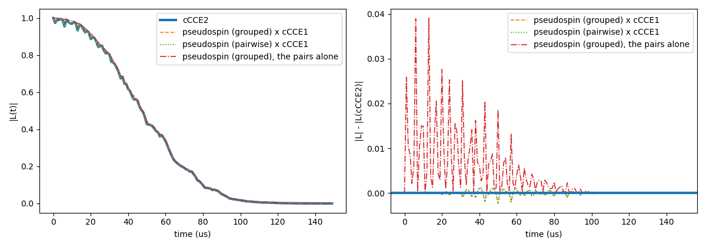

# Advanced 13: Pseudospin pairs

Folder: `example/tutorial/advanced/13_pseudospin/`

Two nuclear spins can exchange their states, for example by a flip-flop $|m_1, m_2\rangle \leftrightarrow
|m_1-1, m_2+1\rangle$. Each such exchange is called a channel. A channel is a two-level system, the pseudospin, with a
coupling $\Omega$ between its two states and a level gap $\Delta$, both of them different in the qubit states $\alpha$
and $\beta$.

Method `pseudospin` computes the pair clusters of cCCE in this picture, for any nuclear spin. It is meant for finding
the pairs that drive a decay, and it does not give the most accurate curve. The model for two spins 1/2 is that of
Seo et al., Nat. Commun. 7, 12935 (2016), which Lee, Park and Seo applied to h-BN, npj 2D Mater. Appl. 6, 60 (2022)
([Pseudospin model of nuclear pairs](../../../../docs/methods/pseudospin.md)).

For each pair CCEX keeps the channels, drops the elements that change one spin only, and computes the pair's
coherence $L_\text{pair}$. The output is the product over the pairs of

$$P = \frac{L_\text{pair}}{L_1 L_2},$$

with $L_1$ and $L_2$ the two single spins from their eigenvalues alone (1 under a Hahn echo). $P$ leaves out the ESEEM
of the single spins. To compare the output with cCCE order 2, multiply it by cCCE order 1.

For two spins 1/2 with the secular hyperfine and the flip-flop alone, $P$ is Seo's eq. 23,

$$P = 1 - K \sin^2\!\big(\sqrt{\Delta A^2 + D^2}\, t/4\big) \sin^2(D t/4), \qquad K = \frac{\Delta A^2}{\Delta A^2 + D^2},$$

with $\Delta A$ the difference of the two nuclei's hyperfine couplings and $D$ their flip-flop coupling.

A state can sit in two channels, which then form a chain, for example $|1,-1\rangle \leftrightarrow |0,0\rangle
\leftrightarrow |-1,1\rangle$ for two spins 1. The key `hamiltonian.pseudospin.channels` chooses how chains are treated
([channels](../../../../docs/user/InputFile_General.md#tag_pseudospin_channels)):

| `channels` | How the channels evolve |
|---|---|
| `"grouped"` (the default) | The channels that share states form a block, and each block evolves as a whole. Exact within the kept elements. |
| `"pairwise"` | Each channel evolves as its own two-level system. It misses the coupling inside a chain. |

The two agree when no two channels share a state.

In each folder run `cd <folder> && NP=4 bash run.sh`, then compare `results/coherence.png` with `expected.png`. Times
are for 4 ranks of a desktop CPU.

This page has one case:

1. [The pairs of an h-BN bath against cCCE2](#ps_vscce) (`pseudospin2_Hahn_vsCCE/`).

<a id="ps_vscce"></a>
## 1. The pairs of an h-BN bath against cCCE2

Folder: `pseudospin2_Hahn_vsCCE/`

<a id="a13_vscce_input"></a>
### 1.1 The input

The system is the V_B⁻ of `advanced/06_hBN`, with one configuration of the flat layer, DFT hyperfine and quadrupole,
3 T, a Hahn echo, the ensemble and 459 nuclei within 20 Å. The rest is as in
`advanced/06_hBN/cCCE2_Hahn_tensors` (`ccein_hf3_qd2.jsonc`). The four inputs differ in the method or the order:

```jsonc
"order"  : 2                                                                       // ccein_cce2.jsonc, cCCE2
"order"  : 1                                                                       // ccein_cce1.jsonc, single nuclei
"method" : "pseudospin", "hamiltonian" : {"pseudospin": {"channels": "grouped"}}   // ccein_grouped.jsonc
"method" : "pseudospin", "hamiltonian" : {"pseudospin": {"channels": "pairwise"}}  // ccein_pairwise.jsonc
```

For `pseudospin`, `order` is 2 by default and the only one accepted. The pseudospin inputs keep the
`hamiltonian.common` block of the others beside `hamiltonian.pseudospin`.

<a id="a13_vscce_run"></a>
### 1.2 Running it

```sh
NP=4 bash run.sh
```

It runs the four inputs, multiplies each pseudospin curve by cCCE1 and plots it with cCCE2. It also plots the
pseudospin curve alone, the pairs' part of the decay. The four runs take 11 s and 0.1 GB per rank.

Each pseudospin run also writes the channel table `results/ccein_<name>_pseudospin_channels`, 68 MB and 424,000
channels here. A line holds the two nuclei and their positions, the labels $m_1\,m_2\;m_1'\,m_2'$ of the two states,
$\Omega_\alpha$ and $\Omega_\beta$ (the splitting $2\lvert\langle m_1,m_2\rvert H\lvert m_1',m_2'\rangle\rvert$) and
$\Delta_\alpha$ and $\Delta_\beta$ (the level gap), in kHz.

<a id="a13_vscce_result"></a>
### 1.3 The result



| Run | T2 |
|---|---|
| cCCE2 | 58.0 µs |
| pseudospin × cCCE1, `grouped` and `pairwise` | 58.1 µs, within 2.3e-3 of cCCE2 |
| pseudospin, the pairs alone | 58.2 µs, within 3.9e-2 of cCCE2 |

The left panel shows the curves, which lie on top of each other, and the right panel their difference from cCCE2.
The pairs alone stay above cCCE2 by up to 0.039, in sharp spikes in the first 60 µs, since they leave out the ESEEM
dips of the single nuclei. Multiplied by cCCE1 they come within 2.3e-3 of cCCE2, and the `grouped` and `pairwise`
lines lie on each other. At 3 T the pairs alone give nearly all of the decay.

The channel table shows which pairs can flip. A channel moves its two states into each other only when its gap
$\Delta$ is not much larger than its coupling $\Omega$, as in any two-level system. In this table:

- The channels with the largest $\Omega_\alpha$ (column 13) are flip-flips $|½,½\rangle \leftrightarrow |-½,-½\rangle$
  of neighbouring ¹¹B, 2.49 Å apart. Their $\Omega_\alpha$ is 4.8 kHz, but their $\Delta_\alpha$ is 91 MHz, far off
  resonance.
- 712 channels have $\lvert\Delta_\alpha\rvert < \Omega_\alpha$. The strongest of them are flip-flops
  $|½,-½\rangle \leftrightarrow |-½,½\rangle$ of the same ¹¹B pairs, with $\Omega_\alpha$ 1.6 kHz and $\Delta_\alpha$
  near 0.

These lines list the channels with $\lvert\Delta_\alpha\rvert < \Omega_\alpha$, the strongest first:

```sh
grep -v '^#' results/ccein_grouped_pseudospin_channels | awk '{d = $15 < 0 ? -$15 : $15; if (d < $13) print}' \
    | sort -k13 -g -r | head
```

Next, try `bfield` 3000 (0.3 T). At a lower field pseudospin × cCCE1 moves further from cCCE2
([how accurate it is](../../../../docs/methods/pseudospin.md#ps_accuracy)).

Inputs: [`ccein_cce2.jsonc`](pseudospin2_Hahn_vsCCE/ccein_cce2.jsonc), [`ccein_cce1.jsonc`](pseudospin2_Hahn_vsCCE/ccein_cce1.jsonc), [`ccein_grouped.jsonc`](pseudospin2_Hahn_vsCCE/ccein_grouped.jsonc), [`ccein_pairwise.jsonc`](pseudospin2_Hahn_vsCCE/ccein_pairwise.jsonc)
