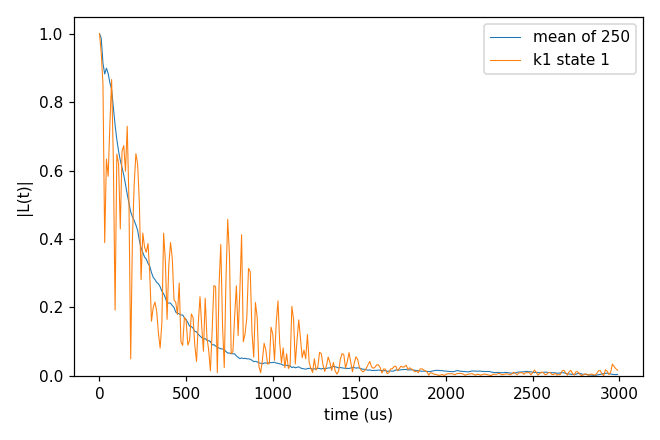

# advanced/13_server_runs

A run too long for a workstation goes to a cluster as a batch job. This folder shows that with Slurm (`sbatch`) on the
production of [basic/05_defect_bath](../../basic/05_defect_bath/README.md)'s `cCCE2_Hahn_states`: 5 bath configurations ×
50 sampled states, 250 curves. That run is still small (about 20 s on 4 ranks), so the scripts can be tried anywhere;
the same steps carry over to runs of hours. Add what your cluster needs to the `#SBATCH` lines (`--partition`,
`--account`) and the `module load` line (the compiler and MPI CCEX was built with).

## cCCE2_Hahn_slurm

- **What it shows:** three steps.
  1. `estimate.sh` runs one state of one configuration here and prints three lines of the log: the clusters per
     order, the memory estimate per rank (0.05 GB, against the memory available per rank) and the time of the state
     (0.08 s on 4 ranks). The whole run is then about 250 × 0.08 s.
  2. `job.sbatch` runs everything in one job: `mpirun -n $SLURM_NTASKS main.out -f ccein.jsonc -o results`, then
     `analyse.sh` (the error correction, the average of the 250 curves and the T2 fit, as in
     [advanced/08_analysis](../08_analysis/README.md)).
  3. `job_array.sbatch` splits the same run by configuration: array task k writes an input with `k_range` [k, k] and
     `seed` [k] (`example/tools/InputKeys/set_input_keys.py`) and runs it; the tasks may run at the same time. Their
     files have the names and the values of the one-job run (the same states are drawn), so `bash analyse.sh`
     afterwards gives the same average.
- **Keys and settings that matter:** `configuration.seed` one per configuration (so a configuration run alone draws the
  same states), `output.file` (one output name for every task), `--ntasks` (the MPI ranks; the clusters are shared over
  them), `$SLURM_SUBMIT_DIR` (Slurm runs a copy of the script, so the script changes to the folder it was submitted
  from).
- **How to run:** `NP=4 bash estimate.sh`, then `sbatch job.sbatch`, or `sbatch job_array.sbatch` and `bash analyse.sh`
  when all five tasks are done. `CCEX_BIN` names another binary, `CCEX_ROOT` the repository.
- **Expected result:** `expected.png` (the scripts run with the Slurm variables set by hand, 4 ranks); the analyzer's
  fit gives T2 267 µs and n 0.98, `plot_coherence.py` 244 µs (the last time |L| ≥ 1/e). The one-job and the array run
  gave the same 250 files.
- **What to change next:** split the states as well: `s_range` [26, 50] computes the states 26 .. 50 of the run [1, 50];
  `srun` in place of `mpirun` where the cluster asks for it.

Input: [`ccein.jsonc`](cCCE2_Hahn_slurm/ccein.jsonc)
