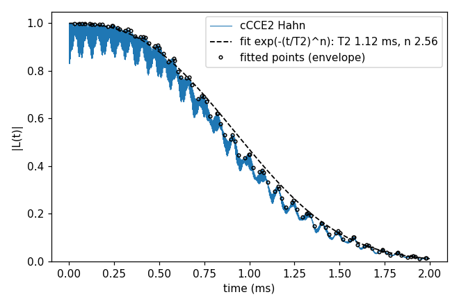

# Basic 01: NV in ¹³C, from a bath to T2

Folder: `example/tutorial/basic/01_first_run/`

This tutorial computes the Hahn echo of an NV centre in diamond with natural-abundance ¹³C (1.1 %). It makes a
bath (step 1), runs CCEX (step 2) and reads T2 from the curve (step 3). `NP=4 bash run.sh` runs the three steps.

<a id="b01_s0"></a>
## 0. Build

Run this once, from the repository root. It makes `bin/main.out`.

```sh
bash do_compile.sh wsl-gnu
cd example/tutorial/basic/01_first_run
mkdir -p results
```

<a id="b01_s1"></a>
## 1. Make a bath

A bath file lists the nuclear spins around the qubit. This step makes one with `example/tools/BathGenerator`. It fills
a 110 Å cell with diamond, makes each carbon a ¹³C with probability 1.1 % and puts the NV at the centre. It needs
python3 with mpi4py, numpy and psutil.

```sh
NP=4 sh ../../make_natab_baths.sh 1 results/bath
head -3 results/bath/config_1
```

The first line holds the number of spins. Each following line is one spin, `x y z isotope`, in Å.
`results/bath/config_defect` holds the NV position.

```
2562.00000	   0.00000	   0.00000	   0.00000
   2.03590	   1.12308	  10.72503	       13C
   2.03590	   4.03532	  80.74127	       13C
```

The input of step 2 does not read this file. It reads `bath/bath_Diamond_NV_natab_1`, a bath made the same way and
kept in the repository, so that everyone gets the same curve. The last section runs the input on your own bath.

<a id="b01_s2"></a>
## 2. Run CCEX

```sh
mpirun -n 4 ../../../../bin/main.out -f ccein.jsonc -o results > results/ccein.log
head -3 results/ccein_wiDiv
```

CCEX splits the bath into clusters: every ¹³C on its own and every pair of ¹³C closer than 10 Å. It solves each
cluster exactly and multiplies the results. `results/ccein_wiDiv` holds the coherence L(t). Each line has the time in
ms and L as a complex number; L starts at 1 and decays. `results/ccein_noDiv` holds the same product before the
division by the sub-clusters, which the analyzer uses for its error correction. `results/ccein.log` is the log.

```
              0	  +1.0000000000+0.0000000000j
          0.001	  +0.9482416411-0.0000013139j
          0.002	  +0.8296882434-0.0000000881j
```

<a id="b01_s3"></a>
## 3. Plot and fit T2

```sh
python3 ../../plot_coherence.py results/coherence.png --fit "cCCE2 Hahn=results/ccein_wiDiv"
```

```
cCCE2 Hahn: 1 file(s), T2 1.084 ms; fit T2 1.116 ms, n 2.56 (99 envelope points)
```

The curve has two parts. The fast ripple comes from the ¹³C precessing at 535 kHz in the 500 G field (ESEEM). The
slow decay comes from pairs of ¹³C flipping each other (flip-flops), and that is what T2 measures.

The fit $\exp(-(t/T_2)^n)$ follows the slow decay and skips the ripple. It cuts the time axis into 100 parts and fits
only the highest point of each part. These points are the circles in the figure, and the dashed line is the fit. It
gives T2 = 1.116 ms and n = 2.56. The first number printed, 1.084 ms, is a simpler measure: the last time |L| is above
1/e.



## The input

`ccein.jsonc` sets nine keys. Each is explained in a comment above it.

| Key | Value | Meaning |
|---|---|---|
| `Qubit.qubit[].file` | `bath/bath_Diamond_NV_natab_defect` | the NV position |
| `configuration.gyrofile` | `bath/gyro_13C` | spin and gyromagnetic ratio of ¹³C |
| `configuration.bathfile` | `bath/bath_Diamond_NV_natab_1` | the bath |
| `order` | 2 | the largest cluster: pairs |
| `bfield` | 500 | the field in G, along the NV axis |
| `rbath` | 50 | the bath reaches 50 Å from the NV |
| `rdip` | 10 | pairs closer than 10 Å are kept |
| `deltat`, `nstep` | 0.001, 2000 | 2000 points, 1 µs apart |
| `pulse.count` | 1 | one π pulse: the Hahn echo |

Every other key has its default. `main.out -e` writes all of them.

Input: [`ccein.jsonc`](ccein.jsonc)

## Next

To run the same input on the bath of step 1, set `configuration.bathfile` to `["results/bath/config_1"]` and
`Qubit.qubit[].file` to `"results/bath/config_defect"`. The fit then gives 0.93 ms. Another placement of the ¹³C
gives another curve. [Basic 02: Bath configurations, sampled states and isotopes](../02_bath_and_states/README.md)
averages over several placements.
