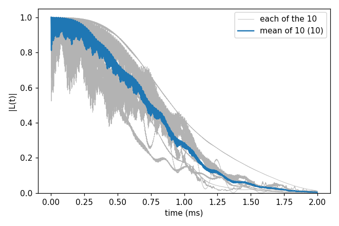
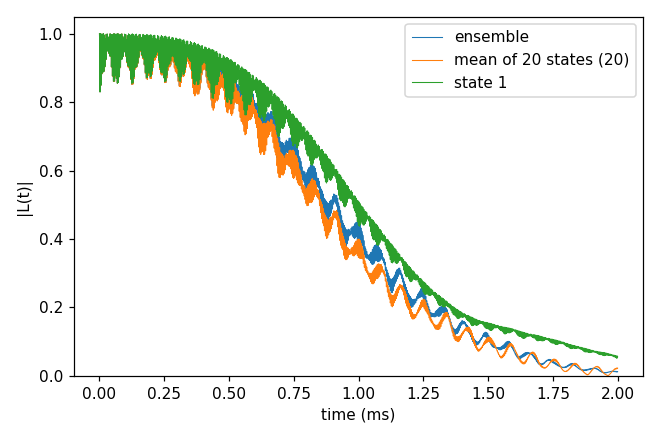
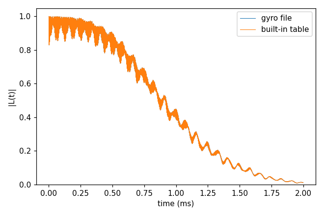

# Basic 02: Bath configurations, sampled states and isotopes

Folder: `example/tutorial/basic/02_bath_and_states/`

This tutorial takes the NV of [Basic 01: NV in ¹³C, from a bath to T2](../01_first_run/README.md) and shows three more
ways to set up its bath:

- Section 1, `cCCE2_Hahn_ensemble`: several bath configurations. One bath file is one placement of the ¹³C, and
  `configuration.k_range` runs several placements. The later tutorials average over these ten.
- Section 2, `cCCE2_Hahn_states`: sampled bath states. The bath is either unpolarised (the ensemble, as in Basic 01)
  or in sampled pure states (`configuration.s_range`).
- Section 3, `cCCE2_Hahn_builtinIsotopes`: the built-in isotope table. The ¹³C spin and gyromagnetic ratio come from
  a gyro file or from CCEX's own table.

`NP=4 bash run.sh` in a folder runs its commands.

<a id="b02_s1"></a>
## 1. cCCE2_Hahn_ensemble: several bath configurations

The ¹³C sit at random sites, and the curve depends on where they are. The few ¹³C next to the NV matter most. One
bath file therefore gives the curve of one particular NV. An experiment on many NVs sees the average, so the
calculation has to average several placements too.

`configuration.k_range` [1, 10] does this in one input. The bath file name holds `{k}` (`results/bath/config_{k}`),
and CCEX runs the calculation once for each k = 1 ... 10. The commands first make the ten bath files, with seeds 1 to
10. The last argument of `make_natab_baths.sh`, 5, leaves out the ¹³C closer than 5 Å to the NV. Such a ¹³C couples
to the NV about as strongly as the field does, and a single one would dominate the whole curve.

```sh
cd example/tutorial/basic/02_bath_and_states/cCCE2_Hahn_ensemble
mkdir -p results
NP=4 sh ../../../make_natab_baths.sh 10 results/bath 110 5
mpirun -n 4 ../../../../../bin/main.out -f ccein.jsonc -o results > results/ccein.log
python3 ../../../plot_coherence.py results/coherence.png --members "mean of 10=results/ccein_k*_wiDiv"
```

CCEX writes one curve per configuration, `results/ccein_k1_wiDiv` ... `ccein_k10_wiDiv`, and does not average them.
`plot_coherence.py` does. With `--members` it also draws each curve in grey under the mean.

```
mean of 10: 10 file(s), T2 0.8892 ms
```

Single configurations scatter widely around the mean, most of all in the ripple of the first 0.5 ms. How many
configurations are enough is what [Advanced 01: Automatic convergence](../../advanced/01_auto_convergence/README.md)
decides.



Input: [`ccein.jsonc`](cCCE2_Hahn_ensemble/ccein.jsonc)

<a id="b02_s2"></a>
## 2. cCCE2_Hahn_states: sampled bath states

In Basic 01 the bath is unpolarised. Every ¹³C is up or down with equal weight, and the result is the average over
all bath states, called the ensemble. A single measurement on one NV sees the bath in one state instead. With
`configuration.s_range` [1, 20], CCEX draws 20 such states from `configuration.seed`, with each ¹³C up or down, and
computes each one separately.

```sh
cd example/tutorial/basic/02_bath_and_states/cCCE2_Hahn_states
mkdir -p results
mpirun -n 4 ../../../../../bin/main.out -f ccein.jsonc -o results > results/ccein.log
python3 ../../../../tools/InputKeys/set_input_keys.py ccein.jsonc results/ensemble.json configuration.s_range=null
mpirun -n 4 ../../../../../bin/main.out -f results/ensemble.json -o results > results/ensemble.log
python3 ../../../plot_coherence.py results/coherence.png "ensemble=results/ensemble_wiDiv" \
  "mean of 20 states=results/ccein_state*_wiDiv" "state 1=results/ccein_state1_wiDiv"
```

The first run writes `results/ccein_state1_wiDiv` ... `ccein_state20_wiDiv`. `set_input_keys.py` then makes a copy
of the input without `s_range`, and the next run computes the ensemble from it for comparison.

```
ensemble: 1 file(s), T2 1.084 ms
mean of 20 states: 20 file(s), T2 1.016 ms, max |L - L(ensemble)| = 6.707e-02
state 1: 1 file(s), T2 1.143 ms, max |L - L(ensemble)| = 1.364e-01
```

The mean of the 20 states is within 0.07 of the ensemble. One state alone is off by up to 0.14. More states bring
the mean closer.



The states can also come from files, for example for a polarised bath or for states from another program.
`configuration.bath_state_file` names the files. `make_state_files.py` writes 20 example files; each has a count line
and then one m_s per spin of the bath file.

```sh
mkdir -p results/states
python3 ../../../../tools/StateFiles/make_state_files.py ccein_files.jsonc --force
mpirun -n 4 ../../../../../bin/main.out -f ccein_files.jsonc -o results > results/ccein_files.log
```

Inputs: [`ccein.jsonc`](cCCE2_Hahn_states/ccein.jsonc), [`ccein_files.jsonc`](cCCE2_Hahn_states/ccein_files.jsonc)

<a id="b02_s3"></a>
## 3. cCCE2_Hahn_builtinIsotopes: the built-in isotope table

Basic 01 reads the ¹³C spin and gyromagnetic ratio from a gyro file, `bath/gyro_13C`. Without
`configuration.gyrofile`, CCEX looks up each isotope name of the bath file, such as 13C, 29Si or 1H, in its built-in
table. A species that is not an isotope, such as a P1 centre, still needs a gyro file
([Basic 06: An electron-spin bath (P1)](../06_defect_bath/README.md)).

```sh
cd example/tutorial/basic/02_bath_and_states/cCCE2_Hahn_builtinIsotopes
mkdir -p results
mpirun -n 4 ../../../../../bin/main.out -f ccein_gyrofile.jsonc -o results > results/ccein_gyrofile.log
mpirun -n 4 ../../../../../bin/main.out -f ccein_builtin.jsonc -o results > results/ccein_builtin.log
grep -E 'built-in isotope table|Read GyroFile' results/*.log
python3 ../../../plot_coherence.py results/coherence.png "gyro file=results/ccein_gyrofile_wiDiv" \
  "built-in table=results/ccein_builtin_wiDiv"
```

The log says where each species came from:

```
results/ccein_builtin.log:        13C from the built-in isotope table: spin 0.5, gyro 6.72828544 rad/ms/G
results/ccein_gyrofile.log:        Read GyroFile : ../../01_first_run/bath/gyro_13C
built-in table: 1 file(s), T2 1.084 ms, max |L - L(gyro file)| = 1.563e-05
```

The γ of the table (6.72828544) and of the file (6.728284) differ by 2e-7, so the two curves agree to 2e-5.



Inputs: [`ccein_builtin.jsonc`](cCCE2_Hahn_builtinIsotopes/ccein_builtin.jsonc), [`ccein_gyrofile.jsonc`](cCCE2_Hahn_builtinIsotopes/ccein_gyrofile.jsonc)

## Next

[Basic 03: Checking convergence](../03_convergence/README.md): how to check the cut-offs `order`, `rbath` and `rdip`.
