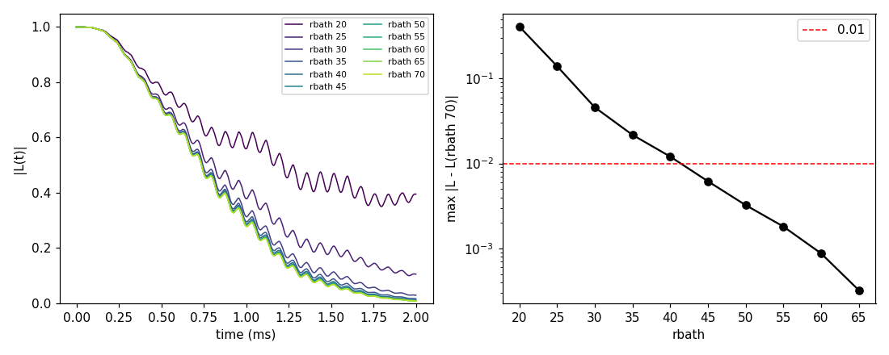
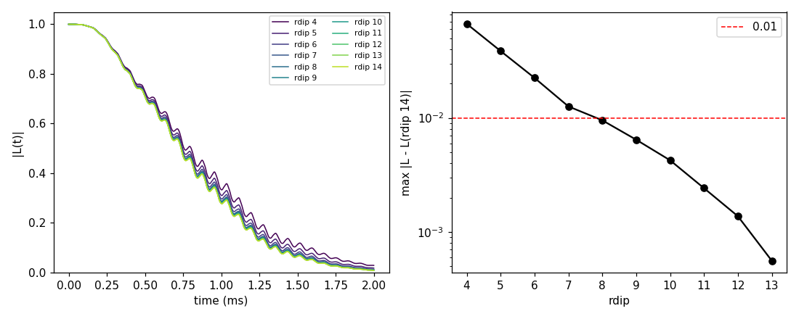
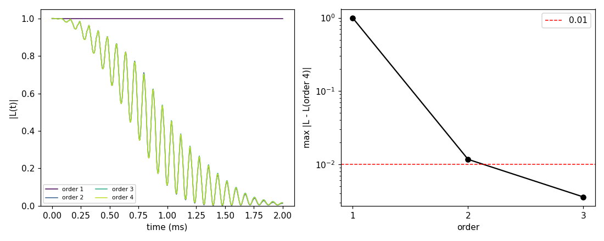
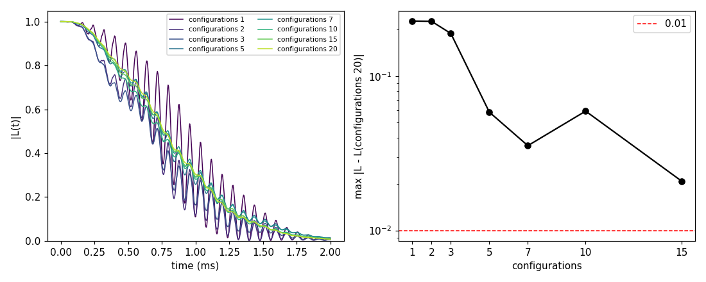
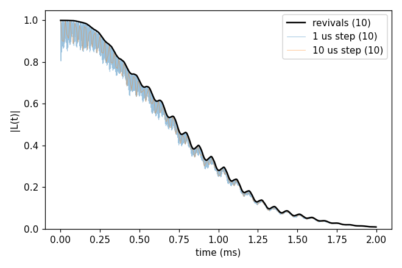

# Basic 03: Checking convergence

Folder: `example/tutorial/basic/03_convergence/`

A CCE result depends on a few numbers in the input that are not part of the physics. They decide how much of the bath
is kept, how many configurations are averaged and how the time axis is sampled. Each one has to be checked for the
system you study.

| Value | What it sets | Cost of a larger value |
|---|---|---|
| `rbath` | the ¹³C within this distance of the NV are in the bath | more spins and clusters |
| `rdip` | two ¹³C closer than this form a pair cluster | more pairs |
| `order` | the largest cluster: 2 for pairs, 3 for triples | many more clusters, each larger |
| `k_range` | the number of bath configurations | one run per configuration |
| `deltat`, `nstep` | the time step and the number of points | more points |

To check a value, scan it in small steps and keep everything else fixed. For each step, compare the curve with the
curve of the largest value. The value is large enough once the difference stays below a limit. Here the limit is 0.01
in |L|.

`plot_convergence.py` makes this comparison. It draws the curves on the left. On the right it draws the largest
difference from the last curve against the value, on a log scale, with the limit as a dashed red line.

Start with `rbath` and `rdip` at `order` 2, where each run takes about a second. Then check `order`, which is
expensive, then the number of configurations, and the time axis last.

All sections use the ¹³C bath of [Basic 02](../02_bath_and_states/README.md), without ¹³C within 5 Å of the NV. The
cells are 150 Å wide so that `rbath` can go up to 70 Å. Section 1 makes 20 configurations in `results/bath` of this
folder, which takes about a minute, and the other sections reuse them. Run section 1 first.

Except in section 5, the time step is 3.735 µs. This puts every point on a revival of the ¹³C (see
[Basic 04](../04_pulses/README.md)), so the fast ripple does not hide the differences. Each folder also has a `run.sh`
with its commands.

<a id="b03_s1"></a>
## 1. cCCE2_Hahn_rbath: how far the bath reaches

This scans `rbath` from 20 to 70 Å in steps of 5 Å, with `rdip` 10 Å, `order` 2 and ten configurations.

```sh
cd example/tutorial/basic/03_convergence/cCCE2_Hahn_rbath
mkdir -p results
NP=4 sh ../../../make_natab_baths.sh 20 ../results/bath 150 5
for v in 20 25 30 35 40 45 50 55 60 65 70; do
  python3 ../../../../tools/InputKeys/set_input_keys.py ccein.jsonc results/rbath$v.json rbath=$v
  mpirun -n 4 ../../../../../bin/main.out -f results/rbath$v.json -o results > results/rbath$v.log
done
python3 ../../../plot_convergence.py results/coherence.png --name rbath \
  --each "results/rbath{v}_k*_wiDiv" 20 25 30 35 40 45 50 55 60 65 70
```

```
rbath 20: 10 file(s), max |L - L(last)| = 0.408, from the previous = nan
rbath 25: 10 file(s), max |L - L(last)| = 0.14, from the previous = 0.29
rbath 30: 10 file(s), max |L - L(last)| = 0.0458, from the previous = 0.0957
rbath 35: 10 file(s), max |L - L(last)| = 0.0217, from the previous = 0.0255
rbath 40: 10 file(s), max |L - L(last)| = 0.0121, from the previous = 0.00965
rbath 45: 10 file(s), max |L - L(last)| = 0.00618, from the previous = 0.00588
rbath 50: 10 file(s), max |L - L(last)| = 0.00324, from the previous = 0.00294
rbath 55: 10 file(s), max |L - L(last)| = 0.00182, from the previous = 0.00143
rbath 60: 10 file(s), max |L - L(last)| = 0.000877, from the previous = 0.000938
rbath 65: 10 file(s), max |L - L(last)| = 0.000324, from the previous = 0.000553
rbath 70: 10 file(s), max |L - L(last)| = 0, from the previous = 0.000324
```

The difference halves roughly every 5 Å and drops below 0.01 at 45 Å. The cost grows with the volume of the bath.
Configuration 1 has 268 clusters at 20 Å, 4336 at 50 Å and 12670 at 70 Å. The ten configurations take 0.1, 0.8 and
3.3 s on 4 ranks. The other tutorials use 50 Å.



Input: [`ccein.jsonc`](cCCE2_Hahn_rbath/ccein.jsonc)

<a id="b03_s2"></a>
## 2. cCCE2_Hahn_rdip: which pairs are kept

This scans `rdip` from 4 to 14 Å in steps of 1 Å, with `rbath` 50 Å and `order` 2.

```sh
cd example/tutorial/basic/03_convergence/cCCE2_Hahn_rdip
mkdir -p results
for v in 4 5 6 7 8 9 10 11 12 13 14; do
  python3 ../../../../tools/InputKeys/set_input_keys.py ccein.jsonc results/rdip$v.json rdip=$v
  mpirun -n 4 ../../../../../bin/main.out -f results/rdip$v.json -o results > results/rdip$v.log
done
python3 ../../../plot_convergence.py results/coherence.png --name rdip \
  --each "results/rdip{v}_k*_wiDiv" 4 5 6 7 8 9 10 11 12 13 14
```

```
rdip 4: 10 file(s), max |L - L(last)| = 0.0667, from the previous = nan
rdip 5: 10 file(s), max |L - L(last)| = 0.0386, from the previous = 0.0285
rdip 6: 10 file(s), max |L - L(last)| = 0.0224, from the previous = 0.0162
rdip 7: 10 file(s), max |L - L(last)| = 0.0126, from the previous = 0.00981
rdip 8: 10 file(s), max |L - L(last)| = 0.00953, from the previous = 0.00308
rdip 9: 10 file(s), max |L - L(last)| = 0.00644, from the previous = 0.00309
rdip 10: 10 file(s), max |L - L(last)| = 0.00425, from the previous = 0.00219
rdip 11: 10 file(s), max |L - L(last)| = 0.00242, from the previous = 0.00183
rdip 12: 10 file(s), max |L - L(last)| = 0.00138, from the previous = 0.00105
rdip 13: 10 file(s), max |L - L(last)| = 0.000561, from the previous = 0.000815
rdip 14: 10 file(s), max |L - L(last)| = 0, from the previous = 0.000561
```

The difference drops below 0.01 at 8 Å. Configuration 1 has 912 clusters at 4 Å, 4336 at 10 Å and 9736 at 14 Å. The
other tutorials use 10 Å.



Input: [`ccein.jsonc`](cCCE2_Hahn_rdip/ccein.jsonc)

<a id="b03_s3"></a>
## 3. cCCE_Hahn_order: the largest cluster

This scans `order` from 1 to 4, with `rbath` 50 Å and `rdip` 10 Å. Order 4 is expensive, so the scan uses
configuration 1 only.

```sh
cd example/tutorial/basic/03_convergence/cCCE_Hahn_order
mkdir -p results
for v in 1 2 3 4; do
  python3 ../../../../tools/InputKeys/set_input_keys.py ccein.jsonc results/order$v.json order=$v "configuration.k_range=[1, 1]"
  mpirun -n 4 ../../../../../bin/main.out -f results/order$v.json -o results > results/order$v.log
done
python3 ../../../plot_convergence.py results/coherence.png --name order --each "results/order{v}_k*_wiDiv" 1 2 3 4
```

```
order 1: 1 file(s), max |L - L(last)| = 0.996, from the previous = nan
order 2: 1 file(s), max |L - L(last)| = 0.0117, from the previous = 0.999
order 3: 1 file(s), max |L - L(last)| = 0.00357, from the previous = 0.0152
order 4: 1 file(s), max |L - L(last)| = 0, from the previous = 0.00357
```

| `order` | clusters | time (one configuration, 4 ranks) |
|---|---|---|
| 1 | 985 | 0.03 s |
| 2 | 4336 | 0.1 s |
| 3 | 23609 | 1.1 s |
| 4 | 150337 | 21 s |

At order 1 the curve does not decay at all. In cCCE the decay comes from pairs of ¹³C that flip each other, and
order 1 has no pairs. Order 2 is 0.012 from order 4, just above the limit. Order 3 is 0.004 from it. Each step up
costs 10 to 20 times more. The other tutorials use order 2 to stay fast.



Input: [`ccein.jsonc`](cCCE_Hahn_order/ccein.jsonc)

<a id="b03_s4"></a>
## 4. cCCE2_Hahn_configurations: how many configurations

Every configuration gives a different curve (Basic 02). Their mean therefore carries a statistical error, which
shrinks as 1/√N with the number N of configurations. This runs 20 configurations once. `plot_convergence.py --first`
then averages the first 1, 2, 3, 5, 7, 10 and 15 and compares each with the mean of all 20.
`plot_coherence.py --spread` prints the T2 of each configuration and the standard error of their mean.

```sh
cd example/tutorial/basic/03_convergence/cCCE2_Hahn_configurations
mkdir -p results
mpirun -n 4 ../../../../../bin/main.out -f ccein.jsonc -o results > results/ccein.log
python3 ../../../plot_convergence.py results/coherence.png --name configurations \
  --first "results/ccein_k*_wiDiv" 1 2 3 5 7 10 15 20
python3 ../../../plot_coherence.py results/spread.png --spread "20 configurations=results/ccein_k*_wiDiv"
```

```
configurations 1: 1 file(s), max |L - L(last)| = 0.227, from the previous = nan
configurations 2: 2 file(s), max |L - L(last)| = 0.226, from the previous = 0.261
configurations 3: 3 file(s), max |L - L(last)| = 0.189, from the previous = 0.0621
configurations 5: 5 file(s), max |L - L(last)| = 0.0584, from the previous = 0.131
configurations 7: 7 file(s), max |L - L(last)| = 0.0354, from the previous = 0.0394
configurations 10: 10 file(s), max |L - L(last)| = 0.0593, from the previous = 0.0576
configurations 15: 15 file(s), max |L - L(last)| = 0.0208, from the previous = 0.0423
configurations 20: 20 file(s), max |L - L(last)| = 0, from the previous = 0.0208
20 configurations: 20 file(s), T2 0.9096 ms; T2 of the 20 files: mean 0.9286 ms, deviation 0.156, standard error 0.0349
```

Here the difference does not fall steadily. One more configuration can move the mean either way: the mean of 10 is
farther from the mean of 20 than the mean of 7 is. The T2 of single configurations varies by 17 % (0.16 ms), so the
mean of N configurations is uncertain by about 17 %/√N. That is 5 % for 10 configurations and 4 % for 20. Even 15
configurations are still 0.02 from the mean of 20, and halving the error takes four times as many configurations.
This is the largest error in this system. The other tutorials use 10 configurations.



Input: [`ccein.jsonc`](cCCE2_Hahn_configurations/ccein.jsonc)

<a id="b03_s5"></a>
## 5. cCCE2_Hahn_timeAxis: the time step and the window

The window, `deltat` × `nstep`, has to reach past the decay. The step has to resolve the fast ¹³C ripple, whose
period is 3.7 µs at 500 G, or else land on its revivals. This input uses a 1 µs step over 2 ms. The commands also run
a 10 µs step, the revivals (3.735 µs) and a window of only 0.3 ms.

```sh
cd example/tutorial/basic/03_convergence/cCCE2_Hahn_timeAxis
mkdir -p results
mpirun -n 4 ../../../../../bin/main.out -f ccein.jsonc -o results > results/ccein.log
python3 ../../../../tools/InputKeys/set_input_keys.py ccein.jsonc results/step10us.json deltat=0.01 nstep=200
python3 ../../../../tools/InputKeys/set_input_keys.py ccein.jsonc results/revivals.json deltat=0.003735387 nstep=536
python3 ../../../../tools/InputKeys/set_input_keys.py ccein.jsonc results/short.json nstep=300
for name in step10us revivals short; do
  mpirun -n 4 ../../../../../bin/main.out -f results/$name.json -o results > results/$name.log
done
python3 ../../../plot_coherence.py results/coherence.png --bold-first "revivals=results/revivals_k*_wiDiv" \
  "1 us step=results/ccein_k*_wiDiv" "10 us step=results/step10us_k*_wiDiv"
python3 ../../../plot_coherence.py results/short.png "0.3 ms window=results/short_k*_wiDiv"
```

```
revivals: 10 file(s), T2 0.8967 ms
1 us step: 10 file(s), T2 0.8932 ms
10 us step: 10 file(s), T2 0.8788 ms
0.3 ms window: 10 file(s), |L| = 0.8879 at 0.299 ms (no 1/e crossing)
```

The 1 µs step shows the whole ripple, and the revival points (thick line) follow its tops. The 10 µs step falls on
random points of the ripple and gives a T2 that is 1.6 % too short. The 0.3 ms window stops at |L| = 0.89, long
before the decay, so it gives no T2.



Input: [`ccein.jsonc`](cCCE2_Hahn_timeAxis/ccein.jsonc)

## Summary

| Value | Scanned | Below 0.01 from | Used in the other tutorials |
|---|---|---|---|
| `rbath` | 20 to 70 Å | 45 Å | 50 Å |
| `rdip` | 4 to 14 Å | 8 Å | 10 Å |
| `order` | 1 to 4, one configuration | 3 | 2, which is 0.012 from order 4 |
| configurations | 1 to 20 | not reached by 20 | 10, T2 uncertain by 5 % |
| time axis | 1 µs, 10 µs, revivals; 0.3 and 2 ms | revivals or 1 µs, 2 ms | revivals or 1 µs |

These values hold for this system: ¹³C at natural abundance, 500 G, Hahn echo. Another bath, field or pulse sequence
needs its own check. [Advanced 01: Automatic convergence](../../advanced/01_auto_convergence/README.md) runs the same
search automatically.

## Next

[Basic 04: Pulse sequences](../04_pulses/README.md): more π pulses keep the coherence longer.
