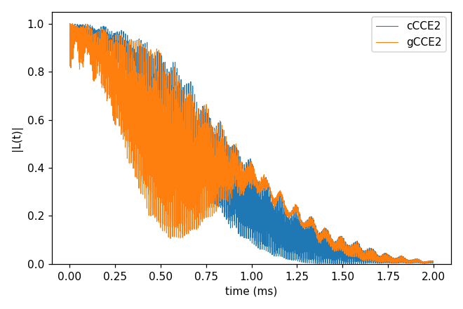
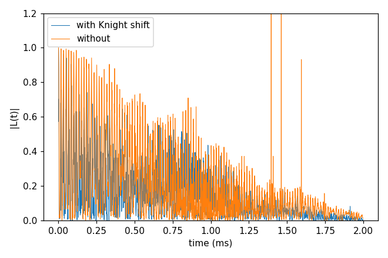
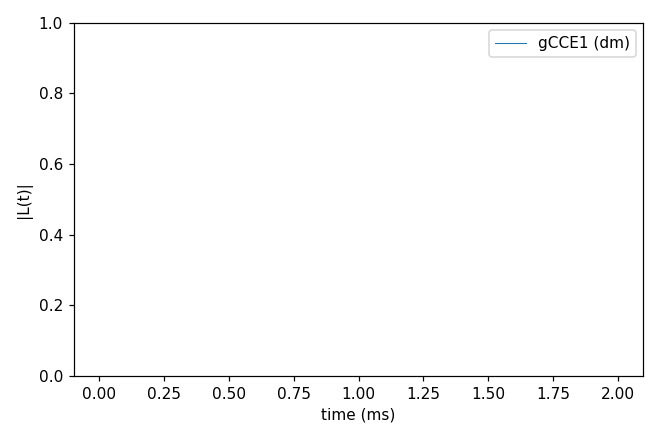

# basic/04_cCCE_vs_gCCE

The two main methods. cCCE (the default `method`) treats the qubit as a two-level system that only sets the field each
bath spin sees (pure dephasing); gCCE puts the qubit into every cluster's Hamiltonian, so qubit-bath flip-flops are kept
and the qubit can be any spin with its zero-field splitting, at any field. The Knight shift adds the transverse field of
a tilted field to cCCE. Each folder: `cd <folder> && NP=4 bash run.sh`, then compare `results/coherence.png` with
`expected.png`. Every key not written in an input has its default (`main.out -e`). Times: i7-14700K, WSL, 4 ranks.

More cCCE options (disjoint clusters, the hyperfine-mediated term) and the master-equation CCE are in
[advanced/06_terms_and_models](../../advanced/06_terms_and_models/README.md).

## gCCE2_Hahn_vsCCE

- **What it shows:** basic/01_first_run's NV by cCCE2 (`ccein_cCCE.jsonc`) and by gCCE2 with the NV zero-field splitting
  (`ccein_gCCE.jsonc`). At 500 G along the NV axis the decay is the same; the ESEEM ripple differs.
- **Keys that matter:** `method` gCCE, the ZFS as a `Qubit.intmap` self entry (kHz).
- **How to run:** `NP=4 bash run.sh`: 6 s, 0.05 GB per rank.
- **Expected result:** `expected.png`; T2 1.068 ms in both; largest |L| difference 0.49 (the ripple).
- **What to change next:** a tilted or a small field, where the two separate.

Inputs: [`ccein_cCCE.jsonc`](gCCE2_Hahn_vsCCE/ccein_cCCE.jsonc), [`ccein_gCCE.jsonc`](gCCE2_Hahn_vsCCE/ccein_gCCE.jsonc)

## cCCE2_Hahn_knightShift

- **What it shows:** in a field tilted from the NV axis ([50, 0, 100] G) the qubit's transverse field shifts the ¹³C
  precession; `hamiltonian.cCCE.knight` adds that shift to cCCE (`ccein_wi_knight.jsonc`) against without
  (`ccein_wo_knight.jsonc`).
- **Keys that matter:** `hamiltonian.cCCE.knight` true, `bfield` [50, 0, 100], the ZFS (`Qubit.intmap` self entry).
- **How to run:** `NP=4 bash run.sh`: 1.2 s, 0.05 GB per rank.
- **Expected result:** `expected.png`; T2 1.064 ms with the Knight shift; without it the divided curve (`_wiDiv`)
  diverges (|L| up to 5e5, cut at 1.2 in the plot) - the analyzer's error correction
  (`example/analysis/Analyzer`, `-err`) repairs such curves against `_noDiv`.
- **What to change next:** gCCE on the same input (the qubit is in its Hamiltonian; `hamiltonian.gCCE` has no Knight key).

Inputs: [`ccein_wi_knight.jsonc`](cCCE2_Hahn_knightShift/ccein_wi_knight.jsonc), [`ccein_wo_knight.jsonc`](cCCE2_Hahn_knightShift/ccein_wo_knight.jsonc)

## gCCE1_Hahn_handwritten

- **What it shows:** the input files written by hand: `bath` (a count line, then x y z name: one ¹³C), `gyro_13C`
  (name, spin, γ in rad/ms/G) and a spin-1 qubit at the origin in the `Qubit.qubit` list (alpha ms 0, beta ms +1);
  gCCE order 1 of the qubit density matrix for one sampled bath state.
- **Keys that matter:** `quantity` dm, `Qubit.qubit` with `Qubit.alpha_state` / `beta_state` `{"ms": [...]}`, `s_range` [1, 1], `seed`.
- **How to run:** `NP=4 bash run.sh`: 0.6 s, 0.05 GB per rank.
- **Expected result:** `expected.png`; |L| stays 1.000 (one ¹³C 37 Å away, order 1).
- **What to change next:** a second ¹³C next to the first and `order` 2; `output.savemode` `cluster_density_matrix`
  for the qubit + bath density matrix of every cluster.

Input: [`ccein.jsonc`](gCCE1_Hahn_handwritten/ccein.jsonc)

