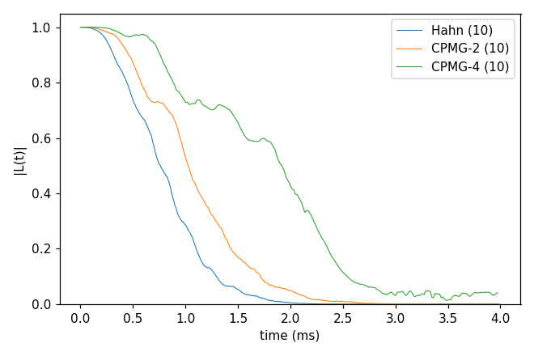
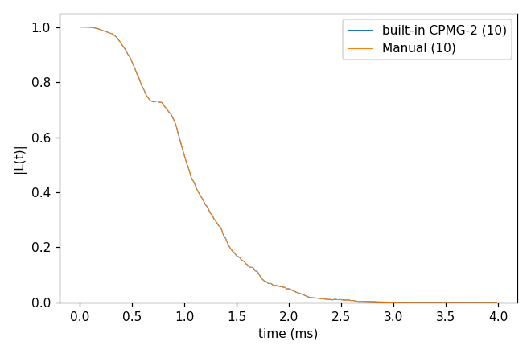

# Basic 04: Pulse sequences

Folder: `example/tutorial/basic/04_pulses/`

This tutorial runs the NV of [Basic 01: NV in ¹³C, from a bath to T2](../01_first_run/README.md) under other pulse
sequences. Each result is the mean over the ten bath configurations of [Basic 02](../02_bath_and_states/README.md)
(`k_range` [1, 10]).

The ¹³C bath makes the field at the NV change slowly, so the NV picks up a random phase and its coherence decays. A
π pulse flips the NV. After the flip, the phase it picks up cancels the phase from before. One pulse in the middle
(the Hahn echo) cancels the slowest changes. More pulses also cancel faster ones, so the coherence lasts longer.

There are two ways to give the pulses in the input:

- `pulse.count` alone gives the standard sequences. 0 is Ramsey (no pulse), 1 the Hahn echo, and N ≥ 2 CPMG-N, with
  N equally spaced pulses. Section 1, `cCCE2_CPMG_ensemble`, uses this.
- `pulse.name` "Manual" with `pulse.sequence` gives any other sequence. Each pulse is written out with its time, axis
  and angle. Section 2, `cCCE2_Manual_ensemble`, shows how on a sequence whose answer is known.

`NP=4 bash run.sh` in a folder runs its commands.

<a id="b04_s1"></a>
## 1. cCCE2_CPMG_ensemble: Hahn echo, CPMG-2 and CPMG-4

CPMG-N puts N equally spaced π pulses in the total time t (at t/(2N), 3t/(2N), ...); N = 1 is the Hahn echo.

The time points are chosen so that the fast ¹³C ripple of Basic 01 drops out. At 500 G the ¹³C precess at
ν_L = 535.4 kHz. When every free period t/(2N) is a whole number of ¹³C periods, the ¹³C are back where they started,
and the ripple is gone. The time step is therefore 2N/ν_L: 3.735 µs for the Hahn echo, 7.471 µs for CPMG-2 and
14.94 µs for CPMG-4. The input is the CPMG-4 run, and `set_input_keys.py` writes the other two with their own
`pulse.count` and `deltat`.

```sh
cd example/tutorial/basic/04_pulses/cCCE2_CPMG_ensemble
mkdir -p results
NP=4 sh ../../../make_natab_baths.sh 10 results/bath 110 5
mpirun -n 4 ../../../../../bin/main.out -f ccein.jsonc -o results > results/ccein.log
python3 ../../../../tools/InputKeys/set_input_keys.py ccein.jsonc results/count1.json pulse.count=1 deltat=0.003735387 nstep=1070
python3 ../../../../tools/InputKeys/set_input_keys.py ccein.jsonc results/count2.json pulse.count=2 deltat=0.007470773 nstep=535
mpirun -n 4 ../../../../../bin/main.out -f results/count1.json -o results > results/count1.log
mpirun -n 4 ../../../../../bin/main.out -f results/count2.json -o results > results/count2.log
python3 ../../../plot_coherence.py results/coherence.png \
  "Hahn=results/count1_k*_wiDiv" "CPMG-2=results/count2_k*_wiDiv" "CPMG-4=results/ccein_k*_wiDiv"
```

```
Hahn: 10 file(s), T2 0.8922 ms
CPMG-2: 10 file(s), T2 1.183 ms
CPMG-4: 10 file(s), T2 2.103 ms
```

T2 grows from 0.89 ms (one pulse) to 1.18 ms (two) and 2.10 ms (four).



Input: [`ccein.jsonc`](cCCE2_CPMG_ensemble/ccein.jsonc)

<a id="b04_s2"></a>
## 2. cCCE2_Manual_ensemble: a sequence written out

A sequence without a name, for example one with pulses at uneven times, cannot be given by `pulse.count`. It is
written out instead, with `pulse.name` "Manual" and one row of `pulse.sequence` per free period. A row holds the free
time as a fraction of t, the axis of the pulse that follows and its angle in degrees. The last row is the free time
after the last pulse, with axis I and angle 0. There are `count` + 1 rows, and the fractions add up to 1.

To check the notation, this folder writes CPMG-2 out by hand. It waits t/4, applies π about X, waits t/2, applies π
about X and waits t/4:

```
"sequence" : [["1/4", "X", 180.0], ["1/2", "X", 180.0], ["1/4", "I", 0.0]]
```

The result is compared with the built-in CPMG-2 (`pulse.count` 2 alone). The two runs must give the same curve.

```sh
cd example/tutorial/basic/04_pulses/cCCE2_Manual_ensemble
mkdir -p results
NP=4 sh ../../../make_natab_baths.sh 10 results/bath 110 5
mpirun -n 4 ../../../../../bin/main.out -f ccein.jsonc -o results > results/ccein.log
python3 ../../../../tools/InputKeys/set_input_keys.py ccein.jsonc results/builtin.json 'pulse={"count": 2}'
mpirun -n 4 ../../../../../bin/main.out -f results/builtin.json -o results > results/builtin.log
python3 ../../../plot_coherence.py results/coherence.png "built-in CPMG-2=results/builtin_k*_wiDiv" "Manual=results/ccein_k*_wiDiv"
```

```
built-in CPMG-2: 10 file(s), T2 1.183 ms
Manual: 10 file(s), T2 1.183 ms, max |L - L(built-in CPMG-2)| = 0.000e+00
```

The two curves are the same. cCCE treats every pulse as a π flip and refuses other angles. A sequence with 90°
pulses, such as WAHUHA, needs `method` gCCE ([Basic 05: cCCE against gCCE](../05_cCCE_vs_gCCE/README.md)).



Input: [`ccein.jsonc`](cCCE2_Manual_ensemble/ccein.jsonc)

## Next

[Basic 05: cCCE against gCCE](../05_cCCE_vs_gCCE/README.md): when the NV has to be part of each cluster.
