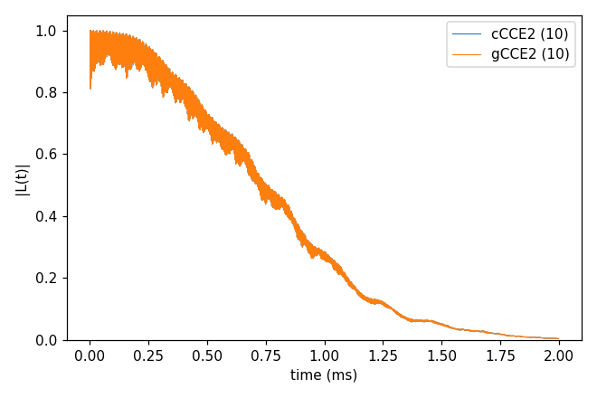
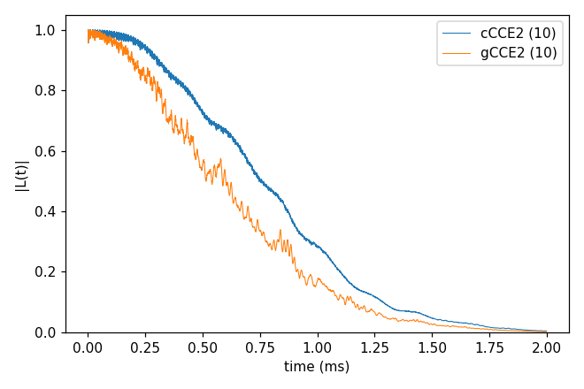

# Basic 05: cCCE against gCCE

Folder: `example/tutorial/basic/05_cCCE_vs_gCCE/`

CCEX has two main methods. In cCCE, the default `method`, the NV only sets the field each ¹³C feels. The NV stays in
its two levels and never flips. In gCCE (`method` gCCE) the NV is part of every cluster and is solved together with
the ¹³C, so the NV and a ¹³C can exchange a flip (a flip-flop). gCCE needs the NV zero-field splitting in the input
(`Qubit.intmap`) and costs more.

The two methods agree when the NV levels are far apart compared with the ¹³C couplings, as in a strong field along
the NV axis. They differ near a level crossing, where two NV levels come close and flip-flops with the ¹³C set in.

- Section 1, `gCCE2_Hahn_vsCCE`: 500 G, L(t) between ms +1 and 0. cCCE and gCCE agree.
- Section 2, `gCCE2_Hahn_levelCrossing`: 1024 G, L(t) between ms −1 and 0. The ms −1 and 0 levels cross at
  D/γ_e ≈ 1028 G (D = 2.88 GHz), 4 G away, and gCCE decays faster.

Both sections average over the ten bath configurations of [Basic 02](../02_bath_and_states/README.md) (`k_range`
[1, 10]).
`NP=4 bash run.sh` in a folder runs its commands. In the legends, a number in brackets is the number of curves averaged.

<a id="b05_s1"></a>
## 1. cCCE and gCCE at 500 G

Folder: `gCCE2_Hahn_vsCCE/`

This section runs the input of Basic 01 on the ten configurations twice: by cCCE (`ccein_cCCE.jsonc`) and by gCCE
(`ccein_gCCE.jsonc`, with `method` gCCE and the zero-field splitting).

```sh
cd example/tutorial/basic/05_cCCE_vs_gCCE/gCCE2_Hahn_vsCCE
mkdir -p results
NP=4 sh ../../../make_natab_baths.sh 10 results/bath 110 5
mpirun -n 4 ../../../../../bin/main.out -f ccein_cCCE.jsonc -o results > results/ccein_cCCE.log
mpirun -n 4 ../../../../../bin/main.out -f ccein_gCCE.jsonc -o results > results/ccein_gCCE.log
python3 ../../../plot_coherence.py results/coherence.png "cCCE2=results/ccein_cCCE_k*_wiDiv" "gCCE2=results/ccein_gCCE_k*_wiDiv"
```

```
cCCE2: 10 file(s), T2 0.8892 ms
gCCE2: 10 file(s), T2 0.8892 ms, max |L - L(cCCE2)| = 3.685e-04
```

The two curves lie on top of each other, and they differ by less than 4e-4. At this field cCCE is enough.



Inputs: [`ccein_cCCE.jsonc`](gCCE2_Hahn_vsCCE/ccein_cCCE.jsonc), [`ccein_gCCE.jsonc`](gCCE2_Hahn_vsCCE/ccein_gCCE.jsonc)

<a id="b05_s2"></a>
## 2. cCCE and gCCE near the level crossing, 1024 G

Folder: `gCCE2_Hahn_levelCrossing/`

This section runs the same two inputs at 1024 G, with L(t) between ms −1 and 0 (`Qubit.alpha_state`
`{"ms": [-1]}`). At this field the ms −1 ↔ 0 transition is only about 10 MHz, against 2.88 GHz at zero field. That is
small enough for the NV to flip-flop with the ¹³C.

```sh
cd example/tutorial/basic/05_cCCE_vs_gCCE/gCCE2_Hahn_levelCrossing
mkdir -p results
NP=4 sh ../../../make_natab_baths.sh 10 results/bath 110 5
mpirun -n 4 ../../../../../bin/main.out -f ccein_cCCE.jsonc -o results > results/ccein_cCCE.log
mpirun -n 4 ../../../../../bin/main.out -f ccein_gCCE.jsonc -o results > results/ccein_gCCE.log
python3 ../../../plot_coherence.py results/coherence.png "cCCE2=results/ccein_cCCE_k*_wiDiv" "gCCE2=results/ccein_gCCE_k*_wiDiv"
```

```
cCCE2: 10 file(s), T2 0.8923 ms
gCCE2: 10 file(s), T2 0.7401 ms, max |L - L(cCCE2)| = 2.166e-01
```

cCCE gives the same T2 as at 500 G, 0.89 ms. It does not see the NV levels, so it cannot see the crossing. gCCE
decays faster, with T2 = 0.74 ms, and the two curves differ by up to 0.22. Right at the crossing, at 1028 G, the gCCE
curve diverges. This tutorial does not cover that case.



Inputs: [`ccein_cCCE.jsonc`](gCCE2_Hahn_levelCrossing/ccein_cCCE.jsonc), [`ccein_gCCE.jsonc`](gCCE2_Hahn_levelCrossing/ccein_gCCE.jsonc)

## Next

[Basic 06: An electron-spin bath (P1)](../06_defect_bath/README.md): a bath of electron spins instead of ¹³C.
