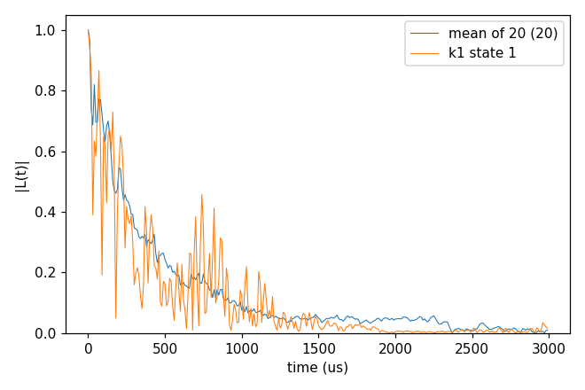
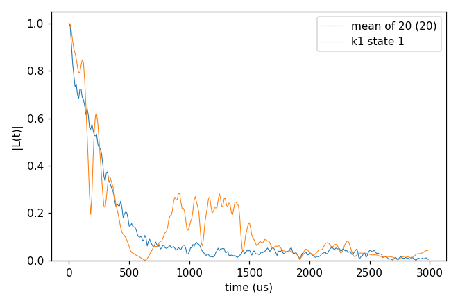
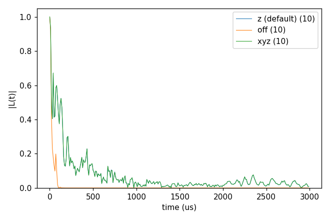

# basic/05_defect_bath

An NV in a bath of electron spins: P1 centres (substitutional N, an electron spin 1/2 whose ¹⁴N hyperfine shifts it by
one of 12 detunings, one per Jahn-Teller axis and ¹⁴N state, the `Defect` block) at 1 and 10 ppm, and Vp defects
(spin 1/2, no `Defect` block; their baths are used in [advanced/01_P1](../../advanced/01_P1/README.md)). An electron bath couples more strongly than ¹³C, so the times are microseconds and the
bath is sampled in pure states (`s_range`, drawn from `seed`). Each folder: `cd <folder> && NP=4 bash run.sh`, then
compare `results/coherence.png` with `expected.png`. Every key not written in an input has its default
(`main.out -e`). Times: i7-14700K, WSL, 4 ranks.

`bath/` holds 5 configurations at 1 ppm (`14N_1ppm/`, cells for `rbath` 850 Å) and 5 at 10 ppm (`14N_10ppm/`), the
NV position of each (`_Defect`), the P1 gyromagnetic ratio (`DiaP1_gyro`) and the Vp baths (`Vp/`, one configuration
at 10, 12 and 50 ppm); larger sets (100 configurations at 1 to 100 ppm, 99 MB) are in git history.
The production runs these inputs were cut from used 50 configurations × 50 states (128 ranks on a cluster); [advanced/13_server_runs](../../advanced/13_server_runs/README.md) runs 5 × 50 of them as a Slurm job. [advanced/01_P1](../../advanced/01_P1/README.md) continues with order 4, gCCE at zero field, the density matrix, Vp baths and a DEER pump.

## cCCE2_Hahn_states

- **What it shows:** the Hahn echo of the NV (ms -1 / 0) in 1 ppm P1, cCCE2, averaged over 2 configurations
  (`k_range`) × 10 sampled states; one state alone gives a curve far from the mean.
- **Keys that matter:** `Qubit.alpha_state` `{"ms": [-1]}`, `bathfile` with `{k}` and `k_range` [1, 2], `s_range` [1, 10], `seed` (one per configuration), `rbath`
  850 Å, `rdip` 620 Å, `deltat` 10 µs × `nstep` 300, the `Defect` block (12 detunings).
- **How to run:** `NP=4 bash run.sh`: 2.2 s, 0.06 GB per rank.
- **Expected result:** `expected.png`; T2 of the mean of 20 curves 295 µs.
- **What to change next:** `k_range` [1, 5] and `s_range` [1, 50] (the production numbers per configuration); `pulse.count` 8.

Input: [`ccein.jsonc`](cCCE2_Hahn_states/ccein.jsonc)

## cCCE2_Hahn_onsite14N

- **What it shows:** each P1 written with its ¹⁴N as an on-site nuclear spin (`n_onsite_spins` 1, four Jahn-Teller
  axes with the ¹⁴N hyperfine and quadrupole tensors), so a cluster of one P1 is its electron and its ¹⁴N.
- **Keys that matter:** the `Defect` species: `n_onsite_spins`, `types`, `spins`, `gyros`, `quadrupole_moments`,
  `n_axis_states` 4, `hyperfine`, `efg`.
- **How to run:** `NP=4 bash run.sh`: 65 s, 0.07 GB per rank.
- **Expected result:** `expected.png`; T2 of the mean 322 µs (against 295 µs with the detunings of `cCCE2_Hahn_states`).
- **What to change next:** the on-site states from a file (`configuration.defect_state_file`).

Input: [`ccein.jsonc`](cCCE2_Hahn_onsite14N/ccein.jsonc)

## cCCE2_Hahn_meanField

- **What it shows:** with sampled bath states each cluster feels the static field of the bath spins outside it
  (`hamiltonian.common.bath_bath_mean_field`): its z part (`ccein_z.jsonc`, the default), left out (`ccein_off.jsonc`)
  and the whole vector (`ccein_xyz.jsonc`); cCCE2, 1 ppm, one configuration, ten states. Without it the P1 of a pair
  are no longer detuned from each other by the field of their neighbours, and the echo decays much faster.
- **Keys that matter:** `hamiltonian.common.bath_bath_mean_field` "z", "off", "xyz"; `s_range` [1, 10] (in the ensemble
  the key is not used).
- **How to run:** `NP=4 bash run.sh`: 3 s, 0.05 GB per rank.
- **Expected result:** `expected.png`; T2 of the mean 148 µs (z), 22 µs (off), 148 µs (xyz, largest difference from
  z 2.6e-3).
- **What to change next:** the 10 ppm bath, with closer P1 pairs.

Inputs: [`ccein_off.jsonc`](cCCE2_Hahn_meanField/ccein_off.jsonc), [`ccein_xyz.jsonc`](cCCE2_Hahn_meanField/ccein_xyz.jsonc), [`ccein_z.jsonc`](cCCE2_Hahn_meanField/ccein_z.jsonc)
