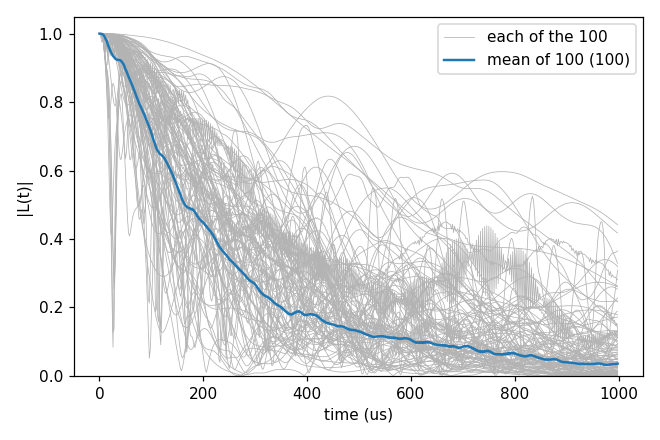
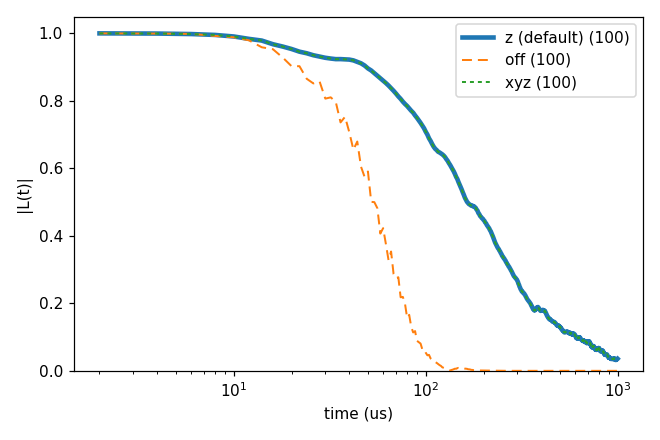

# Basic 06: An electron-spin bath (P1)

Folder: `example/tutorial/basic/06_defect_bath/`

Basic 01 to 05 had a bath of ¹³C nuclear spins. Here the bath spins are electron spins: P1 centres, substitutional
nitrogen in diamond, each an electron spin 1/2. Three things change:

- An electron couples to the NV about 2600 times more strongly than a ¹³C, the ratio of their gyromagnetic ratios.
  The bath therefore reaches farther (`rbath` 850 Å, `rdip` 620 Å at 1 ppm), and the coherence decays in hundreds of
  microseconds instead of milliseconds.
- A P1 is not an isotope. The gyro file gives it as a spin 1/2 with the electron's gyromagnetic ratio. The `Defect`
  block gives the shift of its electron by its own ¹⁴N, one of 12 values set by its bond axis and the ¹⁴N state. The
  ¹⁴N can also be a spin of its own in every cluster, so that a pair is two electrons and two ¹⁴N; see
  `cCCE2_Hahn_onsite14N` in [Advanced 05](../../advanced/05_P1/README.md).
- The bath is computed in sampled pure states (`s_range`, Basic 02) instead of the ensemble. Each P1 is then up or
  down, and the P1 outside a cluster set a static field on those inside it (section 2).

Both sections use the ten ready-made bath configurations at 1 ppm in `bath/14N_1ppm/` (each a 2248 Å cube with about
2000 P1, the NV at the centre, `bath_DiaP1_1ppm_Defect`), with ten sampled states each: 100 curves.

- Section 1, `cCCE2_Hahn_states`: the Hahn echo in the P1 bath.
- Section 2, `cCCE2_Hahn_meanField`: what the static field of the other P1 does.

`NP=4 bash run.sh` in a folder runs its commands. In the legends, a number in brackets is the number of curves averaged.

<a id="b06_s1"></a>
## 1. The Hahn echo in a P1 bath

Folder: `cCCE2_Hahn_states/`

```sh
cd example/tutorial/basic/06_defect_bath/cCCE2_Hahn_states
mkdir -p results
mpirun -n 4 ../../../../../bin/main.out -f ccein.jsonc -o results > results/ccein.log
python3 ../../../plot_coherence.py results/coherence.png --unit us --members "mean of 100=results/ccein_k*_state*_wiDiv"
```

CCEX writes one curve per configuration and state, `results/ccein_k<k>_state<s>_wiDiv` (k, s = 1 ... 10).

```
mean of 100: 100 file(s), T2 235.4 us
```

The mean decays with T2 = 235 µs. Single curves, in grey, differ widely. One NV in one bath state can keep its
coherence much longer than the average, or lose it much faster.



Input: [`ccein.jsonc`](cCCE2_Hahn_states/ccein.jsonc)

<a id="b06_s2"></a>
## 2. The static field of the other bath spins

Folder: `cCCE2_Hahn_meanField/`

In a sampled state every P1 outside a cluster points up or down, and its dipolar field shifts the P1 inside. The two
P1 of a pair then sit in different fields, which slows their flip-flop. `hamiltonian.common.bath_bath_mean_field` sets
how this field enters: `"z"` (the default) keeps its z part, `"xyz"` the whole vector, and `"off"` leaves it out. The
input writes `"z"`, and `set_input_keys.py` makes the other two.

```sh
cd example/tutorial/basic/06_defect_bath/cCCE2_Hahn_meanField
mkdir -p results
mpirun -n 4 ../../../../../bin/main.out -f ccein.jsonc -o results > results/ccein.log
for mf in off xyz; do
  python3 ../../../../tools/InputKeys/set_input_keys.py ccein.jsonc results/$mf.json hamiltonian.common.bath_bath_mean_field=$mf
  mpirun -n 4 ../../../../../bin/main.out -f results/$mf.json -o results > results/$mf.log
done
python3 ../../../plot_coherence.py results/coherence.png --unit us --log-time --dashed \
  "z (default)=results/ccein_k*_state*_wiDiv" "off=results/off_k*_state*_wiDiv" "xyz=results/xyz_k*_state*_wiDiv"
```

```
z (default): 100 file(s), T2 235.4 us
off: 100 file(s), T2 62.34 us, max |L - L(z (default))| = 6.628e-01
xyz: 100 file(s), T2 235.4 us, max |L - L(z (default))| = 5.952e-04
```

Without the field (`"off"`) the pairs flip-flop freely, and T2 drops from 235 to 62 µs. `"z"` and `"xyz"` give the
same curve, within 6e-4; in the figure the dotted xyz line lies on the thick z line. Here the transverse part of the
field makes almost no difference. The time axis is logarithmic so that both decays show.



Input: [`ccein.jsonc`](cCCE2_Hahn_meanField/ccein.jsonc)

## Next

The basic tutorials end here. The advanced ones start with
[Advanced 01: Automatic convergence](../../advanced/01_auto_convergence/README.md), which does the checks of Basic 03
by itself. More on the P1 bath (the ¹⁴N as a spin of its own, order 4, gCCE, a DEER pump) is in
[Advanced 05](../../advanced/05_P1/README.md). The [Examples](../../../../docs/user/Examples.md) page lists all
advanced tutorials by topic.
